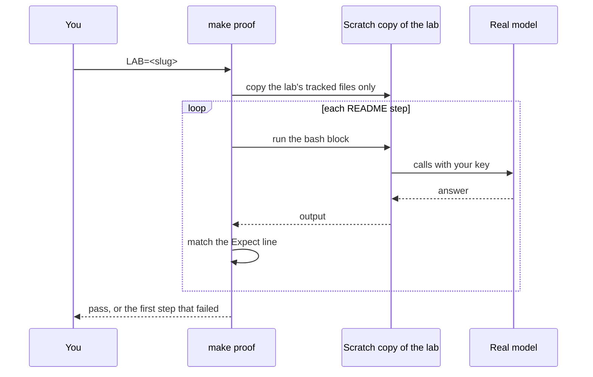

# How the course fits together

## The problem

Most AI tutorials end at a demo that answers one question once. A product has to answer thousands, check
the answer against something the model did not write, and hand the hard cases to a person. This course
teaches that job one lab at a time, each as a named company does it today.

## The course map

Every lab owns one concept. The groups run from calling a model as an API to serving it on your own GPU.
Inside a group the labs are independent, so you can start at any lab whose Set up you can meet.

```mermaid
flowchart LR
  subgraph P0["The LLM as an API"]
    direction TB
    L1["Extract Structured Data with LLMs"]
    L2["Test LLM Features with a Golden Dataset"]
    L3["Process a Million Prompts with Batch APIs"]
  end
  subgraph P1["RAG you can measure"]
    direction TB
    L4["Build a PDF RAG Pipeline with Citations"]
    L5["Measure RAG Accuracy with Recall@k"]
    L6["Stop RAG Hallucinations with an LLM Judge"]
    L7["Build Agentic RAG with LangGraph"]
  end
  subgraph P2["Workflows, routing and decisions"]
    direction TB
    L8["Build an AI Workflow with Mastra"]
    L9["Route Requests with LLM Classification"]
    L10["Build Durable AI Workflows with Temporal"]
  end
  subgraph P3["Agents"]
    direction TB
    L11["Build an AI Agent Loop with Tool Calling"]
    L12["Design Tools for AI Agents with MCP"]
    L13["Cut Agent Token Costs with Context Engineering"]
    L14["Add Long-Term Memory to AI Agents with Mem0"]
    L15["Build a Deep Research Agent with Subagents"]
  end
  subgraph P4["Voice AI"]
    direction TB
    L16["Build a Voice AI Agent with Pipecat"]
    L17["Build a Phone AI Agent with LiveKit"]
  end
  subgraph P5["Vision AI and decision AI"]
    direction TB
    L18["Read Images with Vision LLMs"]
    L19["Score Risk with a Decision Model"]
  end
  subgraph P6["Agentic AI systems you can trust"]
    direction TB
    L20["Ship a Remote MCP Server with OAuth"]
    L21["Enforce Document Permissions in RAG with OpenFGA"]
    L22["Authorize AI Agent Actions with RBAC and ABAC"]
    L23["Block Prompt Injection with Guardrails"]
    L24["Redact PII and PHI with Presidio"]
    L25["Control AI Agent Tool Access with an MCP Gateway"]
  end
  subgraph P7["LLMOps and governance"]
    direction TB
    L26["Route LLM Calls with an LLM Gateway"]
    L27["Track Prompt Versions with Langfuse"]
    L28["Trace AI Agents with OpenTelemetry"]
    L29["Gate AI Releases with Evals in CI"]
    L30["Govern AI Systems with an Inventory and Audit Log"]
  end
  subgraph P8["Deploy"]
    direction TB
    L31["Ship a Streaming AI Agent API with an API Gateway"]
    L32["Run Background Coding Agents with Cloud Sandboxes"]
    L33["Run AI Agents on Serverless with Durable Functions"]
    L34["Fine-Tune a Small LLM with Reviewed Data"]
    L35["Serve Open LLMs with Serverless vLLM"]
  end
  P0 --> P1
  P1 --> P2
  P2 --> P3
  P3 --> P4
  P4 --> P5
  P5 --> P6
  P6 --> P7
  P7 --> P8
```

## What every lab has

Each lab folder is a small product you can run: a README you follow step by step, a `src` folder with the
code, a page that shows the result the way the company's staff would see it, and tests. The README opens
with the product job, then the problem, then the steps.

## How a lab is proved

`make check` needs no key. It checks the structure of every lab and runs each lab's keyless tests.
`make proof LAB=<slug>` runs the README the way a learner would, against a real model, and every step
must print what its `Expect:` line says.

## Where to go next

Open the lab README for the group you need and read its Set up first: it names the tools, accounts and
downloads that lab asks for.
