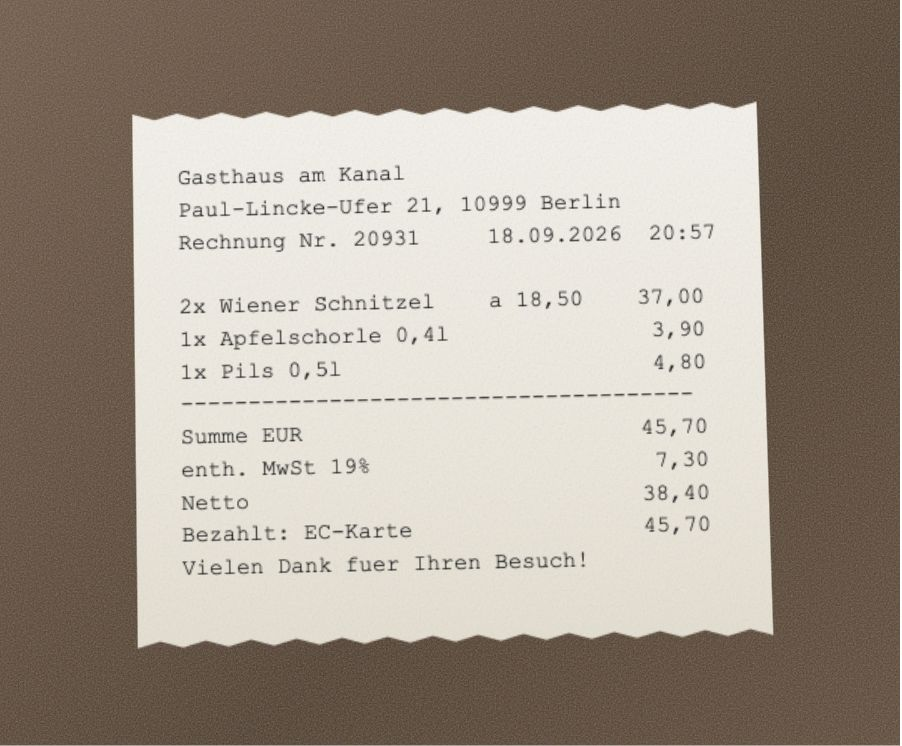
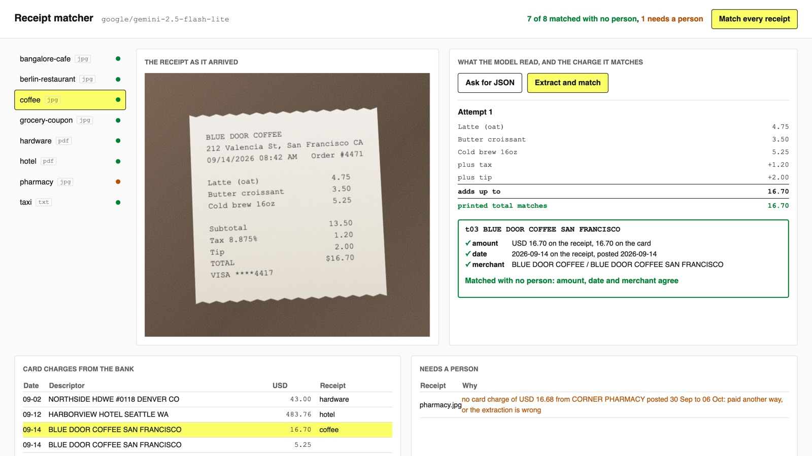

# Extract Structured Data with LLMs

Read receipt photos, PDFs and emails with a model, match each one to the card charge it pays for,
and send only the ones that do not match to a person.

## The product job

A company card charge reaches the books within a day, straight from the bank: an amount, a date and
a cut-short merchant name such as `GASTHAUS AM KANAL BERLIN`. Finance still needs the receipt behind
every charge, for tax and for audit. Ramp, the corporate card company, asks employees to snap or
forward the receipt, reads it, and attaches it to the right charge with no one typing anything. When
Ramp moved that reading step to a fine-tuned model on Modal, manual reviews fell by 34% (Modal, "Ramp
case study").

- **The source of truth** is the bank's card feed, `data/card-transactions.csv`. The model never
  sees it, so a match is a check the model cannot talk its way past.
- **The metric** is the share of receipts matched with no person, with zero matched to the wrong
  charge. The proof test asserts both.

## What you will be able to do

Before: you can call a model and get text back. After this lab you can:

- take a document a person handles today and get typed fields out of it
- check those fields against a record the model did not write
- hand a person only what fails, with a test that says how many still need one

Every lab in this course builds on that pattern.

## The problem



The card feed holds one charge from Gasthaus am Kanal: 45.70 EUR, posted on 19 September. The receipt
prints three amounts that could be "the total": 45,70 paid, 38,40 net and 7,30 of VAT already inside
the price. Read 38,40 and nothing matches, or worse, the 7,30 gap looks like a tip and the wrong
number gets booked.

## What you will build

A receipt matcher. Each receipt sits beside what the model read from it, the arithmetic that checks
it, and the card charge it matched with the three signals that agree. The bank feed sits below with
each charge's receipt, and so does the queue of receipts that need a person.



The eight receipts in `data/receipts` cover what breaks matching: a charge in another currency, a tip
added on the card machine, two coffees bought the same morning, a hotel bill charged at checkout, a
coupon, and one receipt paid with a personal card that has no charge at all. Five are photos, two
are PDFs and one is an email. They are synthetic, drawn by `data/draw_receipts.py` from the texts in
`data/source`.

## Words you will use

- **Structured output**: asking the provider to hold the reply to a JSON schema.
- **Source of truth**: a record the model did not write, here the card feed, that its output is checked against.
- **Business rule**: a fact about the money that no schema can say, such as "the lines add up to the total".
- **Repair loop**: sending the validation error back to the model and asking again, a fixed number of times.
- **Needs a person**: the queue someone works through; the number you are trying to shrink.

## Set up

You need [uv](https://docs.astral.sh/uv/) and a key for any OpenAI-compatible endpoint. The lab was
measured on `google/gemini-2.5-flash-lite` through [OpenRouter](https://openrouter.ai): one run over
all eight receipts, photos and PDFs included, costs about a fifth of a cent.

```bash
cp env.example .env
```

Put your key after `LLM_API_KEY=` in `.env`. Then install:

```bash
uv sync
```

Expect: /Installed|Audited|Resolved/

## 1. Try the obvious way

To match a charge, your code needs a merchant, a date, a currency and a total under keys it knows.
Most people start by asking for JSON. `receipts naive` sends each receipt with one line, "Extract
this receipt as JSON", and reports what came back:

```bash
uv run receipts naive data/receipts
```

Expect: /\d/8 not JSON as sent/

Nothing here can be compared to the bank yet:

- The reply is wrapped in a Markdown fence, so `json.loads` fails before you see a field.
- Every receipt comes back in its own shape: `total`, `grand_total`, `balance_due`, `total_paid`.
- Amounts arrive as text such as `"45,70"`, and the Berlin reply has two totals. Your code has to guess.

## 2. Fix the shape with a schema

`src/receipts/schema.py` describes the entry once, as a Pydantic model: merchant, date, an ISO
currency code, line items, discount, tax, tip and a numeric total. `response_format` in
`src/receipts/extract.py` sends that schema to the provider, which holds the reply to it:

```bash
uv run receipts extract data/receipts/coffee.jpg
```

Expect: valid and reconciled on attempt

The photo went in as a base64 data URL (`read_receipt`), and every receipt now has the same keys the
matcher reads.

## 3. Check the total before you match it

A schema can say "total is a number". It cannot say "this is the amount paid". The `reconcile`
validator in `schema.py` checks that the lines, minus discount, plus tax and tip, add up to the total.
That is what stops a net amount reaching the matcher dressed up as a tip.
`data/ledger-wrong-total.json` has every field right and a total a dollar off; the schema accepts it
and the rule does not:

```bash
uv run receipts check data/ledger-wrong-total.json
```

Expect: add up to 16.70

When the rule fails on a real reply, `extract` sends the exact error back to the model and asks once
more (`repair_request`). If the second answer still does not add up, only a charge equal to its total
to the cent can match it, never one that needs a tip to fit.

## 4. Match against the card feed

`src/receipts/match.py` reads the card feed and looks for the one charge where three signals agree:

- **Amount**, in the receipt's own currency. The bank records the original amount of a foreign
  charge, so 45.70 EUR is compared with 45.70 EUR, not with the dollars billed. A card-machine tip of
  up to 30% still matches, and says so.
- **Date**, from one day before the receipt to five days after, because charges post late.
- **Merchant**, one shared word between the receipt and the bank's cut-short name.

When nothing fits, or two charges fit equally, the receipt goes to a person instead of a guess:

```bash
uv run receipts match data/receipts
```

Expect: /\d/8 matched to a card charge, \d need a person/

In our runs seven receipts matched and none matched the wrong charge. The grocery receipt counts its
coupon twice, so its lines never add up, but its total equals a charge to the cent: the bank confirms
the total and the entry is flagged "the lines need a look". The pharmacy receipt was paid with a
personal card, so no charge fits and a person files it as out of pocket. A person checks one receipt
instead of eight.

## 5. See it

The matcher page is the same code behind one page. Start it and open http://127.0.0.1:8000:

```sh
uv run receipts serve data/receipts
```

Pick the Berlin receipt. Press **Ask for JSON** and watch the fence. Then press **Extract and match**:
the sum checks the total, and the charge below it shows the amount, date and merchant that agree.
Press **Match every receipt** to fill the card feed and the queue for a person; the header counts how
many matched with no person. Then pick the pharmacy receipt: it names the amount, merchant and dates
it searched, and a person decides whether it goes on a charge by hand or is filed as out of pocket.
Stop the matcher with Ctrl-C.

## 6. Prove it

The keyless tests check the rule, the repair loop, every matching trap in the feed and the page with
a fake model:

```bash
uv run pytest -q
```

Expect: /\d+ passed/

The proof runs the real model over all eight receipts. It fails if any receipt matches the wrong
charge, or if fewer than six of the seven card-paid receipts match:

```bash
uv run pytest -m proof -q
```

Expect: 1 passed

## At a startup

Ship exactly this: one cheap model that reads photos and PDFs, the reconcile rule, the matcher and a
queue that is a table with a "this one" button beside each candidate charge. Track one number
weekly: the share of receipts matched with no person.

## At an enterprise

Add what an auditor will ask for. Store the original file, the model's reply, the model name, the
attempt count and the matched charge id with every entry, so a booked number traces to its source
and to the bank. Keep receipts with card numbers or employee names out of a third-party API until
legal has approved the provider, or run an open model yourself. Keep every receipt a person matched:
it is labelled data, the raw material for a fine-tune like Ramp's.

## Change it

- Run `uv run receipts extract --no-retry` on each receipt and count how many the repair loop saves.
- Make `mismatch` in `schema.py` name the coupon when a negative line and a discount have the same
  amount, and see whether the grocery receipt stops reaching a person.
- Lower `MAX_TIP` in `match.py` to 0.15 and find which receipt stops matching.
- Swap `LLM_MODEL` for a Mistral or Claude model and compare matches and cost.
