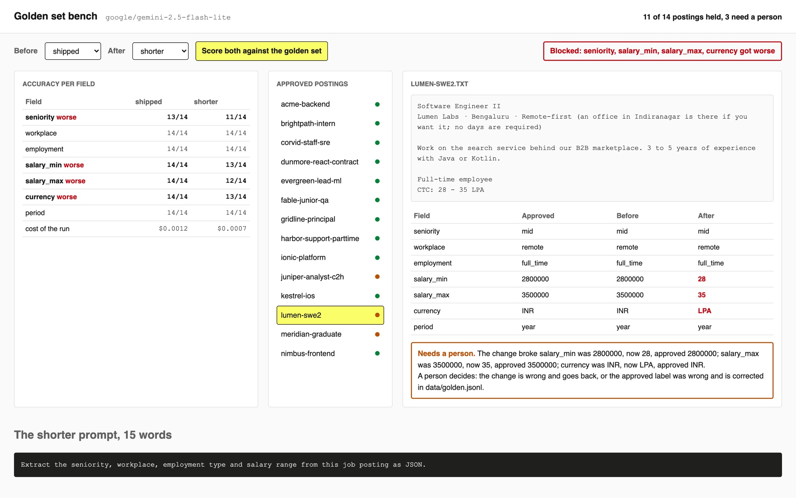

# Build a Golden Set for an LLM Feature

Score every prompt or model change against cases a person already approved, field by field, and
block the change when any field gets worse.

## The product job

A job board shows filters beside every search: seniority, remote or hybrid, contract or full-time,
salary. Employers do not fill those fields in; they paste a posting. A model reads the posting and
fills the filters, and a wrong filter hides a job from the people it was written for.

The model is never finished. Someone trims the prompt to save tokens, someone tries a cheaper model,
someone adds a rule for a case a recruiter complained about. Each change fixes something you can see
and can break something you cannot. LinkedIn's team wrote that they reached about 80% of the quality
they wanted in the first month, then spent four more months pushing past 95% (LinkedIn Engineering,
"Musings on building a Generative AI product"). That last stretch is spent on cases like the ones
here, and you cannot work on it without a fixed set of cases a person has signed off.

- **The source of truth** is `data/golden.jsonl`: 14 postings with the fields a person approved.
  The model never wrote them, so a score against them is a check the model cannot talk its way past.
- **The metric** is accuracy per field, before and after each change. The proof test asserts that
  the golden set blocks a change that breaks a field and passes one that only fixes.

## What you will be able to do

Before: you change a prompt, try it on a few inputs, read the output and ship it. After this lab you
can:

- keep a labelled set of cases a person approved
- score any change against it, field by field
- block a change that makes any field worse
- hand a person only the cases that changed for the worse

## The problem

The prompt in `prompts/shipped.txt` is 219 words of rules: what counts as staff, when a role is
hybrid, how a lakh is written. A teammate replaces it with 15 words in `prompts/shorter.txt` to cut
the cost of every call by about 40%. They try it on three postings, every field looks right, and it
ships. Nothing tells them that a Bengaluru salary of "28 - 35 LPA" now books as 28 rupees.

## What you will build

A check that runs on every prompt change, shown as a pull request review. It scores the prompt in
production and the proposed change against the approved postings, blocks the change if any filter
gets worse, and lists the postings a person has to read.



The 14 postings in `data/postings` cover what breaks the filters: a salary in lakh, an hourly
contract rate, a "lead" title, a contract-to-hire role, an office that is optional, a salary that is
only "up to", and one with no salary at all. They are synthetic.

## Words you will use

- **Golden set**: inputs with the output a person approved, kept fixed so every change is scored on the same cases.
- **Field accuracy**: for one field, how many golden postings the model got right. One number per field, not one for the whole posting.
- **Regression**: a field that was right before the change and is wrong after it.
- **Gate**: the rule that a change ships only when no field gets worse.
- **Needs a person**: a posting the change broke. A person decides whether the change is wrong or the label is.

## Set up

You need [uv](https://docs.astral.sh/uv/) and a key for any OpenAI-compatible endpoint. The lab was
measured on `openai/gpt-6-luna` through [OpenRouter](https://openrouter.ai): scoring one prompt
against all 14 postings costs about a seventh of a cent.

```bash
cp env.example .env
```

Put your key after `LLM_API_KEY=` in `.env`. Then install:

```bash
uv sync
```

Expect: /Installed|Audited|Resolved/

## 1. Try the obvious way

Most people test a prompt change by running it on a few inputs and reading the output. Run the
shorter prompt on three postings:

```bash
uv run postings try prompts/shorter.txt data/postings/acme-backend.txt data/postings/corvid-staff-sre.txt data/postings/nimbus-frontend.txt
```

Expect: 3 postings read with shorter.txt

Every field is right on all three. That check would ship the change. Three postings you picked
yourself say nothing about the lakh, the contract-to-hire role or the graduate scheme.

## 2. Score the prompt you have

`data/golden.jsonl` has one line per posting, with the seven fields a person approved.
`src/postings/score.py` compares a run with it one field at a time: a number must match to the unit,
a currency code in any case. `postings eval` runs every golden posting through a prompt and prints
the score per field:

```bash
uv run postings eval prompts/shipped.txt
```

Expect: /shipped: \d+/98 fields right/

This is the baseline every change is measured against. In our runs on luna the shipped prompt got all
98 fields right. On `google/gemini-2.5-flash-lite` it got 97: it read "2+ years" on the Harbor
posting as junior, where the person approved mid. The run is saved to `runs/shipped.json`.

## 3. Score the change

Run the same postings through the shorter prompt:

```bash
uv run postings eval prompts/shorter.txt
```

Expect: /shorter: \d+/98 fields right/

## 4. Gate the change

A total such as "91 of 98" hides which field fell. `gate` in `score.py` compares the two runs field
by field and lists every posting where a field went from right to wrong:

```bash
uv run postings gate runs/shipped.json runs/shorter.json
```

Expect: blocked: shorter makes

In our runs two fields got worse. Evergreen's lead ML role, approved as staff, became senior, and the
Meridian graduate role lost its top salary. Twelve postings held and need no one. Two need a person,
who reads each and decides: the change is wrong and goes back, or the approved label was wrong and is
corrected in `data/golden.jsonl`. Either way the set gets better.

## 5. Ship a change that only fixes

On flash-lite the shipped prompt's one miss was Harbor's seniority. `prompts/years-rule.txt` adds one
sentence: years of experience alone never make a role junior. Luna already reads Harbor right, so here
the rule guards a case a cheaper model gets wrong. Score it and gate it:

```bash
uv run postings eval prompts/years-rule.txt && uv run postings gate runs/shipped.json runs/years-rule.json
```

Expect: passed: no field is worse with years-rule

The gate lists nothing under "broke", and all 14 postings hold. On flash-lite it also listed Harbor
under "fixed". This is how the last stretch from
80% to 95% gets done: one rule at a time, each proven not to cost another field.

## 6. See it

The check page is the same code behind a page that looks like a pull request review. Start it and
open http://127.0.0.1:8000:

```sh
uv run postings serve
```

**Proposed change** shows "Shorten the posting prompt to 15 words" with its diff. Press **Run the
golden set check**. The box under the diff says the change is blocked and names the filters that got
worse, and the header counts the postings that held and the ones that need a person. Click the **Acme
Ledger GmbH** row: every approved filter is still right, so nobody reads it. Click the **Evergreen Insurance**
row: the broken seniority is in red, and the box says what the person decides. Then pick "Add one sentence
about years of experience" and run the check again: it passes and no posting needs a person. Stop the
page with Ctrl-C.

## 7. Prove it

The keyless tests check the score, the gate and the page with a fake model:

```bash
uv run pytest -q
```

Expect: /\d+ passed/

The proof runs all three prompts on the real model. It fails if the shipped prompt gets fewer than 13
of 14 postings right on any field, if the gate lets the shorter prompt through, or if it blocks the
years rule:

```bash
uv run pytest -m proof -q
```

Expect: 1 passed

## At a startup

Start with 30 to 50 real inputs a person labelled in an afternoon, and run `gate` in CI on every pull
request that touches a prompt or a model name. Each time a user reports a wrong field, add that input
to the set with the right answer. Track one number per field weekly.

## At an enterprise

Version the golden set with the code, and record who approved each label and when. Keep a held-out
part that no prompt author looks at, so rules are not written to the test. Grow the set from
production by sampling outputs for people to label, stratified by the cases that matter: rare
currencies, new countries, new job families. Report the per-field score to the team that owns each
filter, not one average to everyone.

## Change it

- Add a posting for a role in Japan paid in yen per month, label it, and see which prompt holds.
- Make `gate` allow a field to drop by one posting when another rises by three, and decide if you
  would ship that.
- Swap `LLM_MODEL` for a cheaper or a larger model and gate it against `shipped` the same way.
