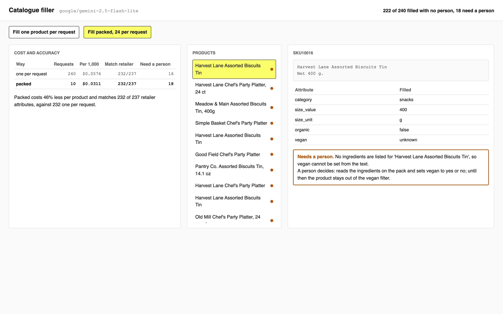

# Process a Million Prompts with Batch APIs

Fill a whole catalogue in one overnight job: pack many products under one copy of the instructions,
write every request to one file, and resume from a checkpoint when the run dies halfway.

## The product job

A grocery storefront filters on category, size, organic and vegan. Retailers send products as a
title and a description, and most of those fields are missing. Instacart runs jobs like this through
Maple, its service for large LLM jobs, which writes the prompts to files and hands them to a
provider's batch API (Instacart Engineering, "Simplifying Large-Scale LLM Processing across
Instacart with Maple"). At that scale the cost per product decides whether the job runs at all.

- **The source of truth** is `data/retailer-attributes.csv`: for 48 of the 240 products, the
  attributes the retailer already supplied. The model never sees them; they score what it filled.
- **The metric** is the cost per thousand products at the same attribute accuracy. The proof test
  asserts that packing cuts the cost by at least 30% and loses no more than three attributes.

## What you will be able to do

Before: you loop over the catalogue and send one request per product, and a crash at product 3,000
means starting again. After this lab you can write a whole job as one batch file, pack many products
per request, run it with a checkpoint that skips what is done, retry what a reply dropped, send the
same file to a provider's batch API, and hand a person only the products the text cannot settle.

## The problem

`data/catalogue.csv` holds 240 products from eight brands. Sizes are written "142 g", "5.0 oz",
"pack of 6" or "47.9 fl oz", sometimes in the title and sometimes only in the description. Some list
ingredients and some do not. The obvious loop sends the same paragraph of instructions with every
product, so most of what you pay for is that paragraph, 240 times.

## What you will build

A catalogue filler. It fills every product one per request and then packed 24 per request, and shows
the cost per thousand products, how many attributes match the retailer, and which products a person
has to finish.



The catalogue is synthetic and seeded: `python3 data/make_catalogue.py` writes the same two files.

## Words you will use

- **Batch file**: one JSON line per request, in the format OpenAI's batch API reads. Other providers read the same shape.
- **Packing**: many products in one request under one copy of the instructions, so the instructions are paid for once per pack.
- **Checkpoint**: a file of finished results. A rerun reads it and sends only what is missing.
- **Batch API**: a provider endpoint that takes a whole batch file and returns the results within a day, usually at about half price.
- **Needs a person**: a product whose attributes the text cannot settle, such as vegan with no ingredients listed.

## Set up

You need [uv](https://docs.astral.sh/uv/) and a key for any OpenAI-compatible endpoint. The lab was
measured on `google/gemini-2.5-flash-lite` through [OpenRouter](https://openrouter.ai): filling all
240 products both ways costs about two cents.

```bash
cp env.example .env
```

Put your key after `LLM_API_KEY=` in `.env`. Then install:

```bash
uv sync
```

Expect: /Installed|Audited|Resolved/

## 1. Try the obvious way

Send one request per product, eight at a time:

```bash
uv run catalog one data/catalogue.csv
```

Expect: /240 requests for 240 products/

In our runs this cost $0.0576 per thousand products, and 232 or 233 of the 237 attributes the
retailer supplied matched. The accuracy is fine. The cost is the instructions, sent 240 times.

## 2. Write the job as a batch file

`batch_lines` in `src/catalog/fill.py` puts 24 products in each request, one line per product
("sku | title | description"), under one copy of the instructions. The reply is a list of products,
each with its sku. Every request goes in one file:

```bash
uv run catalog file data/catalogue.csv --size 24
```

Expect: 10 requests for 240 products, 24 per request

Open `out/batch.jsonl`: each line has a `custom_id`, the endpoint and the request body. That file is
the whole job, and you can send it two ways.

## 3. Run the file with a checkpoint

`run_lines` sends every line not already in `out/done.jsonl`, and appends each result the moment it
lands. When a reply leaves a product out or mangles its sku, `settle` retries that product once on
its own:

```bash
uv run catalog run out/batch.jsonl
```

Expect: /sent \d+ requests/

In our runs packing cost $0.0311 per thousand products, about 46% less, and 232 of 237 attributes
matched, as many as one per request. Run it again, as you would after a crash:

```bash
uv run catalog run out/batch.jsonl
```

Expect: sent 0 requests, 10 already done

Nothing is sent twice. A run that dies at pack 3,000 of 40,000 loses one pack, not the night.

## 4. Hand the file to a batch API

`submit` uploads the same file to a provider's batch endpoint, and `collect` writes the results into
the same checkpoint, so `run` settles them exactly as before:

```bash
uv run catalog submit out/batch.jsonl
```

Expect: /no batch API|submitted batch/

OpenRouter has no batch endpoint, so on the lab's setup this prints "this endpoint has no batch API"
and you keep the run from step 3. With a key for an OpenAI-compatible batch API, point
`LLM_BASE_URL` at it, submit, and run `uv run catalog collect <id>` within a day. Those endpoints
usually charge about half. We did not measure that discount here; the 46% above comes from packing
alone.

## 5. See it

The filler page is the same code behind one page. Start it and open http://127.0.0.1:8000:

```sh
uv run catalog serve
```

Press **Fill one product per request**, then **Fill packed, 24 per request**. The cost table puts
the two side by side, and the header counts the products filled with no person and the ones that
need one. Pick a green product: every attribute is set and, when the retailer supplied it, matches.
Pick an orange one, such as an assorted biscuits tin: no ingredients are listed, so vegan cannot be
set from the text, and the box says what the person decides. Press a button again and nothing is
sent: the checkpoint already holds it. Stop the page with Ctrl-C.

## 6. Prove it

The keyless tests check the batch file, the parse and the retry, the checkpoint, the batch API calls
and the page with a fake model:

```bash
uv run pytest -q
```

Expect: /\d+ passed/

The proof fills the catalogue both ways on the real model. It fails if packing costs more than 70%
of one per request, matches more than three fewer attributes, or matches fewer than 95%:

```bash
uv run pytest -m proof -q
```

Expect: 1 passed

## At a startup

Write every bulk job as a batch file from the first day, even if you run it yourself with
`catalog run`. Pick the pack size by measuring: raise it until accuracy against your sample drops,
then step back one. Keep the checkpoint next to the output, and send the products that need a person
to a queue the catalogue team already works.

## At an enterprise

Put one service in front of every bulk job, as Instacart did with Maple, so each team hands over a
file and gets results without writing its own retry and resume. Route a file to the provider's batch
API when it can wait a day and to the live endpoint when it cannot. Score a sample of every run
against data people supplied, and stop a run whose score drops before it finishes the catalogue.

## Change it

- Try `--size 8` and `--size 60`, and find where accuracy starts to fall.
- Add `allergens` to `Attributes` and decide which products a person must check.
- Send the products that need a person through the run again with a larger model, and count how many
  it settles.
