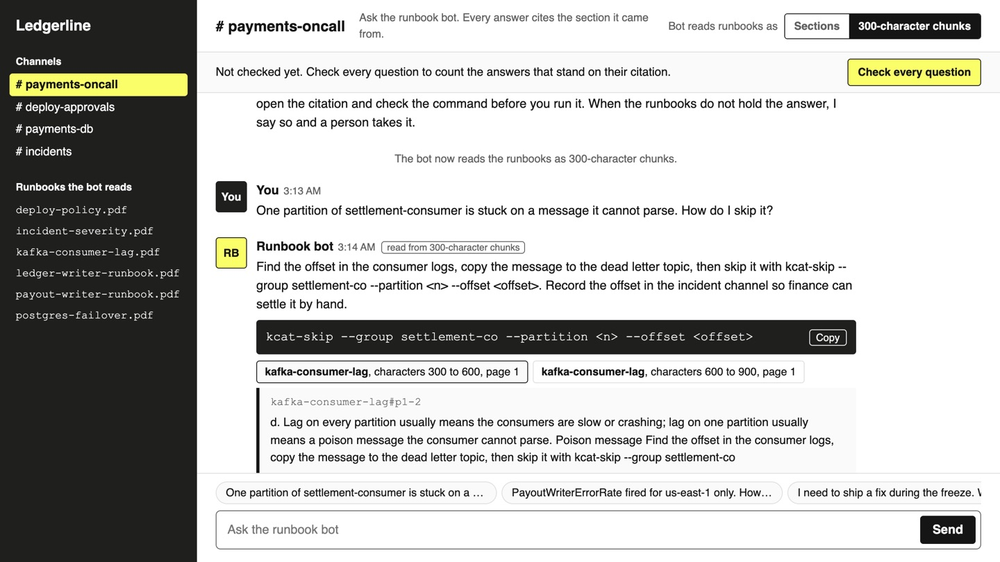

# Build a RAG Pipeline over PDFs

Turn PDFs into passages a citation can point at, answer only from the passages found, and send a
person every answer whose citation does not hold it.

## The product job

An engineer on call asks a question in Slack at 3 a.m.: how do I skip a stuck message, who do I page,
can I deploy now. The answer is in a runbook somewhere, exported from the wiki as a PDF. Uber's
Genie answers these questions in on-call channels from internal docs, and cites the doc it used
(Uber Engineering, "Genie: Uber's Gen AI On-Call Copilot"). An answer is only worth running when the
engineer can open the cited passage and see the command there.

- **The source of truth** is the runbook passage each answer cites. `data/questions.jsonl` pairs 19
  questions with the fact the right passage holds, such as a command or a channel; two questions are
  about things no runbook covers.
- **The metric** is the share of answers whose citation supports them: the answer states the fact and
  a passage it cites holds it. The proof test asserts at least 95%, more supported answers than
  fixed-size chunks give, and no guess on a question the docs do not cover.

## What you will be able to do

Before: you paste docs into a prompt or cut them every few hundred characters, and trust whatever
comes back. After this lab you can:

- read PDFs into passages by section, with their page, and drop the page furniture
- find the passages a question needs and get an answer that cites them
- check each citation against its passage
- send a person the answers that do not stand

## The problem

`data/docs` holds six runbooks and policies for a payments platform, as a wiki prints them: a header
and a footer on every page, and commands wrapped across lines. Two runbooks are near twins:
ledger-writer drains a region with `ledgerctl drain`, payout-writer pauses one with
`payoutctl pause`. An answer that mixes them runs the wrong command on the wrong service.

## What you will build

Ledgerline's #payments-oncall channel with a runbook bot in it. You ask a question, the bot answers
from the runbook PDFs and cites the section it used, and you can open the citation to see the fact.
When the cited passage does not hold the fact, or no runbook covers the question, the bot hands it to
a person.



The docs are synthetic: `uv run --with reportlab==4.4.4 python data/make_docs.py` writes the same PDFs.

## Words you will use

- **Ingestion**: reading documents into text a search can index, keeping where each piece came from.
- **Passage**: one piece of a document the search returns and an answer cites. Here, one section with its doc and page.
- **Page furniture**: the header, footer and page number printed on every page. Left in, they match every question a little.
- **Citation**: the id of the passage an answer comes from, so a person can open it and check.
- **Supported**: the answer states the fact, and a passage it cites holds that fact.

## Set up

You need [uv](https://docs.astral.sh/uv/) and a key for any OpenAI-compatible endpoint. The lab was
measured on `google/gemini-2.5-flash-lite` through [OpenRouter](https://openrouter.ai): answering all
19 questions both ways costs well under a cent.

```bash
cp env.example .env
```

Put your key after `LLM_API_KEY=` in `.env`. Then install:

```bash
uv sync
```

Expect: /Installed|Audited|Resolved/

## 1. Try the obvious way

Ask the model with no docs at all:

```bash
uv run oncall blind "One partition of settlement-consumer is stuck on a message it cannot parse. How do I skip it?"
```

Expect: no docs

The answer is long, confident and generic: it guesses the platform is "Kafka-like" and starts a
tutorial. It cannot know the team's `kcat-skip` command, or that the runbook says to copy the message
to the dead letter topic first and record the offset so finance can settle the payout by hand.

## 2. Read the PDFs into passages

A PDF reader returns lines, not sections. `lines` in `src/oncall/ingest.py` reads each line with its
printed size: 8 for the header and footer, 18 for the title, 14 for a heading. `by_section` drops the
furniture, starts a passage at every heading, and joins the wrapped lines back into one:

```bash
uv run oncall ingest data/docs
```

Expect: 26 passages by section from 6 PDFs

Each passage has an id such as `kafka-consumer-lag#poison-message`, its doc, its heading and its
page. That is what a citation points at. Now look at the way most tutorials cut text, every 300
characters:

```bash
uv run oncall ingest data/docs --by size
```

Expect: /\d+ passages by size from 6 PDFs/

The first chunk opens with "Ledgerline Payments Platform - Internal", and chunks end mid-word.

## 3. Answer with citations

`Index` in `src/oncall/retrieve.py` finds the four passages that share the rarest words with the
question. Ranking is kept plain here on purpose. `answer` in `src/oncall/answer.py` sends only those
passages, each with its id, and asks for JSON: the answer, and the ids it comes from, or no answer
when the passages do not cover it:

```bash
uv run oncall ask "One partition of settlement-consumer is stuck on a message it cannot parse. How do I skip it?"
```

Expect: kafka-consumer-lag#poison-message

The answer is the team's command, and it cites the passage that holds it.

## 4. Check every citation

`judge` in `src/oncall/score.py` lets an answer stand only when it states the question's fact and a
passage it cites holds that fact. Everything else goes to a person with the reason. Run all 19
questions from 300-character chunks:

```bash
uv run oncall eval --by size
```

Expect: /size passages on .*: \d+ of \d+ answers supported/

In our runs 15 of 17 answers were supported. The chunk that held the skip command ended at
`kcat-skip --group settlement-co`, and the approval channel was cut the same way. In one run the
answer copied the cut: `--group settlement-co --partition`, a command that names no consumer group.
No passage a person could open holds the whole command. Now from section passages:

```bash
uv run oncall eval
```

Expect: /section passages on .*: \d+ of \d+ answers supported/

In our runs all 17 answers were supported, and the two questions no runbook covers came back with no
answer. Those two go to a person: 17 of 19 answered with a supporting citation, 2 go to a person.

## 5. See it

The channel is the same code behind one page. Start it and open http://127.0.0.1:8000:

```sh
uv run oncall serve
```

Pick **300-character chunks** at the top, then press the suggested question about the stuck
partition. The command in the reply is cut to `settlement-co`, and the reply says it needs a person:
press a citation to see the chunk end mid-name. Pick **Sections** and ask again: the whole command
comes back, and the cited passage marks it. Ask the TLS certificate question: no runbook covers it, the
bot says so instead of guessing, and **Hand to the on-call lead** posts the handoff. Press **Check
every question** to count the answers that stand on their citation and list the ones that need a
person. Stop the page with Ctrl-C.

## 6. Prove it

The keyless tests check ingestion, the search, the verdict and the page with a fake model:

```bash
uv run pytest -q
```

Expect: /\d+ passed/

The proof answers every question both ways on the real model. It fails if fewer than 95% of the
section answers are supported, if fixed-size chunks do as well, or if the model answers a question the
docs do not cover:

```bash
uv run pytest -m proof -q
```

Expect: 1 passed

## At a startup

Export the runbooks your team already has and cut them by heading, not by size. Make every answer cite
a passage id, and show the passage under the answer, so the engineer checks it in a second. Log every
question that came back with no answer: that list is the runbook pages nobody has written yet.

## At an enterprise

Ingest from the source the docs are written in, not only PDFs, and re-ingest when a page changes so a
citation never points at a stale step. Keep each passage's owner and last edit date, and show them
next to the citation. Run a labelled set of on-call questions like `data/questions.jsonl` on every
change to ingestion or the prompt, and route unsupported answers to the owning team's queue.

## Change it

- Add a runbook PDF for the API gateway with a TLS rotation section, and watch that question move
  from a person to a supported answer.
- Try `k=2` and `k=8` in `Desk`, and count what changes.
- Cut by size with 50 characters of overlap, and see whether it closes the gap to sections.
