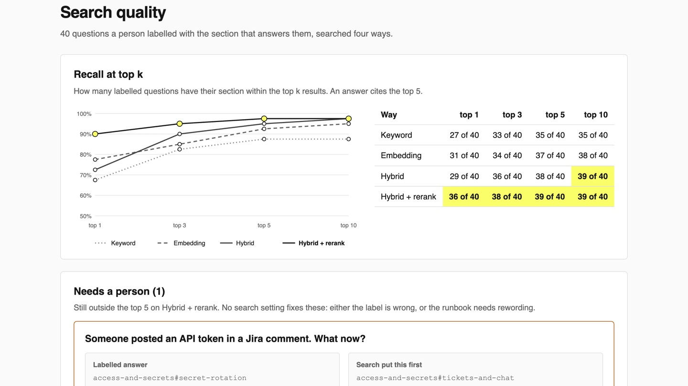

# Measure RAG Accuracy with Recall@k

Label the runbook section each question needs, measure how often search brings it back, and raise
that number with hybrid search and a reranker.

## The product job

An answer can only cite a passage the search returned. When search misses, the model writes from the
wrong runbook, and no prompt fixes that. Uber's team behind Genie built a golden set of test questions
with the answers experts expected, over internal policy documents, and measured every change to
retrieval against it (Uber Engineering, "Enhanced Agentic-RAG: What If Chatbots Could Deliver
Near-Human Precision?").

- **The source of truth** is `data/golden.jsonl`: 40 questions a person labelled with the one runbook
  section that answers each.
- **The metric** is recall@k: of the labelled questions, how many have their section in the top k
  results. The proof test asserts at least 95% in the top 5 on hybrid search with a reranker. It also
  asserts that hybrid beats each single way, and that the reranker puts more answers first.

## What you will be able to do

Before: you pick an embedding model, try three questions, and ship when the results look fine. After
this lab you can:

- label questions with the section that answers them, and score any search by recall@k
- see where keyword search wins, where embeddings win, and merge both with hybrid search
- reorder the shortlist with a cross-encoder reranker
- hand the questions no setting fixes to a person, who decides whether the label or the runbook is wrong

## The problem

`data/docs` holds 14 runbooks and policies from Ledgerline's payments wiki, 64 sections in all. Engineers
ask in three ways, and each one breaks a different search:

- **Exact names**, like `RECON-MISMATCH-22` or `hookctl replay`. An embedding blurs these into
  "something about reconciliation".
- **Paraphrases**, like "the consumer is stuck on one bad event it cannot read". The runbook calls it a
  poison message, so keyword search shares no word with it.
- **Same heading, different service**: four runbooks have a section called "Roll back". Only the
  service name in the question tells them apart.

## What you will build

Ledgerline's internal runbook search. Staff type a question the way they would ask a teammate, and
pick how to search. When the question is one a person labelled, the page says at what rank the right
section came back, on every way. The Search quality tab measures all 40 labelled questions four ways,
draws recall at top k, and lists the questions that still need a person.



The docs are synthetic: `uv run --with reportlab==4.4.4 python data/make_docs.py` writes the same PDFs.

## Words you will use

- **Golden set**: questions a person labelled with the right answer, here the right section.
- **Recall@k**: the share of labelled questions whose section is in the top k results.
- **Keyword search (BM25)**: scores a section by the question's words it contains, weighting rare words more.
- **Embedding**: a list of numbers for a text, close for texts that mean the same thing, even with no shared words.
- **Hybrid search**: runs both and merges the two lists by rank.
- **Reranker (cross-encoder)**: a model that reads the question and one section together and scores how well it answers.

## Set up

You need [uv](https://docs.astral.sh/uv/). No key: the three models run on your laptop's CPU through
[fastembed](https://github.com/qdrant/fastembed), and [Qdrant](https://qdrant.tech) runs in memory.

```bash
uv sync
```

Expect: /Installed|Audited|Resolved/

`env.example` lists the three models. You only need a `.env` to try others.

## 1. Read the runbooks

Each section becomes one passage with its doc, heading and page:

```bash
uv run wiki ingest data/docs
```

Expect: 64 sections from 14 PDFs

## 2. Measure the obvious way

Most tutorials embed every passage and return the closest ones. Score that on the labelled set. The
first run downloads the models, about 150 MB:

```bash
uv run wiki eval --how embedding
```

Expect: /embedding\s+\d+ of 40/

In our runs 31 of 40 came back first and 37 of 40 in the top 5. Look at what it misses. It puts
the `redisctl add-shard` section second, behind another Redis section. It never finds the escalation
chain for "the secondary on-call does not pick up". The question looks like the response time rule,
which also says "escalate to the secondary", so the embedding lands there.

## 3. Add keyword search

`Search` in `src/wiki/search.py` stores two vectors per section in one Qdrant collection. The second is
BM25, a sparse vector with one weight per word. Qdrant counts how rare each word is (IDF):

```bash
uv run wiki eval --how keyword --how embedding
```

Expect: /keyword\s+\d+ of 40/

Keyword finds every exact name and misses the paraphrases: 35 of 40 in the top 5. "How long do we
have to keep the books?" shares no useful word with "Ledger entries are kept for 7 years". Neither way is
better. Each finds what the other misses.

## 4. Merge them: hybrid search

Hybrid runs both searches and scores each section by its rank in each list: 1 / (60 + rank). Ranks,
not raw scores, because BM25 and cosine scores sit on different scales. This is reciprocal rank
fusion, and Qdrant does it in one query:

```bash
uv run wiki eval --how keyword --how embedding --how hybrid
```

Expect: /hybrid\s+\d+ of 40/

Hybrid puts 38 of 40 in the top 5 and 39 in the top 10. But it puts fewer first than embedding alone.
Fusion trades places at the top.

## 5. Rerank the shortlist

A cross-encoder reads the question and one section as a single input. It sees that "us-east-1
payouts" belongs to the payout runbook, which two separate vectors cannot. It is slow per pair, so it
only reorders the hybrid top 20:

```bash
uv run wiki search "The consumer is stuck on one bad event it cannot read. How do I get past it?" --how rerank
```

Expect: labelled

The poison message section comes back at rank 3, marked as the labelled answer. Keyword, embedding
and hybrid all miss it in the top 5. Now all four ways together:

```bash
uv run wiki eval
```

Expect: Needs a person (1)

In our runs rerank put 36 of 40 first and 39 of 40 in the top 5. One question still misses: "Someone
posted an API token in a Jira comment. What now?" Search puts the "Tickets and chat" rule first, and
the label says "Secret rotation". Both are fair. No search setting decides that, so a person does.

## 6. See it

Start the search page and open http://127.0.0.1:8000:

```sh
uv run wiki serve
```

Press a labelled question under the search box. The banner says at what rank the labelled section came
back on each way. Switch between **Keyword**, **Embedding** and **Hybrid + rerank** on the poison
message question and watch the rank move. Open **Search quality**: it measures all 40 questions in
about a minute and draws recall at top k. Under **Needs a person**, read the labelled section beside
the one search put first. Then either move the label, or queue the runbook for rewording. The decision
goes to `out/review.jsonl`. Stop the page with Ctrl-C.

## 7. Prove it

The keyless tests use fake encoders on a real in-memory Qdrant. They check ingestion, the labels,
the recall maths, every search way and the page:

```bash
uv run pytest -q
```

Expect: /\d+ passed/

The proof runs the real models on the golden set. It fails if hybrid with rerank puts fewer than 95%
in the top 5, if hybrid trails keyword or embedding, or if the reranker does not put more answers first:

```bash
uv run pytest -m proof -q
```

Expect: 1 passed

## At a startup

Label 40 real questions from your support or on-call channel before you tune anything. Run
`wiki eval` on every change to chunking, models or search, and keep the table in the pull request.
Start with hybrid search: it costs one extra vector per passage and covers exact names for free.

## At an enterprise

Run a Qdrant server and pass its client to `Search`: the collection, vectors and queries stay the same.
Grow the golden set from real questions people marked as unanswered, and give each label an owner.
Send every question that falls out of the top 5 to that owner's queue, like the **Needs a person** list.

## Change it

- Set `DENSE_MODEL=BAAI/bge-base-en-v1.5` in `.env` and rerun `wiki eval`. Does a bigger model close the gap to hybrid?
- Change `SHORTLIST` in `src/wiki/search.py` to 5 and to 40, and watch rerank recall and speed.
- Add five questions of your own to `data/golden.jsonl` and see which way finds them.
