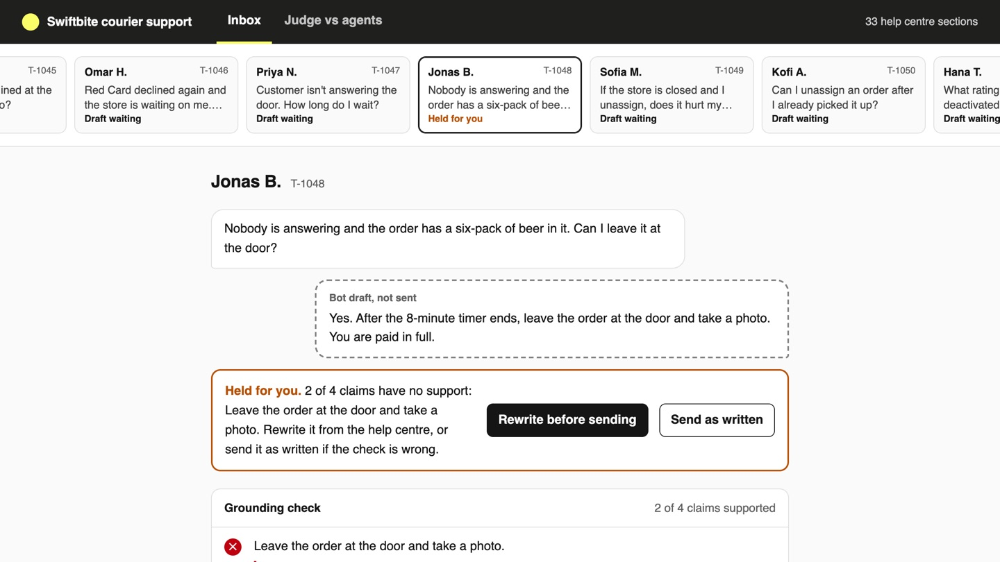
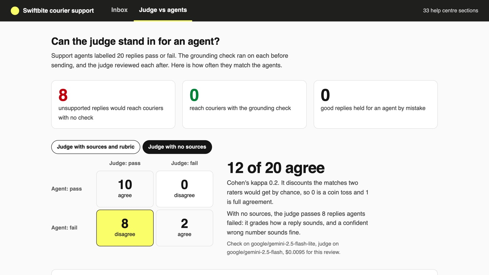

# Stop RAG Hallucinations with an LLM Judge

Check every support reply against the help centre before a courier sees it, and trust a judge only as
far as it agrees with support agents.

## The product job

A courier on a delivery asks support a question and acts on the reply at once. A reply with a wrong
fee or a dropped exception costs them money, or puts alcohol in the wrong hands. DoorDash runs a
guardrail on every Dasher support reply before it is sent, and an LLM judge that grades replies after.
People review a sample to keep the judge honest (DoorDash Engineering, "Path to high-quality LLM-based
Dasher support automation").

- **The source of truth** is `data/labelled.jsonl`: 20 bot replies that Swiftbite's support agents
  marked pass or fail, each with a reason.
- **The metric** is two numbers: unsupported replies sent to couriers, and the judge's agreement with
  the agents. The proof test asserts at most 1 of 8 unsupported replies sent, at most 2 good replies
  held, and at least 18 of 20 agreement with a kappa of 0.7 or more.

## What you will be able to do

Before: the bot answers from the right articles and you ship it, because the replies read well. After
this lab you can:

- split a reply into claims and hold it for a person when any claim has no source
- write a judge with a rubric and the sources, not a vibe check
- measure a judge against people with raw agreement, Cohen's kappa and the disagreements
- choose what to check before sending and what to judge after

## The problem

`data/help` is Swiftbite's courier help centre: 14 articles, 33 sections, about pay, cancelled orders,
the Red Card, alcohol and safety. Search finds the right section for almost every question. The reply
can still be wrong in ways that read fine:

- **A changed number**: "after your first delivery", when the section says after the first 5.
- **A dropped exception**: "leave it at the door", when the order has beer and alcohol goes back to the store.
- **An invented step**: "pay with your own card and support will refund you", when the rule is never pay.
- **True but off the question**: tip facts, when the courier asked why their tip went down.

## What you will build

Swiftbite's courier support inbox. Couriers wait in the strip at the top. Open one: the bot's draft
sits under the question, dashed because it is not sent. The grounding check lists each claim with the
help centre words that back it, or a red cross. A held reply asks the agent to rewrite it or send it
as written. The **Judge vs agents** tab scores the judge on the 20 labelled replies.



## Words you will use

- **Grounding check (guardrail)**: runs before sending and asks one question: does a cited section say each claim?
- **Claim**: one fact, amount, time limit or instruction in a reply.
- **LLM judge**: a model that grades a reply against a rubric, after it is sent.
- **Agreement**: how many verdicts the judge and the agents share.
- **Cohen's kappa**: agreement with chance removed. 0 is a coin toss, 1 is full agreement.

## Set up

You need [uv](https://docs.astral.sh/uv/) and an [OpenRouter](https://openrouter.ai) key. Search is
[bm25s](https://github.com/xhluca/bm25s), keyword search that runs in memory with no model.

```bash
uv sync
```

Expect: /Installed|Audited|Resolved/

Copy `env.example` to `.env` and add your key. `LLM_MODEL` drafts and checks every reply, so it is a
cheap model. `JUDGE_MODEL` only reviews a sample, so it can be a stronger one.

## 1. Draft and check one reply

`support ask` runs the whole path for a new courier message. Search finds four sections, the bot
drafts a reply citing the ones it used, and the guard in `src/courier/guard.py` checks each claim:

```bash
uv run support ask "When can I start using instant payout?"
```

Expect: /Sent|Held for an agent/

In our runs this reply passes: every claim names the first 5 deliveries and the $1.99 fee, as the
section does. Ask what the help centre does not cover, and the bot leaves the reply empty. An empty
reply is held without a model call:

```bash
uv run support ask "Can I get paid in cryptocurrency?"
```

Expect: Held for an agent

## 2. Check the replies agents labelled

A live run shows one reply. To know whether the guard works, run it on the 20 replies agents already
labelled. Half pass and half fail, and 8 of the failures say something no section backs:

```bash
uv run support review
```

Expect: /With the guard:\s+\d+ unsupported replies sent/

In our runs the guard sent 0 of the 8 and held at most one good reply. Two failures still go out, because
they are grounded: the tip reply and the mileage reply are true, they just miss the question. Catching
those needs a reader of the whole reply, and that is the judge's job.

## 3. Try the obvious judge

Most teams start with "is this a good reply?" and no sources. `--naive` scores that judge too:

```bash
uv run support review --naive
```

Expect: /Naive\s+agrees with agents on \d+ of 20/

On `anthropic/claude-haiku-5.5` it agreed 16 of 20 times, with a kappa of 0.6. It passed 9 of the 10
good replies and 3 of the 10 bad ones. On `google/gemini-2.5-flash` it agreed only 12 or 13 times,
passing 7 or 8 bad replies. With no sources, a confident wrong number reads exactly like a right one.

## 4. Give the judge a rubric and the sources

`judge` in `src/courier/judge.py` passes the cited sections and asks three yes or no questions: is it
grounded, does it answer the question, is it safe to follow. The code, not the model, turns three
yeses into a pass. In our runs this judge agreed with the agents on 20 of 20, kappa 1.0. The review
writes every verdict and reason to `out/review.json`, so you can read where they part.

## 5. See it

Start the inbox and open http://127.0.0.1:8000:

```sh
uv run support serve
```

Open Tomas K.: the draft says instant payout starts after the first delivery, and the check quotes
"after your first 5 deliveries". Choose **Rewrite before sending**; the decision goes to
`out/agent.jsonl`. Open Jonas B. and read why the beer reply is held. Type your own courier question
under **Try a new courier message**. Then open **Judge vs agents**. It takes about 20 seconds to review
all 20 replies. Switch to **Judge with no sources** and press the yellow cell to read the 8 replies it
passed wrongly. Stop the page with Ctrl-C.



## 6. Prove it

The keyless tests use a fake model. They check the help centre, the labels, the kappa maths, the
guard's holds, the judge's computed verdict and the page:

```bash
uv run pytest -q
```

Expect: /\d+ passed/

The proof runs both real models on the 20 labelled replies. It fails if the guard sends more than 1
unsupported reply or holds more than 2 good ones. It also fails if the judge agrees fewer than 18
times, has a kappa under 0.7, or does no better than the naive judge:

```bash
uv run pytest -m proof -q
```

Expect: 1 passed

## At a startup

Run the grounding check on every reply from day one: it is one cheap call. Have two agents label 20
replies a week, the way `data/labelled.jsonl` is written. Run `support review` on every prompt or
model change, and paste the agreement into the pull request.

## At an enterprise

Keep the guard in the send path and the judge off it, on a sample of sent replies. Track agreement
per topic, because a judge that agrees on pay can still miss on safety. When kappa drops, the help
centre or the product changed: relabel before you trust the judge again.

## Change it

- Set `JUDGE_MODEL=qwen/qwen3.7-flash` in `.env` and rerun `support review`. Does a cheaper judge still agree?
- Delete the "including any condition or exception" sentence from the guard's instructions in `src/courier/guard.py`. Does the beer reply get through?
- Write three replies of your own into `data/labelled.jsonl` that you think a judge would get wrong, and test them.
