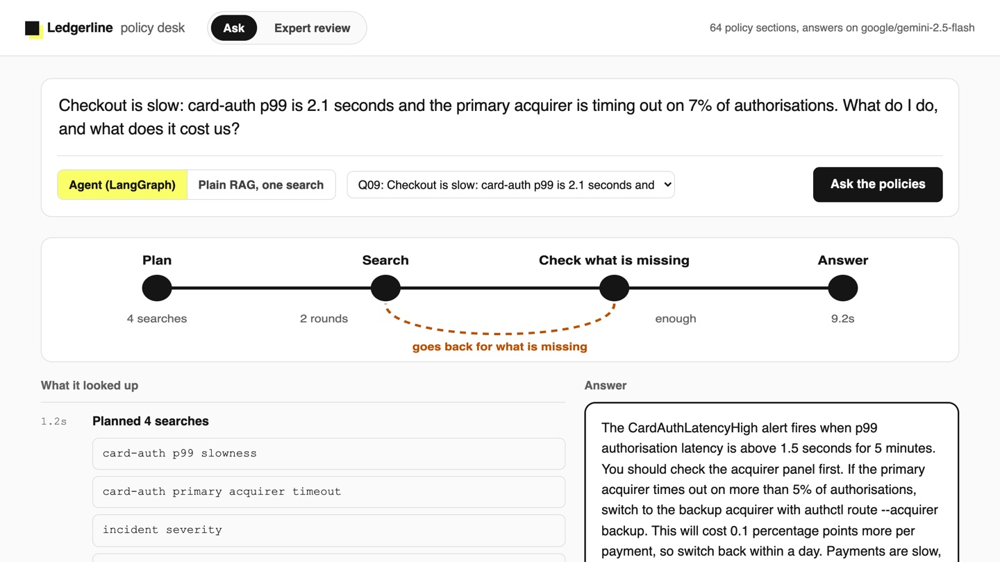
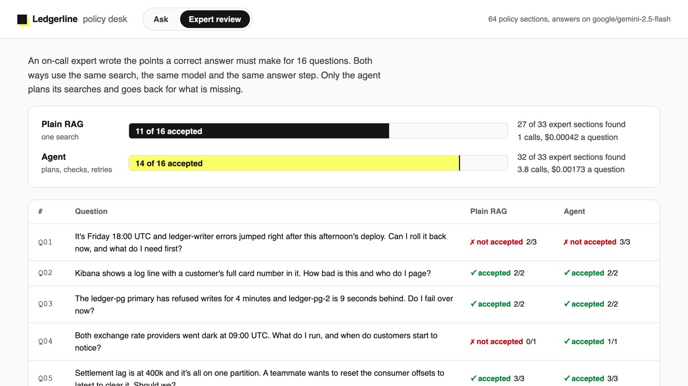

# Build Agentic RAG with LangGraph

Answer on-call policy questions that need more than one document, by letting the model plan its
searches and go back for what is missing.

## The product job

An on-call engineer at 3am asks one question, but the answer lives in two or three documents: the
service's runbook, the deploy freeze, the paging rule. Uber's on-call copilot started as plain RAG and
gave wrong advice when a question spanned documents. Its agentic version rewrites the question into
searches and checks what it found. That raised acceptable answers by 27% and cut incorrect advice by 60%
(Uber Engineering, "Enhanced Agentic-RAG: What If Chatbots Could Deliver Near-Human Precision?").

- **The source of truth** is `data/expert.jsonl`: 16 on-call questions. For each, an expert listed
  the sections a correct answer uses and the points it must make.
- **The metric** is the share of answers the expert's points accept. The proof test asserts the agent
  gets at least 14 of 16 accepted, more than plain RAG, and finds at least 30 of the 33 sections.

## What you will be able to do

Before: you embed the docs, search once with the user's question and answer, because that is what a
RAG tutorial does. After this lab you can:

- build a LangGraph graph with a loop: plan, search, check what is missing, search again, answer
- give an agent a budget and a no-progress stop, so a retry loop always ends
- stream each step of the graph to a page as it happens
- score plain RAG and an agent on the same questions, with the same search and the same model

## The problem

`data/docs` holds Ledgerline's 14 runbooks and policies as PDFs, 64 sections in all. Ask "It's
Friday 18:00 and ledger-writer errors began after this afternoon's deploy: can I roll it back?" One
search with those words finds the ledger-writer rollback section. It does not find the deploy policy,
which says a rollback in the Friday freeze needs two approvals. The question never says "freeze".

## What you will build

Ledgerline's on-call policy desk. Type a question, or pick one from the expert's set. The route
across the top is the graph: Plan, Search, Check what is missing, Answer, with a dashed loop back from
Check to Search. Each stop lights as the agent finishes it. The log below shows every search, with
newly found sections in yellow. The answer on the right cites each section by number. When the
policies do not cover a question, it goes to the policy owners instead of guessing.



## Words you will use

- **Plain RAG**: one search with the user's words, then an answer from what came back.
- **Agentic RAG**: the model decides what to search for, reads the results, and searches again for what is missing.
- **Graph**: the steps as nodes and the moves between them as edges. LangGraph runs it.
- **State**: what the graph carries from step to step: the question, the searches, the sections found.
- **Reducer**: how a step's output joins the state, such as adding new sections to the ones already found.

## Set up

You need [uv](https://docs.astral.sh/uv/) and an [OpenRouter](https://openrouter.ai) key. Search is
[bm25s](https://github.com/xhluca/bm25s), keyword search in memory, the same for both ways of
answering. A stemmer makes "deploys" in a policy match "deploy" in a search.

```bash
uv sync
```

Expect: /Installed|Audited|Resolved/

Copy `env.example` to `.env` and add your key. `LLM_MODEL` plans, checks and answers. `JUDGE_MODEL`
grades answers against the expert's points.

## 1. Ask with plain RAG

`src/policy/plain.py` searches once with the question and answers from the top 4 sections:

```bash
uv run policy ask --plain "Product wants the new checkout flag turned on for every merchant on Saturday morning. Is that allowed?"
```

Expect: /Cited:/

It finds the feature flag rule, which says a flag change "follows the freeze". It does not find the
freeze window itself, so nothing in front of the model says whether Saturday is inside it. Some runs
say they cannot tell; others guess.

## 2. Ask the agent

`src/policy/graph.py` is the graph. `plan` writes up to four searches in the runbooks' own words.
`check` reads what was found and names what is still missing. The edge after `check` is code: search
again while there is something missing and budget left, otherwise answer.

```bash
uv run policy ask "Product wants the new checkout flag turned on for every merchant on Saturday morning. Is that allowed?"
```

Expect: /model calls/

Read the trace. The planner searched for the freeze window as well as the flag rule, so the answer
says no: Saturday is inside the freeze from Friday 16:00 to Monday 08:00 UTC.

## 3. Score both on the expert's questions

One answer proves nothing. `policy review` runs both ways on all 16 questions and grades each answer
against the expert's points. It takes about a minute:

```bash
uv run policy review
```

Expect: /agentic\s+\d+ of 16/

In our run on `openai/gpt-6-luna`, graded by `anthropic/claude-haiku-5.5`, plain RAG was accepted on 8
of 16 and the agent on 14 of 16. The agent had all 33 sections the expert used in front of it, against
26 for plain RAG. It cost about 3 model calls a question instead of 1, under a tenth of a cent. `out/review.json` holds every answer and grade, and each miss names the expert's point it missed.

## 4. See it

Start the desk and open http://127.0.0.1:8000:

```sh
uv run policy serve
```

Pick Q09 from the expert's set and press **Ask the policies**. The question is about slow card
payments, and the plan adds a search for incident severity, which holds the paging command. When the
check finds a section missing, the loop goes back for it. The expert's points appear under the answer
with a tick for each point made. Switch to **Plain RAG, one search** and ask again. Then open **Expert
review** and press any row to read both answers side by side. Stop the page with Ctrl-C.



## 5. Prove it

The keyless tests use a fake model. They check the loop, the round budget, the no-progress stop, the
grading and the streamed page:

```bash
uv run pytest -q
```

Expect: /\d+ passed/

The proof runs both ways on a real model. It fails if the agent is accepted fewer than 14 times, is
not ahead of plain RAG, or finds fewer than 30 of the expert's sections:

```bash
uv run pytest -m proof -q
```

Expect: 1 passed

## At a startup

Start with plain RAG and an expert set of 15 questions that each need two documents. Move to the agent
only when the review shows plain RAG missing sections, as it does here. Keep the round budget at 3:
each round costs two calls and two seconds.

## At an enterprise

Run the review on every prompt, model or document change, and block the change when acceptance drops.
Log each run's searches with the answer, because a wrong answer is usually a missing search. Send
every uncovered question to the document owners; those are the gaps to write next.

## Change it

- Set `MAX_ROUNDS = 1` in `src/policy/graph.py` and rerun `policy review`. How many answers does the retry earn?
- Delete the "Add a search for each policy the situation triggers" sentence from `PLAN`. Which questions fail?
- Remove `stemmer=STEM` from both calls in `src/policy/search.py` and rerun `policy review`. Which sections stop being found?
- Write two questions of your own into `data/expert.jsonl` that need three documents, and test both ways.
