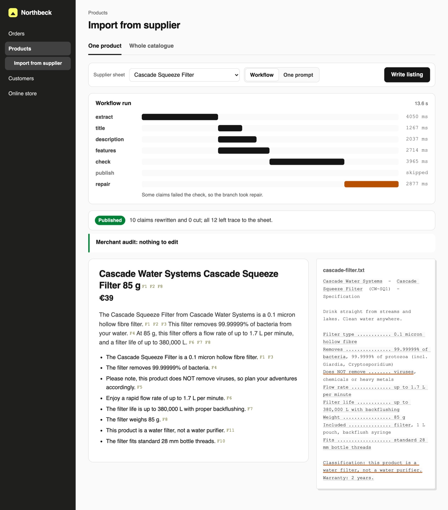
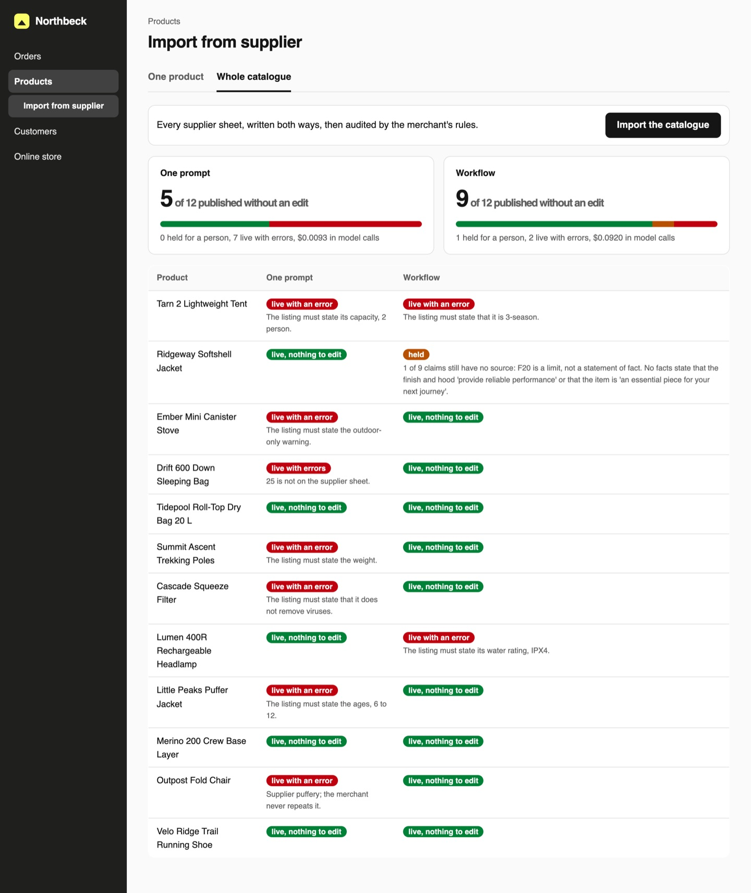

# Build an AI Workflow with Mastra

Turn a supplier spec sheet into a product listing in chained steps, with every claim checked against
the sheet before it goes live.

## The product job

Northbeck Outdoor sells tents, jackets and stoves from dozens of suppliers. Each product arrives as a
spec sheet: a table of facts, plus the supplier's own marketing lines. A merchandiser turns it into a
listing by hand. Shopify Magic writes product descriptions from the details a merchant gives it, and
every store now wants the same for its whole catalogue. The danger is a listing that sells something
the sheet never said: "waterproof" on a softshell, or a filter with no virus warning.

- **The source of truth** is the supplier sheet in `data/sheets/`. Northbeck's merchandisers wrote
  their audit for each product into `data/merchant.jsonl`: what a listing must say, and what it must never say.
- **The metric** is the share of listings published without an edit. The proof test asserts the
  workflow gets at least 8 of 12, more than one prompt does, with at most 3 live with an error.

## What you will be able to do

Before: you paste the sheet into one prompt and publish what comes back, because it reads well. After
this lab you can:

- chain steps in a Mastra workflow, where each step has a typed input and output
- run independent steps in parallel, and branch on a result in code
- pass facts between steps instead of raw text, so a writer can only use what was extracted
- check model output in code first, then with a model, and repair only what failed
- measure both ways on a whole catalogue with a merchant's audit written in code

## The problem

The Ridgeway softshell sheet says "Wind? Rain? Bring it on." in its marketing lines. The spec table
says the finish is water-resistant and the seams are not taped. One prompt sees both. It writes in
the store's voice and it reads well. In our runs it published 6 to 9 of 12 listings that needed no
edit, on both models we tried. The rest went live with something the merchant had to take back, such
as a stove's outdoor-only warning left out.

## What you will build

Northbeck's admin page for importing from a supplier. Pick a sheet and write its listing. The run
panel draws each step as a bar on one clock: extract, then the three writers side by side, then check,
then the branch to publish or repair. The product page shows each claim with the fact ids it cites.
Click a claim and its words light up on the supplier sheet beside it. A sentence the repair could not
source is shown struck out. A listing still in doubt is held, with **Publish anyway** and **Edit before
publishing** for a merchandiser.



## Words you will use

- **Workflow**: steps in a fixed order that code declares. The model fills in each step; it never picks the next one.
- **Step**: one small job with a typed input and output, such as "extract the facts".
- **Parallel**: steps that need the same input and not each other, run at the same time.
- **Branch**: the workflow picks the next step from a condition in code, such as "every claim passed".
- **Fact**: one thing the sheet states, with the sheet's exact words as its quote.
- **Limit**: a fact a buyer must know, such as "not for snow" or "do not use indoors".

## Set up

You need Node 22 and an [OpenRouter](https://openrouter.ai) key. [Mastra](https://mastra.ai) runs the
workflow and calls the model through its model router.

```bash
npm ci
```

Expect: /added \d+ packages|up to date/

Copy `env.example` to `.env` and add your key. `LLM_MODEL` is the model every step uses.

## 1. Write one listing

`src/workflow.ts` is the workflow. `extract` pulls facts from the sheet and drops any whose quote is
not on it. `title`, `description` and `features` see only those facts, so the marketing lines cannot
reach them. `check` tests each claim in code, then asks the model about the rest:

```bash
npm run -s listing -- write tarn-2p-tent
```

Expect: /start\s+features/

Read the times. The three writers start within a millisecond of each other: that is `.parallel()`.
Each claim prints the facts it cites, and the merchant's audit runs last.

## 2. Write it with one prompt

`src/onePrompt.ts` is the way most teams start: the whole sheet in, the whole listing out.

```bash
npm run -s listing -- write cascade-filter --one-prompt
```

Expect: /Merchant audit/

It costs a tenth of the workflow and reads well. Nothing checks it, so whether it states the virus
warning depends on the run. Run it three times and compare the audit lines.

## 3. Import the whole catalogue

One listing proves nothing. `listing review` writes all 12 sheets both ways and audits each one. It
takes about a minute:

```bash
npm run -s listing -- review
```

Expect: /workflow\s+published without an edit: \d+ of 12/

In our run on `openai/gpt-6-luna` one prompt published 8 of 12 without an edit and put 4 live with an
error. The workflow published 9 of 12, held 1 for a person, and put 2 live with an error. It cost about
a fifth of a cent a listing against a fiftieth.

On `google/gemini-2.5-flash` the workflow did a little better, 10 or 11 of 12 with at most 1 wrong, at
four times the price: 0.7 to 0.9 of a cent a listing. `out/review.json` holds every listing and every
edit.

## 4. See it

Start the import page and open http://127.0.0.1:8000:

```sh
npm run -s listing -- serve
```

Pick the Ridgeway Softshell Jacket and press **Write listing**. Watch the writers run side by side.
Click a feature and find its quote on the sheet. Switch to **One prompt** and write it again: no claim
cites anything. Then open **Whole catalogue** and press **Import the catalogue** to watch both ways land
row by row. Stop the page with Ctrl-C.



## 5. Prove it

The keyless tests use a fake model. They check the code checks, the parallel writers, both branches,
the cut and the hold, the merchant's audit and the page's local-only server:

```bash
npm test
```

Expect: /\d+ passed/

The proof imports the catalogue on a real model. It fails if the workflow publishes fewer than 8 of
12 without an edit, is not ahead of one prompt, or puts more than 3 live with an error:

```bash
npm run proof
```

Expect: /1 passed/

## At a startup

Start with one prompt and a merchant's audit in code on 20 real products. Move to the workflow when
the audit finds claims the sheet never made. Keep the steps few: each one is a call and a second.

## At an enterprise

Keep the merchant's rules as data that merchandisers own. Send every held listing to a person, and
log the choice, as the **Publish anyway** button does. Rerun the import on every prompt or model
change, and block the change when clean listings drop.

## Change it

- Remove `.slice(0, 3)` from the description in the `check` step and rerun `listing review`. What happens to the descriptions?
- Delete `missingLimits` from `check` and rerun `listing review`. Which warnings go missing?
- Give the writers the whole sheet instead of `listFacts(...)`. How many listings still pass the audit?
- Write a supplier sheet of your own into `data/sheets/`, with a rule row in `data/merchant.jsonl`, and import it both ways.
