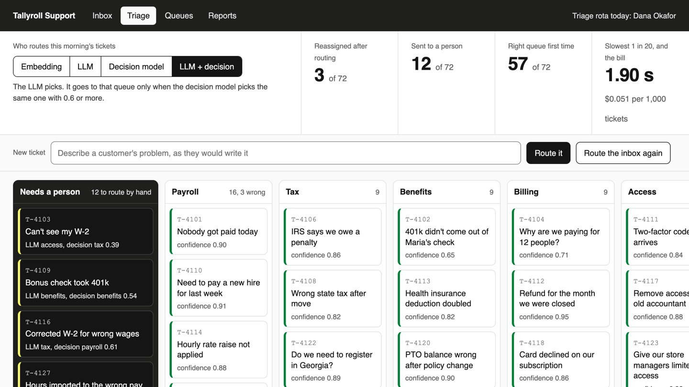

# Route Requests with LLM Classification

Send each support ticket to the queue that can solve it, and send the ones in doubt to a person,
using a model whose confidence you can trust.

## The product job

Tallyroll runs payroll for small US businesses. Every morning its helpdesk gets tickets about pay
runs, tax forms, benefits, its own bill, sign-in and connected apps. Six teams each own one of those
queues. A ticket in the wrong queue waits, gets read by the wrong team, then gets moved. Zendesk's
intelligent triage predicts each ticket's intent with a confidence level, so routing rules can act
only on the confident ones. Every helpdesk now wants the same.

- **The source of truth** is the queue each ticket was finally solved in. `data/inbox.jsonl` holds
  this morning's 72 tickets with that queue, which no router sees. 12 of them are vague or describe
  the wrong thing.
- **The metric** is the share of tickets reassigned after routing. The proof test asserts the LLM with
  a decision model's second opinion reassigns at most 5 of 72, and sends at most 18 to a person.

## What you will be able to do

Before: you ask an LLM to pick a queue and say how sure it is, and you trust the number. After this
lab you can:

- route by similarity to past tickets with an embedding model, with no model call
- route with an LLM and structured output, so the answer is always one of your queues
- ask a decision model one choice question and read a probability for every queue
- send a ticket to a person when the probability is low, and see why an LLM's own number cannot do that
- combine the LLM and the decision model, and count reassignments, hand-offs, speed and cost for each

## The problem

T-4169 says "We're hiring someone who'll live in New Jersey and come into our New York office twice
a week." Nothing in it says tax, but it was solved by the tax team: two states means two withholding
setups. An LLM picks a queue and writes a confidence above 0.9 for almost every ticket, right or wrong. In our runs it never sent one ticket to a person, so every wrong pick landed in a queue.

## What you will build

Tallyroll's triage board. Each queue is a lane, and the first lane, **Needs a person**, belongs to
whoever is on the triage rota. A switch at the top picks the router. Change it and every ticket slides
to its new lane. The score above counts tickets reassigned, sent to a person and right first time.
A card with a red edge went to the wrong queue and says where it moved to.

Open a ticket to see what the LLM said and the decision model's probability for every queue, with
0.6 marked. A ticket in the person lane shows the six queues as buttons: you pick one, and your choice
is logged for the next routing review.



## Words you will use

- **Queue**: a team's list of tickets. Routing is picking the queue.
- **Reassigned**: a ticket routed to a queue, then moved by an agent because another team had to solve it.
- **Decision model**: a model trained to answer choice, score and yes-or-no questions, not to write
  prose. It returns a probability for each choice.
- **Calibrated**: when the model says 0.7, it is right about 7 times in 10. A threshold only works on
  a calibrated number.
- **System One**: the request format a decision model takes: the situation as text, plus named
  questions, each with its choices and what each means.
- **Human in the loop**: the person on the triage rota, who routes the tickets the routers doubt.

## Set up

You need [uv](https://docs.astral.sh/uv/) and an [OpenRouter](https://openrouter.ai) key. The
embedding router uses [FastEmbed](https://github.com/qdrant/fastembed) on the CPU. The decision model
is [Strands Decider](https://huggingface.co/StrandsAgents/strands-decider-2B-hobson-v19), a 2B open
model that runs on your laptop.

```bash
uv sync
```

Expect: /Installed|Audited|Resolved/

Copy `env.example` to `.env` and add your key. The first call to the decision model installs it and
downloads about 4 GB of weights. After that it takes about 30 seconds to start, and `triage` starts
and stops it for you. If it will not start, `uv run triage decider` runs it in the foreground with its log.

## 1. Route one ticket three ways

`src/triage/embed.py` finds the five past tickets most like this one and lets them vote.
`src/triage/llm.py` asks the LLM for a queue and a confidence as JSON. `src/triage/decide.py` asks the
decision model one choice question, built from the routing guide in `data/queues.json`:

```bash
uv run triage route "We're hiring someone who will live in New Jersey and come into our New York office twice a week. Anything we need to do before she starts?"
```

Expect: /Decision model, every queue:/

Read the confidence column. The LLM's number is one it wrote. The decision model's is its probability
for that queue, and the bars below show the other five. When it is unsure, the bars are close.

## 2. Route the whole inbox

One ticket proves nothing. `triage review` routes all 72 tickets with each router, then scores each
against the queue the ticket was solved in. The decision model takes a few seconds a ticket on a
laptop, so this takes about five minutes:

```bash
uv run triage review
```

Expect: /LLM \+ decision\s+\d+/

In our run on 72 tickets:

| Router | Reassigned | To a person | Right first time | Slowest 1 in 20 | Cost per 1,000 |
| --- | --- | --- | --- | --- | --- |
| Embedding | 9 | 25 | 38 | 0.11 s | none |
| LLM | 2 | 0 | 70 | 4.1 s | $0.07 |
| Decision model | 5 | 10 | 57 | 4.6 s | none |
| LLM + decision | 2 | 13 | 57 | 4.9 s | $0.07 |

The LLM picks the right queue most often, but its confidence never fell under 0.6, so it sent nobody
to a person. The decision model's probability did fall, and 5 of its 10 hand-offs were wrong picks it
caught. Together, the LLM picks and the decision model must agree. On `openai/gpt-6-luna` that
reassigned 2 tickets, the same as the LLM alone, and cost 13 tickets for the triage rota. On the
weaker `google/gemini-2.5-flash` the LLM alone reassigned 4 and the pair 3. The pair is insurance for
the day the model or the tickets change, and a person sees why each one was held.

`out/review.json` holds every ticket, every pick and every probability.

## 3. See it

Start the board and open http://127.0.0.1:8000:

```sh
uv run triage serve
```

Switch between the four routers and watch tickets move lanes. Open a red-edged card in **LLM** to
see a confident wrong pick. Switch to **LLM + decision** and open T-4169 in **Needs a person**:
the bars show why the decision model doubted. Pick its queue. Type a ticket of your own into **New
ticket** and press **Route it**. Stop the page with Ctrl-C.

## 4. Prove it

The keyless tests use fakes for every model. They check the threshold, the second opinion, the System
One request, the review counts and the page's local-only server:

```bash
uv run pytest -q
```

Expect: /\d+ passed/

The proof routes the inbox with the real LLM and decision model. It fails if the LLM alone sends more
than 3 to a person, if the decision model catches no wrong pick, or if the pair reassigns more than 5
or hands more than 18 to a person:

```bash
uv run pytest -m proof -q
```

Expect: 1 passed

## At a startup

Start with the LLM and structured output, and log the queue each ticket was finally solved in. That
log is your truth. Add the decision model's second opinion when reassignments cost more than the
triage rota's time. It runs on your own machine, so no ticket text leaves for it.

## At an enterprise

Pick the threshold from the review, not by feel: raise it and count hand-offs against reassignments.
Feed the triage rota's choices back into the history, so the routing guide and the past tickets keep
up with new products. Rerun the review on every model or guide change, and block the change when
reassignments rise.

## Change it

- Set `CONFIDENT = 0.8` in `src/triage/route.py` and rerun `triage review`. How many more tickets reach a person, and how many reassignments do you save?
- Rewrite the `tax` line in `data/queues.json` to mention "employees in another state". Does T-4169 still go to a person?
- Set `NEIGHBOURS = 1` in `src/triage/embed.py`. What happens to the embedding router's confidence?
- Write five vague tickets of your own into `data/inbox.jsonl`, with the queue that would solve each, and compare the routers.
