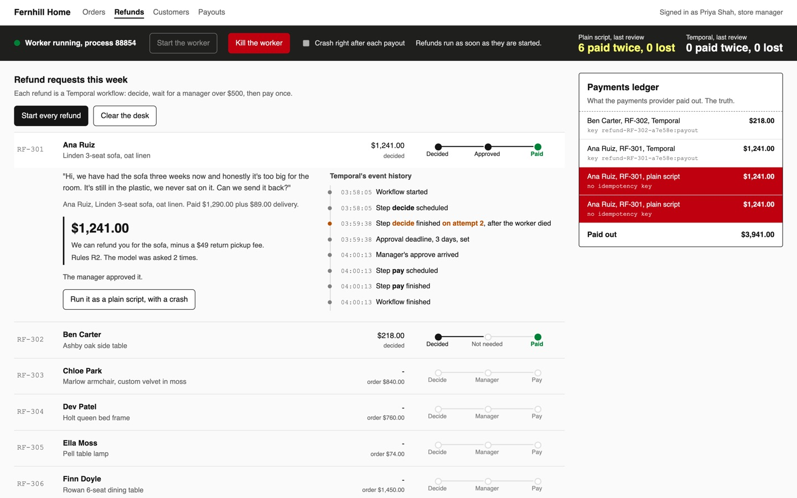

# Make an AI Workflow Survive a Crash

Run a refund that waits days for a manager's approval and pays out exactly once, even when the
process running it dies at the worst moment.

## The product job

Fernhill Home sells furniture online. A customer writes in about a damaged sofa or a late delivery,
and a refund agent reads the message against the refund policy and decides an amount. Any refund
over $500 waits for a store manager, sometimes for days. Then the payments provider sends the money.
Coinbase moves money and Netflix runs its encoding pipeline on Temporal for the same reason: a step
that moved money must never run twice after a crash.

- **The source of truth** is the payments ledger, the provider's record of every payout. Finance
  also ruled on each of the 8 refund requests in `data/requests.jsonl`, so the ledger can be checked
  against the right amount.
- **The metric** is refunds paid twice or lost after a crash. The proof test kills the worker right
  after every payout and asserts zero of each.

## What you will be able to do

Before: your AI step is a script, and a deploy or a crash halfway through means you rerun it and hope.
After this lab you can:

- see why rerunning a plain script pays a refund twice and asks the model again
- write the refund as a Temporal workflow: decide, wait for a manager, pay
- keep the model call and the payout in activities, whose results Temporal records in the history
- wait days for a human in the loop with one line, and escalate when the deadline passes
- give the payment an idempotency key, so a retried payout is not a second payout
- kill the worker mid-refund and watch a new worker carry on from the history

## The problem

A refund is three steps: the model decides an amount, a manager approves it, the provider pays.
Written as a plain script, the state lives in the process. If it dies right after the provider paid
but before anything was saved, nobody knows the money moved. The operator runs it again, as anyone
would. The script asks the model again, which may decide a different amount, and pays again.

An idempotency key on the payment alone does not fix this. The rerun asks the model again, and the
wait for the manager was a loop in the dead process. You need the whole refund to remember where it
was.

## What you will build

Fernhill's refund approvals back office. A dark strip at the top is the worker: the process that runs
refunds. It has a **Kill the worker** button that sends SIGKILL, as a pulled plug would. Below it, each refund
request has a stage track, from deciding to waiting for a manager to paid.

Open a refund to see the model's decision and the policy rules it cited. A refund over $500 shows a
manager's **Approve** and **Reject** panel. Temporal's event history for that refund sits beside it.
On the right, the payments ledger reads like a bank statement. A refund paid twice by the same
program shows in red. **Run it as a plain script, with a crash** pays the same refund the naive way,
so both stories land in one ledger.



## Words you will use

- **Workflow**: the refund as code that Temporal runs to the end, through crashes and restarts.
- **Activity**: a step that touches the outside world, here the model call and the payout. Temporal
  records its result once it returns.
- **Event history**: the server's record of every step a workflow started and finished. A new worker
  replays it to carry on.
- **Worker**: your process that runs workflows and activities. You can kill it; the workflow lives on
  the server.
- **Signal**: a message sent into a running workflow, here the manager's approval.
- **Idempotency key**: an id sent with the payment, so the provider pays it once however often it is asked.
- **Human in the loop**: the store manager, who approves every refund over $500.

## Set up

You need [uv](https://docs.astral.sh/uv/) and an [OpenRouter](https://openrouter.ai) key. The
[Temporal Python SDK](https://docs.temporal.io/develop/python) starts a local Temporal dev server for
you on first use, with its web UI on http://127.0.0.1:8233. [Restate](https://restate.dev) gives the
same guarantees with a different model, and is worth a look once this one makes sense.

```bash
uv sync
```

Expect: /Installed|Audited|Resolved/

Copy `env.example` to `.env` and add your key. To use Temporal Cloud or your own server, set
`TEMPORAL_ADDRESS`.

## 1. Pay a refund the plain way, and crash

`src/refunds/naive.py` decides, waits for a manager if the amount is over $500, then pays. RF-302 is
a damaged side table, $218 under rule R1. The first run crashes right after the payout. The second
run is the operator trying again:

```bash
uv run refund naive RF-302 --crash-after-pay
uv run refund naive RF-302
uv run refund ledger
```

Expect: /RF-302 .*naive .*\n.*RF-302 .*naive /

Two payouts of $218 for one side table, and the model was asked twice. Nothing in the second run
could know the first had paid.

## 2. Run the same refund as a workflow, and crash

`src/refunds/workflow.py` holds `RefundWorkflow`. The model call and the payout are activities in
`Steps`. The payout sends the workflow id as its idempotency key. This run kills the worker right
after the payout, then starts a new one:

```bash
uv run refund run RF-302 --crash-after-pay
uv run refund ledger
```

Expect: /RF-302 .*durable\s+refund-RF-302:payout/

The decision was already in the history, so the new worker did not ask the model again. The payout
had no recorded result, so Temporal retried it. The provider saw the same key and returned the first
payout. One payout, marked durable.

## 3. Crash all eight

`refund review` runs every request both ways, with the worker killed right after each payout. The
manager approves every refund that asks. Then the ledger is scored against finance's rulings:

```bash
uv run refund review
```

Expect: /durable\s+0\s+0\s+/

In our run on 8 refunds, $3,901 due in total:

| Way | Paid twice | Lost | Paid the right amount | Model calls | Dollars out |
| --- | --- | --- | --- | --- | --- |
| Plain script | 6 | 0 | 0 of 6 | 14 | $8,846 |
| Temporal workflow | 0 | 0 | 5 of 6 | 13 | $4,423 |

The plain script paid every refund it reached twice. The workflow paid each once, though the worker
died 6 times. Its 5 extra model calls were decide steps still running in the worker when it died.
They had no result to record, so Temporal ran them again. A finished decision was never asked again.

Paying the right amount is a separate question: one decided amount did not match finance's ruling.
Durability keeps a decision; it does not make it right.

## 4. See it

Start the back office and open http://127.0.0.1:8000:

```sh
uv run refund serve
```

Tick **Crash right after each payout** and press **Start the worker**. Open RF-302 and press **Start
this refund**. It pays, the worker dies, and the strip turns red. Press **Start the worker** again and
watch nothing pay twice. Start RF-301: it waits for you. Press **Approve** and read its event
history. Then press **Run it as a plain script, with a crash** on RF-301 and watch the red rows land
in the ledger. Stop
the page with Ctrl-C.

## 5. Prove it

The keyless tests use a fake model and Temporal's time-skipping test server, so three days of waiting
pass in a second. They check the idempotency key, the wait, the escalation, the crash retry and the
page's local-only server:

```bash
uv run pytest -q
```

Expect: /\d+ passed/

The proof runs the review on the real model with a real worker killed after every payout. It fails if
the workflow pays any refund twice or loses one, or if the model was asked more often than the history
records. It also fails if no worker died, or if the plain script never paid twice:

```bash
uv run pytest -m proof -q
```

Expect: 1 passed

## At a startup

Start with the Temporal dev server or Temporal Cloud and one worker. Put every model call and every
call that moves money in an activity, and send the workflow id as the idempotency key. Keep the
workflow code itself free of clocks, randomness and network calls, so a replay takes the same path.

## At an enterprise

Run workers as a deployment that can be killed at any time, and alert on workflows waiting past their
deadline. Version workflow code before changing a running workflow's steps. Reconcile the provider's
ledger against the workflows every day: a payout with no workflow, or a workflow with two payouts, is
an incident.

## Change it

- Set `APPROVAL_DEADLINE = timedelta(minutes=1)` in `src/refunds/workflow.py`, start RF-301 on the desk and wait. What does the stage track show?
- Remove the `key` from `Steps.pay`, pass `None` instead, and rerun step 2. What does the ledger show now?
- Raise `ThreadPoolExecutor(4)` to 8 in `src/refunds/cli.py` and rerun the review. Do model calls go up or down, and why?
- Add a rule R7 to `data/policy.md` and a request that needs it. Does the model cite it?
