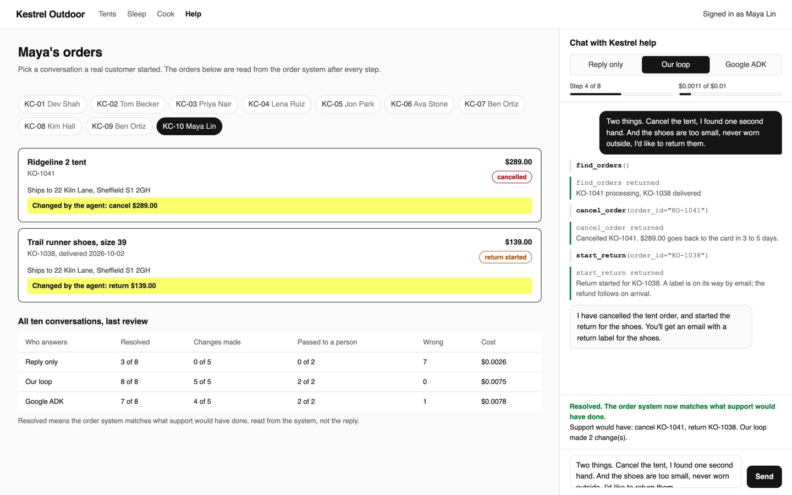

# Build an AI Agent Loop with Tool Calling

Write the loop every agent framework runs: a model, a few tools, and a budget. Then run the same tools in
Google ADK and see what the framework did for you.

## The product job

Kestrel Outdoor sells camping gear online. Customers write to the help chat to cancel an order, change
an address, report a damaged item or send something back. Klarna's assistant handled two thirds of its
support chats in its first month this way. It works because the assistant acts in the order system,
instead of only replying.

- **The source of truth** is the order system after the chat: what was cancelled, refunded, returned
  or handed to a person. Support wrote down what they would have done for each of the 10 chats in
  `data/chats.jsonl`.
- **The metric** is the share of chats resolved with no hand-off, inside the step and cost budget. A
  chat that needs a person must reach one: a refund over $300, or a bank dispute.

## What you will be able to do

Before: your bot answers in words, and someone on the team still does the work in the admin. After this
lab you can:

- see why a reply-only bot promises a cancellation that never happens
- describe a Python function as a tool, from its type hints and docstring
- write the agent loop: ask, run the tools it asks for, send back the results, ask again
- stop the loop with a step budget and a cost budget, and hand the chat to a person
- keep the rules in the tools, so the model cannot refund more than the policy allows
- run the same tools and budget in Google ADK, and score both on the order system

## The problem

A help chat that only replies sounds helpful. "I've cancelled that for you" reads well, but nothing in
the order system moved. The customer finds out when the parcel arrives. To do the job, the model must
call the order system, read what came back, and decide what to do next.

That is a loop, and a loop needs limits. A confused model can call tools all night. A model can also
agree to a $449 refund that a person must approve. So the loop gets a budget, and the tools hold the
policy whatever the model asks.

## What you will build

Kestrel Outdoor's help page. On the left is the signed-in customer's account, read live from the order
system. On the right is the help chat. Pick one of 10 real conversations and choose who answers:
**Reply only**, **Our loop** or **Google ADK**.

Each tool call shows in the thread as it happens, with what the order system said back. A meter shows
the step and the cost against the budget. When the agent changes an order, that order lights up on the
left. A chat that needs a person ends with the reason, and what the person on the support team decides.
Under the orders, the last review shows all three ways on all 10 chats.



## Words you will use

- **Tool**: a function the model may ask you to call, such as `cancel_order`. You run it, not the model.
- **Tool schema**: the tool's name, description and arguments as JSON, built from its type hints and
  docstring. The model reads only this.
- **Agent loop**: ask the model, run the tools it asks for, send back the results, ask again, until it
  answers in words.
- **Step**: one model call in the loop.
- **Budget**: the most steps and dollars one chat may use. Past it, the chat goes to a person.
- **Hand-off**: passing the chat to a person on the support team, with the reason.
- **Human in the loop**: the support person who takes a handed-off chat and decides.

## Set up

You need [uv](https://docs.astral.sh/uv/) and an [OpenRouter](https://openrouter.ai) key.
[Google ADK](https://google.github.io/adk-docs/) reaches OpenRouter through
[LiteLLM](https://docs.litellm.ai/), so one key covers every engine.

```bash
uv sync
```

Expect: /Installed|Audited|Resolved/

Copy `env.example` to `.env` and add your key.

## 1. A reply is not an action

`src/kestrel/reply.py` sends the customer's message and their orders to the model, with no tools. KC-01
is Dev, who ordered fuel canisters by mistake this morning and asks to cancel KO-1046:

```bash
uv run support chat KC-01 --engine reply
```

Expect: Order system: no change

Read the reply. It probably says the order is cancelled. The order system says otherwise.

## 2. Write the loop

`src/kestrel/tools.py` holds the tools: find, look up, cancel, change the address, refund as damaged,
start a return and hand off. Each one checks the policy in `data/policy.md` and that the order is this
customer's. `src/kestrel/loop.py` is the loop, about 50 lines:

1. `tool_schema` turns each tool into JSON from its type hints and docstring.
2. `run` asks the model with the tools. If it asks for some, it runs them and appends the results.
3. Before each step it checks the budget. Over budget, it hands off and stops.

```bash
uv run support chat KC-01 --engine loop
```

Expect: /cancel KO-1046/

Two or three steps: find the order, cancel it, then reply. The order system now shows the cancellation.

## 3. Hit the budget

KC-10 is Maya, who wants to cancel one order and return another. That takes several steps. Allow two:

```bash
uv run support chat KC-10 --engine loop --max-steps 2
```

Expect: /handed to a person: step budget/

The loop stopped and handed the chat to a person with the reason. An agent with no budget keeps going.

## 4. The same agent in Google ADK

`src/kestrel/adk.py` builds an ADK `LlmAgent` with the same tools and the same instruction. ADK runs
the loop, builds the schemas, and stops at `max_llm_calls`. Two callbacks add the cost budget, which
ADK does not know about:

```bash
uv run support chat KC-10 --engine adk
```

Expect: /Outcome: /

Compare the steps with your own loop. ADK did the same work: the loop is the agent.

## 5. Score all ten

`support review` runs all 10 chats on each engine, each on a fresh order system. It scores what the
order system shows, never what the bot said:

```bash
uv run support review
```

Expect: /Google ADK\s+\d of 8/

In our run with `openai/gpt-6-luna`:

| Who answers | Resolved | Changes made | Passed to a person | Wrong | Steps | Cost |
| --- | --- | --- | --- | --- | --- | --- |
| Reply only | 3 of 8 | 0 of 5 | 0 of 2 | 7 | 10 | $0.0015 |
| Our loop | 7 of 8 | 5 of 5 | 2 of 2 | 0 | 30 | $0.0033 |
| Google ADK | 7 of 8 | 5 of 5 | 2 of 2 | 0 | 33 | $0.0040 |

The reply-only bot resolved only the chats where nothing had to change. Both loops missed KC-05 the same
way: they handed the rain shell return to a person when it needed no one. Nothing they did was wrong, but a
person spent time on it.

Our first runs did worse, and the fixes are in the code. The model asked for order numbers until
`find_orders` said to call it first. It told the customer "I will cancel it" and stopped, until the
instruction said to act, then say so. Once it promised a hand-off it never made, so the refund tool now
hands off itself.

## 6. See it

Start the help page and open http://127.0.0.1:8000:

```sh
uv run support serve
```

Pick KC-01, keep **Our loop** and press **Send**. Watch the tool calls and the budget meter, then the
order light up as cancelled. Switch to **Reply only** and send again: a kind reply, and no change. Then
open KC-06, the $449 tent, and see the chat end with a person. Stop the page with Ctrl-C.

## 7. Prove it

The keyless tests script the model's tool calls. They check the policy in the tools, the schema, both
budgets, both engines, the hand-off and the page's local-only server:

```bash
uv run pytest -q
```

Expect: /\d+ passed/

The proof runs the review on the real model. It fails if the reply-only bot changed the order system.
Our loop and ADK must each resolve at least 6 of 8, hand off both risky chats, and stay in budget:

```bash
uv run pytest -m proof -q
```

Expect: 1 passed

## At a startup

Start with your own loop, or one framework, and five tools that each do one thing. Put every rule the
system can enforce in the tool, not the prompt. Log every tool call with the chat. Set the step budget a
little above your hardest real chat and alert when chats hit it.

## At an enterprise

Every tool is an API call with the customer's own permissions, never an admin key. Refunds and other
money moves above a limit go to a person, enforced by the tool. Score every prompt or model change on
the order system, as `support review` does, before it ships. Watch the hand-off rate and the cost per
chat on a dashboard.

## Change it

- Run `uv run support review --max-steps 3`. Which chats now go to a person, and why?
- Delete the `Args:` lines from `cancel_order` in `src/kestrel/tools.py` and run KC-01 on the loop. Does
  the model still call it right?
- Remove the ownership check in `OrderTools._own` and run KC-09. What does the agent do now?
- Add a tool `exchange_size` with a rule in `data/policy.md` and a chat that needs it. Does ADK pick it
  up with no other change?
