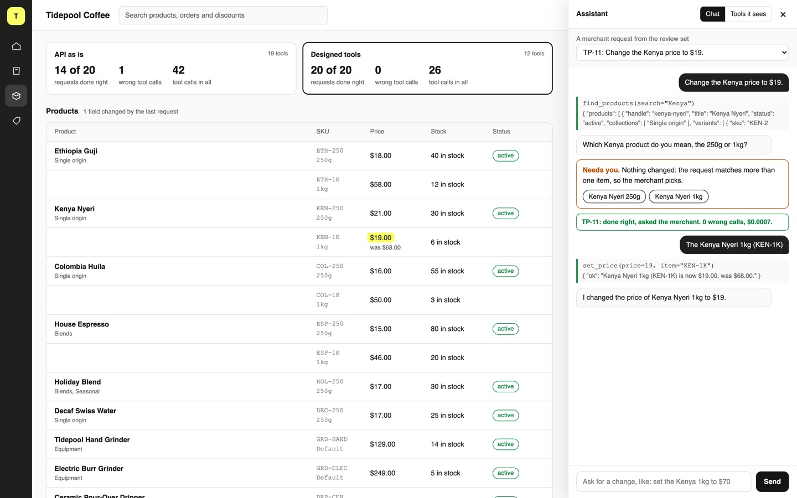

# Design Tools for AI Agents with MCP

Give one assistant two MCP servers for the same store: one that mirrors the admin API, and one designed
for the merchant's job. Then measure which tools get the work done.

## The product job

Tidepool Coffee sells beans and brewing gear online. The owner wants to run the store by asking: "Mark
the Kenya 1kg as sold out", "Refund the torn bag on #1043". Shopify built Sidekick for this job, and its
team found that tool design, more than the prompt, decides whether it works.

- **The source of truth** is the store's admin state after each request: prices, stock, status,
  collections, discount codes, refunds and fulfilment. Each of the 20 requests in `data/tasks.jsonl`
  lists exactly what should change.
- **The metric** is the share of requests done right, and the wrong-tool calls on the way. A request
  that could mean two products is done right only when the assistant asks which one and changes nothing.

## What you will be able to do

Before: you wrap your REST API as MCP tools, one per endpoint, and wonder why the agent fumbles. After
this lab you can:

- serve tools from Python with the official MCP SDK, and connect any MCP client to them
- see why tools copied from an API make the model chain IDs, guess and give up
- name tools by the job and let them take the merchant's own words
- write tool errors that tell the model what to do next, including "ask the merchant"
- mark tools read-only or destructive with MCP annotations
- score two tool sets on the store's state, not on what the assistant says

## The problem

The quickest MCP server is the API you already have: `products_list`, `variant_update`,
`inventory_level_adjust`. Each tool is correct. But to add stock to "the Colombia 1kg", the model must
list products, find the variant, read its inventory item ID, list the locations, then adjust. Every hop
is a chance to guess an ID or give up.

The merchant never says an ID. They say "the Kenya", and Kenya comes in two sizes. An API tool cannot
know that the merchant was vague. A tool designed for the job can refuse to guess.

## What you will build

Tidepool Coffee's store admin. The product table shows every variant with its SKU, price and stock. Two
cards at the top switch the assistant between **API as is** and **Designed tools**, each with its score
from the last review.

Open the assistant drawer and pick a merchant request. Each tool call shows as it happens, red when the
server answered with an error. When the assistant changes the store, the cell lights up with the old
value beside it. When a request could mean two products, a **Needs you** card offers the choices. Pick
one, and the assistant finishes the job.



## Words you will use

- **MCP server**: a program that offers tools to any AI app over the Model Context Protocol. Claude
  Code, Cursor and your own agent all connect the same way.
- **Tool**: a function the server offers, with a name, a description and a JSON Schema for its
  arguments. The model reads only those.
- **Wrong-tool call**: a call the server answered with an error, such as a bad ID. Each one costs a
  model step.
- **ToolError**: the SDK's error whose message is sent to the model, so the model can read what to do
  next.
- **Annotation**: a hint on a tool, such as read-only or destructive, so a client can ask before
  running it.
- **Human in the loop**: the merchant, who answers when a request could mean more than one thing.

## Set up

You need [uv](https://docs.astral.sh/uv/) and an [OpenRouter](https://openrouter.ai) key. The servers
use the [MCP Python SDK](https://github.com/modelcontextprotocol/python-sdk) version 2.

```bash
uv sync
```

Expect: /Installed|Audited|Resolved/

Copy `env.example` to `.env` and add your key.

## 1. The API as tools

`src/tidepool/api_server.py` wraps the admin API the way most teams start: one tool per endpoint, with
the API's own descriptions. List what the model sees:

```bash
uv run store tools --server api
```

Expect: API as is: 19 tools

Every write takes a numeric ID. Prices live on variants, stock lives on inventory items at a location,
and a discount is a price rule plus a code.

## 2. Watch it fumble

TP-02 asks to add 24 bags of the Colombia 1kg to stock. `src/tidepool/assistant.py` connects to a
server, hands its tools to the model and runs whatever the model calls:

```bash
uv run store ask TP-02 --server api
```

Expect: /Result: /

In our run it searched for a product titled "Colombia 1kg", found none, and asked the merchant for the
right title. The product is called Colombia Huila, and 1kg is a variant. The API was correct, and the
job still failed.

## 3. Design the tools for the job

`src/tidepool/tools_server.py` serves the same store with 12 tools. Read its docstring, then these
parts:

1. `find_variant` takes a SKU or the merchant's words, like "Colombia 1kg". When the words match more
   than one variant, it raises a `ToolError` naming each one, ending "Ask the merchant which one".
2. Each tool is named by the job: `set_price`, `adjust_stock`, `refund_items`.
3. `READ_ONLY`, `SAFE_WRITE` and `MOVES_MONEY` are the annotations. Only `refund_items` is destructive.

```bash
uv run store tools
```

Expect: Designed tools: 12 tools

## 4. Ask about the Kenya

TP-11 says "Change the Kenya price to $19." Kenya Nyeri comes in 250g and 1kg:

```bash
uv run store ask TP-11
```

Expect: /asked the merchant/

The tool refused, the model read why, and it asked. Nothing changed. The rule lives in the tool, so a
model that guesses still cannot change the wrong price.

## 5. Review all twenty

`store review` runs every request on both servers, each on a fresh store. `src/tidepool/review.py`
compares what changed with what should have:

```bash
uv run store review
```

Expect: /Designed tools\s+\d+ of 20/

In our run with `google/gemini-2.5-flash`:

| Tools | Done right | Wrong calls | Tool calls | Tools listed | Cost |
| --- | --- | --- | --- | --- | --- |
| API as is | 14 of 20 | 1 | 42 | 19 | $0.0193 |
| Designed tools | 20 of 20 | 0 | 26 | 12 | $0.0169 |

The API server lost TP-02 and TP-10 to exact-title search, and TP-13 the same way. On TP-06 it passed
the product ID in the wrong format. On TP-14 it archived the product and zeroed the stock when the
merchant asked to hide it. On TP-20 its answer left out the House Espresso.

Our first designed server did worse, and the fixes are in the code. Tools that took only a SKU made the
model invent ones like COL-1KG and GRINDER-ELECTRIC, so `find_variant` now takes words too. The model
once said the Tidepool Mug was live without calling a tool. The status tool now says "put it live", the
merchant's words.

## 6. See it

Start the store admin and open http://127.0.0.1:8000/?assistant:

```sh
uv run store serve
```

Pick TP-11 and press **Send**. Watch `find_products` run, then the **Needs you** card. Click **Kenya
Nyeri 1kg** and see the price light up as $19.00, was $68.00. Switch to **API as is** and send TP-02.
Stop the page with Ctrl-C.

## 7. Prove it

The keyless tests script the model's calls. They check the refusal, every error's next step, the
annotations, both servers on one store, the judge, and the page's local-only server:

```bash
uv run pytest -q
```

Expect: /\d+ passed/

The proof runs the review on the real model. Designed tools must beat the API, finish at least 18 of
20, make no more wrong calls, and ask on both vague requests:

```bash
uv run pytest -m proof -q
```

Expect: 1 passed

## At a startup

Write the tools for the five jobs your users ask for most, not for every endpoint. Let them take the
words users type: names, SKUs, order numbers. Put the next step in every error. Keep a review set of
real requests with the state each should leave, and run it on every tool change.

## At an enterprise

Each tool calls your API with the user's own token, never an admin key. Destructive tools carry the
annotation, and the client asks before running them. Shopify returns instructions with the tool result
when they apply, instead of growing one long prompt. Watch wrong-call rates per tool to find the one
that misleads.

## Change it

- Make `find_variant` return the first match instead of refusing, then run TP-11. What changed in the
  store?
- Delete the `Args:` lines from `adjust_stock` and run the review. Which tasks fail?
- Connect Claude Code to the designed server with `claude mcp add tidepool -- uv run store mcp`, and
  ask it for TP-18 in your own words.
- Add a `set_compare_at_price` tool for "on sale" requests, and a task that needs it.

Sources: [Shopify Engineering on building Sidekick](https://shopify.engineering/building-production-ready-agentic-systems),
the [MCP Python SDK](https://github.com/modelcontextprotocol/python-sdk), and the
[MCP tool annotations](https://modelcontextprotocol.io/specification/2025-06-18/server/tools).
