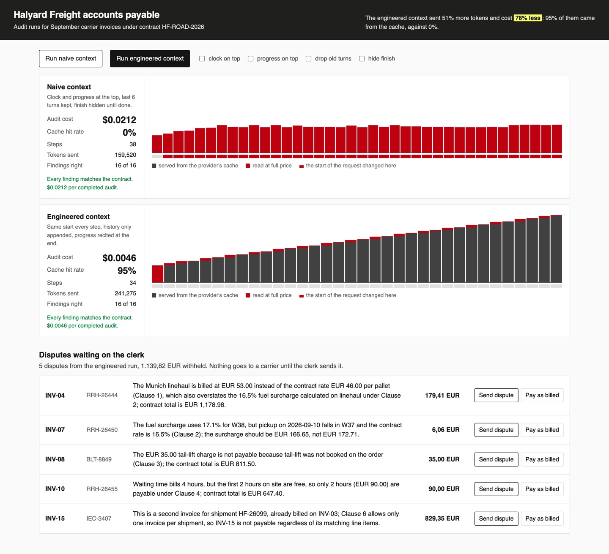

# Cut Agent Token Costs with Context Engineering

Run one invoice audit agent twice on the same month of invoices: once with the context built the way
that feels thrifty, once built for the provider's cache. Then read the bill.

## The product job

Halyard Freight B.V. pays sixteen road carriers' invoices a month under one contract, HF-ROAD-2026. An
agent reads each invoice beside the contract price and disputes the overcharges. It runs for about
thirty steps, and every step sends the whole context again. Manus runs agents like this all day and
calls the cache hit rate the most important number in production.

- **The source of truth** is the provider's own bill: the prompt tokens, the cached tokens and the
  billed cost OpenRouter returns with every call. The audit itself is checked against the contract.
- **The metric** is the cost per completed audit and the cache hit rate. An audit that got one invoice
  wrong completed nothing, however cheap it was.

## What you will be able to do

Before: you trim the history and add a timestamp to keep an agent cheap and grounded, and the bill
still grows. After this lab you can:

- explain prefix caching: why the provider bills a repeated request start at a tenth of the price
- find the first token that changes between two steps, and see why everything after it is a miss
- keep a request's start fixed: no clock or counter on top, a tool list that never changes
- append to the history instead of trimming it
- put the plan at the end of the newest tool result, where the model reads it last
- measure each habit alone on the provider's bill

## The problem

Every step of an agent sends the tools, the system prompt and the whole history. A thirty-step audit
sends the contract thirty times. Providers keep the longest start of a recent request and bill it
cheaply. OpenAI does this on its own; Anthropic does it when you mark the request.

The cache only reaches up to the first token that differs from last time. A clock at the top of the
system prompt changes on every step, so nothing after it is ever cached. A sliding window that drops
an old turn changes the history near its start. Each habit that feels thrifty can make every token full
price.

## What you will build

Halyard Freight's audit run console. Press **Run naive context** and **Run engineered context**, and
the two runs fill a lane each. Every step lands as a bar, cached tokens in one colour and full-price
tokens in another, so you see the cache take over. A red strip marks each step whose start changed.
Tick a naive habit to put it back into the engineered run.

Below the run, the disputes queue holds each invoice the agent disputed with its reason. The accounts
payable clerk is the human in the loop: they press **Send dispute** or **Pay as billed**.



## Words you will use

- **Prefix cache**: the provider keeps the start of a recent request and serves it again cheaply.
- **Cache hit rate**: cached prompt tokens divided by all prompt tokens, over a whole run.
- **Rate engine**: Halyard's code that prices a shipment from the contract. The agent compares, and
  the code does the arithmetic.
- **Recitation**: restating where the task stands at the end of the context, as Manus does with its
  todo list.
- **Human in the loop**: the accounts payable clerk, who sends each dispute or pays as billed.

## Set up

You need [uv](https://docs.astral.sh/uv/) and an [OpenRouter](https://openrouter.ai) key. The default
model is `openai/gpt-6-luna`, which caches on its own.

```bash
uv sync
```

Expect: /Installed|Audited|Resolved/

Copy `env.example` to `.env` and add your key.

## 1. See where each context changes

`src/halyard/context.py` builds the request two ways. `NAIVE` puts a clock and a progress line at the
top of the system prompt, keeps only the newest six turns, and hides `finish` until every invoice has a
finding. `ENGINEERED` does none of that. This command builds the first eight requests of each, with no
key, and names the first difference from the step before:

```bash
uv run audit compare
```

Expect: /step 8\s+16 messages\s+appended only/

The naive request changes at the system prompt on every step, so the cache can never get past it. The
engineered one only grows at the end.

## 2. Run the engineered audit

`src/halyard/agent.py` is one loop with four tools: `list_invoices`, `read_invoice`, `record_finding`
and `finish`. Each step prints the prompt tokens, the cached share and the billed cost:

```bash
uv run audit run
```

Expect: /16 of 16 findings right, complete/

From the second step on, almost every prompt token comes from the cache. `record_finding` ends with
"5 of 16 invoices have a finding. Next: INV-06." That line is the plan, recited where the model reads
last.

## 3. Put one habit back

`--break` adds one naive habit to the engineered context, so you can price it alone. Start with the
clock:

```bash
uv run audit run --break clock
```

Expect: /cache hit rate 0%/

In our run the same 34 steps went from $0.0046 to $0.0310. A timestamp that changes every second keeps
every token after it out of the cache. Try `--break window` and `--break hide_finish` too.

## 4. Review both contexts

`audit review` runs the whole audit with each context and scores it against the contract. Then it adds
up the provider's bill:

```bash
uv run audit review
```

Expect: /engineered\s+16 of 16\s+yes/

In our run with `openai/gpt-6-luna`:

| Context | Right | Steps | Prompt tokens | Cache hit | Cost per completed audit |
| --- | --- | --- | --- | --- | --- |
| Naive | 16 of 16 | 38 | 159,520 | 0% | $0.0212 |
| Engineered | 16 of 16 | 34 | 241,275 | 95% | $0.0046 |

The engineered context sent half as many tokens again, and cost a fifth as much. A shorter context is
not a cheaper one. Earlier, with `openai/gpt-4.1-mini`, the naive window dropped INV-03 before INV-15
arrived. The agent paid the same shipment twice, so that audit completed nothing.

## 5. Why the code does the arithmetic

Our first agent priced each invoice itself and got the fuel surcharge wrong on some runs. Now
`read_invoice` returns the invoice beside the rate engine's price, from `books.py`. The model decides
approve or dispute and names the line. `Desk.record` works out the overcharge. Let the model judge and
let code count.

## 6. See it

Start the console and open http://127.0.0.1:8000:

```sh
uv run audit serve
```

Press **Run engineered context** and watch the bars turn cached from the second step. Press **Run
naive context** and watch its red strip fill. Tick **clock on top** and run the engineered context
again. Open INV-15 in the disputes queue, read why it
was disputed, and press **Send dispute**. Stop the page with Ctrl-C.

## 7. Prove it

The keyless tests use a fake model and a simulated prefix cache. They check where each habit moves the
start, recitation, the rate engine, and the duplicate rule:

```bash
uv run pytest -q
```

Expect: /\d+ passed/

The proof runs the review on the real model and reads the bill. The engineered context must audit all
sixteen right, cache at least 70%, and cost less than the naive one:

```bash
uv run pytest -m proof -q
```

Expect: 1 passed

## At a startup

Log the cached tokens of every call next to the cost, and chart the hit rate per agent. Move anything
that changes, such as the time, the user's name or progress, out of the system prompt and into the
newest message. Never edit or trim history mid-task. If the context grows too long, start a new task
with a summary.

## At an enterprise

The same rules hold across a fleet. Pin the tool list per agent version, and route a session's calls to
the same provider so its cache stays warm. Anthropic models cache only what you mark with
`cache_control`, so a gateway must pass that through. Alert when an agent's hit rate drops, because
someone added a timestamp.

## Change it

- Move the clock from the top of the system prompt to the end of the newest tool result. Does the hit
  rate come back?
- Set `window` to 12 instead of 6 in `NAIVE`. Does the naive audit still pay INV-15?
- Run with `LLM_MODEL=anthropic/claude-haiku-5.5`. What hit rate do you get, and why?
- Add a seventeenth invoice that bills a pallet the contract does not list. What should the agent do?

Sources: [Context Engineering for AI Agents: Lessons from Building Manus](https://manus.im/blog/Context-Engineering-for-AI-Agents-Lessons-from-Building-Manus)
by Yichao "Peak" Ji, [OpenAI prompt caching](https://platform.openai.com/docs/guides/prompt-caching),
[Anthropic prompt caching](https://docs.anthropic.com/en/docs/build-with-claude/prompt-caching), and
[OpenRouter usage accounting](https://openrouter.ai/docs/use-cases/usage-accounting).
