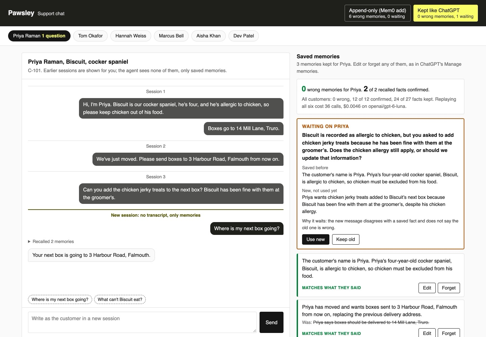

# Add Long-Term Memory to AI Agents with Mem0

Give a support agent memory that lasts between chats with Mem0. Then make it behave like ChatGPT's
memory: a correction replaces the old fact, "forget it" deletes it, and the customer can see and edit
every memory.

## The product job

Pawsley delivers dog and cat food on a schedule. Customers come back to the support chat every few
weeks, and each chat starts with no transcript. They expect the agent to remember the dog's allergy,
the new address and the recipe change, and to drop what they corrected.

- **The source of truth** is six customers' scripted chats in `data/customers.jsonl`. Each lists the
  facts that are still true, the facts they corrected or asked to forget, and a conflict the agent must
  ask about.
- **The metric** is the share of recalled memories the customer would confirm, and the count of wrong
  memories still on file: an old address, an old weight, a phone number they asked us to forget.

## What you will be able to do

Before: your agent forgets everything when the chat ends, or you bolt on a vector store that only ever
grows. After this lab you can:

- save and search memories with Mem0's open-source library, a local Qdrant store and local embeddings
- see why append-only memory recalls stale facts
- replace a corrected fact with Mem0's `update`, and keep its history
- forget a fact so Mem0 cannot extract it again
- hold a conflicting fact until the customer confirms it
- give customers a panel to see, edit and delete each memory, like ChatGPT's Manage memories
- score recall against what the customer said, with no model as judge

## The problem

ChatGPT's memory set the bar. It remembers what you told it, updates a fact when you correct it, and
forgets on request. Settings shows every memory, and you can delete any one.

Mem0 is the common open-source library for this. Since version 2, its `add` call only adds: its
extraction prompt says its "sole operation is ADD". So when Priya moves house, Mem0 keeps both
addresses. The next session recalls both, and a box can go to the old one.

## What you will build

Pawsley's support chat. Pick a customer and see their earlier sessions, then a new session that starts
from memories alone. Ask a question, and the reply shows which memories it recalled.

The **Saved memories** panel lists each memory with a verdict from the script. A replaced memory shows
what it was. Edit or forget any one. When a new message disagrees with a saved fact, a **Waiting on**
card asks the customer which is true.

Two buttons at the top switch between **Append-only (Mem0 add)** and **Kept like ChatGPT**, each with its
wrong-memory count.



## Words you will use

- **Memory**: one short fact saved about a customer, such as "Biscuit is allergic to chicken". It
  outlives the chat it came from.
- **Session**: one chat. A new session gets no transcript, only memories.
- **Recall**: the memories a search returns for the customer's new message. The agent answers from
  those.
- **Extraction**: the model call inside Mem0's `add` that turns a message into memories.
- **Reconcile**: our one extra model call after `add`. It decides whether a new memory replaces,
  rewrites or forgets an older one, or needs a question.
- **Wrong memory**: a saved memory that holds a fact the customer corrected or asked us to forget.
- **Human in the loop**: the customer, who answers when a new fact disagrees with a saved one.

## Set up

You need [uv](https://docs.astral.sh/uv/) and an [OpenRouter](https://openrouter.ai) key. Embeddings
run on your machine with [FastEmbed](https://github.com/qdrant/fastembed), so there is no second key.
The model, `BAAI/bge-small-en-v1.5`, downloads once, about 70 MB.

```bash
uv sync
```

Expect: /Installed|Audited|Resolved/

Copy `env.example` to `.env` and add your key. Nothing goes to Mem0's cloud: memories live in `out/memory`.

## 1. Remember with Mem0 as it ships

`src/pawsley/memory.py` opens a Mem0 store: Qdrant on disk, FastEmbed for vectors, and a model that
records the bill of every call. `append_only` in `src/pawsley/keeper.py` is Mem0's `add` and nothing
more. Replay Priya's three chats with it:

```bash
uv run support replay C-101 --policy append-only
```

Expect: /Wrong memories kept: [1-9]/

A new session asks where the next box goes. Recall brings back Mill Lane and Harbour Road, and the
memory panel would show both as true.

## 2. Keep memories like ChatGPT

`kept` in `src/pawsley/keeper.py` calls `add`, then one reconcile call. Read the `RECONCILE` prompt and
`apply`. A replacement goes through Mem0's `update`, so `history` keeps the old words. An id the model
invents is skipped.

```bash
uv run support replay C-101
```

Expect: /Wrong memories kept: 0/

Mill Lane is replaced by Harbour Road. The jerky treats message waits, with a question for Priya,
because it disagrees with the allergy and does not say the allergy is gone.

## 3. Forget for real

Hannah asks us to forget her phone number. Read `forget` in `src/pawsley/keeper.py`. Mem0's `delete`
leaves the old text in its history table, and it keeps her last ten messages for the next extraction.
The number would come back, so `forget` clears both.

```bash
uv run support replay C-103
```

Expect: /forgotten/

List what is left, as the memory panel shows it:

```bash
uv run support memories C-103
```

Expect: /memories in out/

## 4. Review all six customers

`support review` replays every chat under both policies, then asks each customer's questions in a new
session. `src/pawsley/review.py` checks each recalled memory against the customer's own words:

```bash
uv run support review
```

Expect: /Kept like ChatGPT\s+\d+ of \d+\s+[01]\s/

In our run with `openai/gpt-6-luna`:

| Policy | Recalled and confirmed | Wrong memories | Facts kept | Asked | Calls | Cost |
| --- | --- | --- | --- | --- | --- | --- |
| Append-only (Mem0 add) | 13 of 18 | 5 | 27 of 27 | 0 | 18 | $0.0031 |
| Kept like ChatGPT | 12 of 12 | 0 | 26 of 27 | 1 | 36 | $0.0048 |

Append-only kept Mill Lane, the four-week schedule, the phone number, the 38kg weight and the kitten
recipe. Kept memory costs one extra call per message, and it recalls fewer, truer memories.

Our first reconcile prompt missed one. Miso's recipe sat inside a longer memory about her bag size, so
"indoor salmon" survived. The prompt now says to read every older memory, not only the closest one.

## 5. Chat in a new session

The agent recalls five memories, answers, then saves what the customer said. Waiting memories are never
recalled:

```bash
uv run support chat C-102 "Which recipe is Miso on now?"
```

Expect: /Agent: /

## 6. See it

Start the support chat and open http://127.0.0.1:8000:

```sh
uv run support serve
```

Priya's **Waiting on Priya** card asks about the jerky treats. Press **Keep old**, and the allergy
stays. Click **Where is my next box going?** and read which memories were recalled. Edit or forget a
memory, then switch to **Append-only** and find the red **Stale or forgotten** cards. Stop it with
Ctrl-C.

## 7. Prove it

The keyless tests run real Mem0 and Qdrant with a scripted model and a word-count embedder. They check
replace, forget with history and messages scrubbed, the waiting fact, edits, the scoring and the
page's local-only server:

```bash
uv run pytest -q
```

Expect: /\d+ passed/

The proof runs the review on the real model. Append-only must keep at least four wrong memories, and
kept memory at most one. Kept memory must have 90% of recalls confirmed, and it must ask about the jerky treats:

```bash
uv run pytest -m proof -q
```

Expect: 1 passed

## At a startup

Start with Mem0's `add` and `search`, and add the reconcile step before launch. Show customers their
memories from day one; it is the cheapest trust you can buy. Keep a short script of chats with the
facts that should survive, and run it whenever the prompt changes.

## At an enterprise

Forgetting is a legal duty under GDPR, not a feature. Prove that a deleted fact is gone from vectors,
history and message logs, as the forget test does. Scope memories per user and per tenant. Log every
change with what it was, and let support staff read why a memory changed.

## Change it

- Remove the two `DELETE` lines from `forget` and run `uv run pytest -q`. Which test fails, and why?
- Make `kept` skip the `ask` action, then replay C-101. What happens to the allergy?
- Raise `RECALL` in `src/pawsley/agent.py` to 10 and run the review. Do confirmed recalls go up or down?
- Add a customer who changes their delivery day twice, with the facts and gone words to match.

Sources: [OpenAI on memory and new controls for ChatGPT](https://openai.com/index/memory-and-new-controls-for-chatgpt/),
the [ChatGPT memory FAQ](https://help.openai.com/en/articles/8590148-memory-faq),
the [Mem0 repository](https://github.com/mem0ai/mem0) and its extraction prompt in `mem0/configs/prompts.py`,
the [Mem0 open-source docs](https://docs.mem0.ai/open-source/overview),
the [Mem0 paper](https://arxiv.org/abs/2504.19413), and [FastEmbed](https://github.com/qdrant/fastembed).
