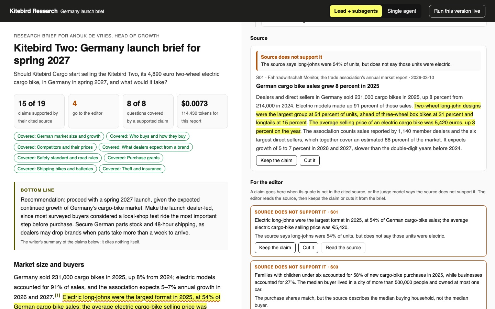

# Build a Deep Research Agent with Subagents

Answer one business question from a library of sources two ways: one agent alone, or a lead agent that
plans and runs subagents in parallel. Then check every citation against its source.

## The product job

Kitebird Cargo builds electric cargo bikes in Utrecht. Anouk de Vries, head of growth, asks: should
Kitebird sell the Kitebird Two, a 4,890 euro bike, in Germany in spring 2027, and what would it take?
She wants a short brief she can forward, with every claim cited.

Anthropic built the Research feature in Claude for this job. A lead agent plans the question and hands
parts of it to subagents that search at the same time, each in its own context window.

- **The source of truth** is the sources each claim cites. The library in `data/sources/` holds 31
  dated sources. Some are off topic, some are stale, and two pairs disagree.
- **The metric** is the share of claims their cited source supports, and the cost per report. A claim
  is supported only when its quote is in the source, word for word, and a judge model reading that
  source agrees.

The sources are synthetic. Kitebird, its rivals and every number in `data/` were written for this lab,
so the facts are fixed and the check can be repeated.

## What you will be able to do

Before: you ask one agent to research a broad question, it reads three sources, and its citations look
right. After this lab you can:

- give a research agent `search`, `read` and `finish` tools and a budget of tool calls
- have a lead agent split a question into objectives that do not overlap
- run subagents in parallel with `asyncio.gather`, each with its own context window
- check each citation in code: the quote must sit in the cited source
- ask a judge model whether the quoted sentences support the claim
- measure what the lead's breadth costs in tokens and money
- send the claims that fail to an editor, who keeps or cuts each one

## The problem

A model writes a citation as fluently as a fact. Ask one agent for a brief on eight questions and it
spends its budget on the first three. It then writes confident claims about the rest, each with a
footnote, and the footnote looks the same either way.

Reading a long brief source by source is the work a brief was meant to save. So the check has to be
code: open the cited source, find the quote, and only then ask a model whether it supports the claim.

## What you will build

The research report reader Anouk opens. The brief sits in a reading column, with a scorecard on top:
how many claims their sources support, how many wait for the editor, and which of her eight questions
are covered.

Each claim ends in a footnote. Click one and the rail opens the source with the quoted sentences
highlighted. Above it is the research tree: the lead, its subagents, each one's latest search, its tool
calls and its tokens. Press **Run this version live** and watch the subagents work at the same time.



## Words you will use

- **Lead agent**: the agent that plans the question, starts the subagents and hands their findings to
  the writer.
- **Subagent**: a research agent with one objective, its own context window and its own budget of tool
  calls.
- **Context window**: everything one model call reads. Each subagent fills its own, so none of them
  reads what the others found.
- **Finding**: a claim, the source that states it, and the exact sentences quoted from that source.
- **Citation check**: the code that looks for each quote in the cited source, then the judge model that
  rules on the claim.
- **Human in the loop**: the editor, who reads the source behind each flagged claim and keeps it or
  cuts it.

## Set up

You need [uv](https://docs.astral.sh/uv/) and an [OpenRouter](https://openrouter.ai) key. The agents
use the [OpenAI Python SDK](https://github.com/openai/openai-python) with tool calls, and no agent
framework.

```bash
uv sync
```

Expect: /Installed|Audited|Resolved/

Copy `env.example` to `.env` and add your key.

## 1. Search the library

`src/kitebird/corpus.py` loads the sources and ranks them with BM25, the keyword search most retrieval
still starts from. Every agent gets this search and a `read` tool:

```bash
uv run research search "cargo bike grant Berlin"
```

Expect: /S09\s+[\d.]+\s+2026-04-03/

Two sources answer, and they disagree. S10 from 2024 says the Berlin grant will not return. S09 from
2026 says it reopened. A good brief cites both and says which is newer.

## 2. One agent alone

`src/kitebird/searcher.py` is the research loop every agent runs. It searches, reads, and calls
`finish` with findings. Each result tells the model how many tool calls are left, and at zero the code
forces `finish`. Run it on all eight questions with 10 tool calls:

```bash
uv run research run single
```

Expect: /Single agent: \d+ of \d+ claims supported by their cited source/

Each line is a claim, marked `ok` or `EDITOR`. The summary counts how many of Anouk's questions a
supported claim covers. With ten calls, one agent reads a few sources and leaves questions open.

## 3. A lead and its subagents

`src/kitebird/lead.py` holds both versions. In `run_lead` the lead plans up to four objectives, then
`asyncio.gather` starts a subagent for each. They run the same loop with the same budget of 10 calls:

```bash
uv run research run lead
```

Expect: /Lead \+ subagents: \d+ of \d+ claims supported by their cited source/

Watch the search lines interleave: the subagents work at the same time, so four of them take about as
long as one. The writer then cites findings by number, and the code copies each finding's quotes into
the claim. The writer can reword a claim, but never the quotes the check reads.

## 4. Check every citation

`src/kitebird/citations.py` is the check. `find_quote` looks for every quote in the cited source after
evening out case, spacing and curly quotes. A quote found in a different source is named. Only claims
whose quotes are all there go to `judge`, which reads the whole source and rules on the claim.

Compare both runs:

```bash
uv run research compare
```

Expect: /The lead and its subagents used [\d.]+ times the single agent's tokens/

In our run with `openai/gpt-6-luna`:

| Version | Supported | For the editor | Questions covered | Tokens | Time | Cost |
| --- | --- | --- | --- | --- | --- | --- |
| Single agent | 12 of 19 | 7 | 7 of 8 | 29,957 | 66 s | $0.0031 |
| Lead + subagents | 15 of 19 | 4 | 8 of 8 | 114,430 | 78 s | $0.0073 |

The lead used 3.8 times the tokens. Anthropic reports about 15 times the tokens of a chat for its
multi-agent system, and fewer here because each subagent has only ten calls. The costs above are what
OpenRouter billed, and the check is billed apart.

Our first runs taught two fixes, both in the code. Agents packed several facts behind one quote, and
the judge rightly said the quote did not support them all, so a finding now carries up to three quotes.
The writer once filled a gap with a claim that a source says nothing, so its prompt now forbids that.
Subagents with no word on their budget searched until it ran out and never read, so every result now
says how many calls are left.

## 5. See it

Start the reader and open http://127.0.0.1:8000:

```sh
uv run research serve
```

Click a footnote and read the highlighted passage. Open a claim in **For the editor**, read the judge's
reason, and press **Keep the claim** or **Cut it**. Switch to **Single agent** to see the brief one agent
wrote. Press **Run this version live** to watch the research tree fill in. Stop the page with Ctrl-C.

## 6. Prove it

The keyless tests script the model. They check the search, every way a quote can fail, the forced
finish, subagents truly in flight at once, the writer unable to touch a quote, and the local-only server:

```bash
uv run pytest -q
```

Expect: /\d+ passed/

The proof runs both versions on the real model. The lead must have at least 7 in 10 claims
supported, more supported claims than the single agent, as many questions covered, and over twice its
tokens:

```bash
uv run pytest -m proof -q
```

Expect: 1 passed

## At a startup

Start with one agent and a citation check, and add subagents only when your questions are broad. A
question with one answer gains nothing from four context windows, and costs four times the tokens. Keep
the quote check in code from day one, because it is free and catches the worst failures.

## At an enterprise

Search your own document store, with each subagent reading as the user who asked, so a brief never
cites a file the reader cannot open. Log every agent's searches and reads with the report, so an
auditor can follow each claim back. Track the share of claims sent to editors over time.

## Change it

- Give the single agent 40 tool calls in `SINGLE_BUDGET`. Does it catch the lead, and at what cost?
- Set `MOST_SUBAGENTS` to 8 and run the lead. Do more subagents cover more, or repeat each other?
- Delete the `[N tool calls left]` line in `searcher.py` and run the lead. How many sources does each
  subagent read now?
- Make the writer return its own quotes instead of finding numbers, and count the quotes that go
  missing.

Sources: Anthropic's [How we built our multi-agent research system](https://www.anthropic.com/engineering/multi-agent-research-system),
OpenRouter's [usage accounting](https://openrouter.ai/docs/use-cases/usage-accounting), and the
[BM25 ranking function](https://en.wikipedia.org/wiki/Okapi_BM25).
