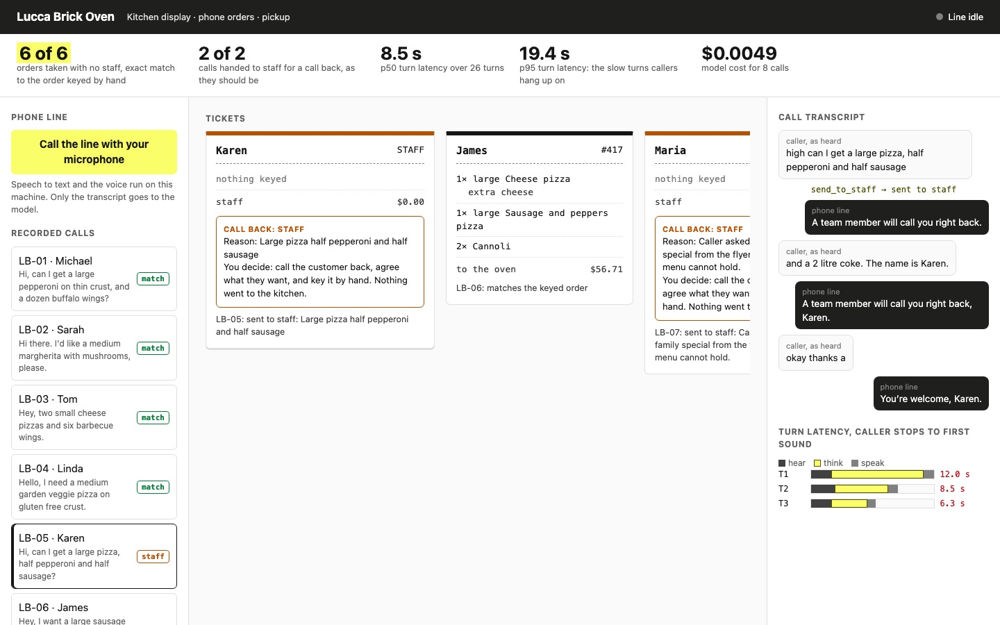

# Build a Voice AI Agent with Pipecat

Build a phone line that takes a pizzeria's orders by voice and keys them into the till. Speech to text
and the voice run on your machine; only the transcript goes to the model.

## The product job

Lucca Brick Oven is a pizzeria on Murray Avenue in Pittsburgh. On a Friday night the phone rings while
every hand is on the oven. SoundHound sells this job to restaurant chains: a voice agent answers, takes
the order and puts it in the point of sale, so staff only cook.

- **The source of truth** is the order a person keyed by hand from the same call. Each of the eight
  recorded calls in `data/calls.json` carries that keyed order, or the reason it must go to staff.
- **The metric** is orders taken with no staff, counted only on an exact match with the keyed order. The
  second number is turn latency at p50 and p95: the gap from the caller's last word to the first sound
  of the reply.

## What you will be able to do

Before: you can build a chat agent with tools, but a phone call is audio, it has no "send" button, and
callers talk over you. After this lab you can:

- build a Pipecat pipeline that turns audio into frames, frames into text, and text back into speech
- run speech to text (Whisper) and text to speech (Kokoro) locally, with no audio leaving the machine
- give the voice agent till tools, so the till decides what can be ordered
- let the caller interrupt the agent, and measure how fast it stops talking
- split each turn's latency into hear, think and speak, and read it at p50 and p95
- send an order the menu cannot hold to staff for a call back, with the reason

## The problem

A chat agent waits for the user to press send. A phone caller never does. Something has to decide that
a pause means "I'm done", and a pause after "a large pepperoni" is not the end of the order. Decide too
early and the agent answers half an order. Decide too late and the caller says "hello?".

Every turn then pays three waits in a row. The audio becomes text, the model thinks and calls tools,
and the text becomes audio. A chat user forgives two seconds. A caller hears two seconds of silence and
starts talking again, right over the reply.

And the order must be right. A voice agent that guesses keys a pizza nobody asked for, and the kitchen
bakes it.

## What you will build

Lucca Brick Oven's kitchen ticket display. A ticket fills in line by line as the caller speaks. Beside
it, the call transcript shows what the caller said, what Whisper heard, every till tool the model
called, and where the caller cut in. Under it, a latency strip shows each turn split into hear, think
and speak.

The top bar counts the shift: orders taken with no staff, calls handed to staff, and p50 and p95 turn
latency. A call the menu cannot hold shows a **Call back** card on its ticket, with the reason and what
staff decide. You can open any recorded call, or call the line with your own microphone.



## Words you will use

- **Frame**: one piece of data moving through a Pipecat pipeline, such as 20 ms of audio, a transcript,
  a word of the reply, or "the caller started talking".
- **Pipeline**: the chain of processors a frame passes through: transport in, speech to text, the
  model, text to speech, transport out.
- **Transport**: where audio enters and leaves. Here it is either Pipecat's eval harness playing a
  recorded caller, or a WebRTC call from the browser.
- **VAD (voice activity detection)**: a small model, Silero, that hears when someone is speaking.
- **Turn detection**: deciding a pause means the caller has finished. Pipecat's Smart Turn model reads
  the audio for that.
- **Barge-in**: the caller talks over the agent. The agent should stop at once and listen.
- **Eval scenario**: a recorded call as Pipecat's eval suite plays it: each caller line, and what the
  line must do before the next one is spoken.
- **Turn latency**: from the caller's last word to the first sound of the reply.
- **Human in the loop**: staff, who call back when the menu cannot hold the order.

## Set up

You need [uv](https://docs.astral.sh/uv/), an [OpenRouter](https://openrouter.ai) key and an Apple
Silicon Mac, where Whisper and Kokoro run on the GPU. The first run downloads the speech models, about
1.6 GB.

```bash
uv sync
```

Expect: /Installed|Audited|Resolved/

Copy `env.example` to `.env` and add your key.

## 1. The till decides

`src/lucca/till.py` holds the menu and the ticket. The model never writes a ticket line itself. It
passes the caller's words, like "a dozen buffalo wings", and the till resolves them or refuses with the
next step.

```bash
uv run phoneline menu
```

Expect: /Wings: 6 piece \$\d+\.\d\d, 12 piece/

A pizza without a size, or wings without a sauce, is refused with "Ask the caller". Anything the menu
cannot hold, like a half and half pizza, is refused with "Call send_to_staff".

## 2. Recorded callers

The proof needs callers who say the same words the same way every run. Each call in `data/calls.json`
is an eval scenario in `evals/scenarios/`, and `evals/manifest.yaml` lists them for Pipecat's eval suite.

The suite starts a fresh bot per call and speaks each caller line with Kokoro, in that caller's voice.
It waits for the line's reply before it speaks the next line, as a caller does. Play one call:

```bash
uv run phoneline review LB-01
```

Expect: /LB-01 MATCH/

`src/lucca/review.py` runs the suite, then reads the till each bot left in `out/calls/` and compares it
with the keyed order. The suite's own checks only say a reply arrived; the till says whether it was right.

## 3. The pipeline

Read `run_bot` in `src/lucca/bot.py`. It has the shape of Pipecat's own voice examples, and one list is
the whole agent:

1. `transport.input()` sends audio frames.
2. `hearing()` is Whisper on the GPU through MLX. It transcribes once the voice detector says speech ended.
   `MenuHearing` gives Whisper the menu as words already said, so "two cannolis" is not heard as "two
   canoles", which the till cannot match.
3. `user` decides the turn is over and adds the transcript to the context. Silero hears speech stop,
   and the Smart Turn model decides whether that pause ends the caller's turn.
4. The model streams its reply and calls till tools from `src/lucca/agent.py`.
5. `speaking()` is Kokoro on the GPU. It speaks each sentence as soon as the model finishes it.
6. `transport.output()` plays the audio, and `assistant` saves what was said.

The same `run_bot` answers both kinds of call. The eval suite starts `bot.py` with `-t eval`, and
`phoneline serve` hands it a browser's WebRTC connection.

`src/lucca/voice.py` runs Kokoro the way Pipecat's macOS local voice agent does: in its own process,
one sentence in and audio segments out. MLX's GPU work must not share a thread with Pipecat's event
loop. The bot loads the voice before it answers, so no caller waits for a model to load.

## 4. Interruptions

In LB-03, Tom cuts in as the line starts to answer: "Sorry, wait. Make the wings garlic parmesan
instead." The scenario speaks that line 1.5 s after the model starts its reply. Silero hears him, and Pipecat sends
an interruption through the pipeline. Kokoro's queued audio is dropped, and the reply stops mid-word.

The agent then calls `remove_item` and `add_item`, and reads the order back again. The transcript on the
page marks the reply that was cut.

## 5. The latency budget

Pipecat's `UserBotLatencyObserver` times each reply from the moment the caller went quiet to the first
audio out. It also names every part of that wait, and `split_turn` in `src/lucca/bot.py` folds them into
three:

- **hear** is the transcript plus turn detection.
- **think** is the model, including any tool calls before it speaks.
- **speak** is Kokoro making the first sentence.

A reply that follows a cut-in keeps its total but has no split, because Pipecat resets the parts when
the caller interrupts. A caller starts to wonder after about 1.5 s of silence.

## 6. See it

Score the whole shift first, then open the kitchen display at http://127.0.0.1:8016:

```bash
uv run phoneline review
```

Expect: /taken with no staff: \d of 6 orders/

```sh
uv run phoneline serve
```

Click LB-05. Karen asked for a half and half pizza, so the ticket shows a **Call back** card with the
reason, and nothing went to the kitchen. Click LB-03 to see the cut-in in the transcript. Press **Call
the line with your microphone** and order a pizza yourself: it runs the same `run_bot` the shift was
scored on. Stop the page with Ctrl-C.

## 7. Prove it

The keyless tests script the model's replies and check the till and the tool loop through Pipecat.
They also check how a turn's latency splits, that every keyed call is one eval scenario, and the page's
local-only server:

```bash
uv run pytest -q
```

Expect: /\d+ passed/

The proof plays all eight calls through the real pipeline and model. At least 5 of 6 orders must match
the keyed order exactly, and both staff calls must go to staff with a reason. Every caller line but
one must get a timed reply, and the p50 turn must be under 3.5 s:

```bash
uv run pytest -m proof -q
```

Expect: 1 passed

The proof run on 22 Oct 2026, with `anthropic/claude-haiku-5.5`, Whisper `base.en` and Kokoro on an M1
laptop's GPU:

| Taken with no staff | Sent to staff | Timed turns | p50 turn | p95 turn | Model cost |
| --- | --- | --- | --- | --- | --- |
| 6 of 6 | 2 of 2 | 26 of 26 | 3.2 s | 5.4 s | $0.0103 for 8 calls |

The orders are right, and the model costs about $0.0013 a call. The typical turn split into hear 0.4 s,
think 2.0 s and speak 0.6 s. Think is the part to cut. A turn that keys an item asks the model twice:
once to call the tool, and once to speak after the till answers. Each ask waits for the model's first
word over the network.

Earlier runs failed in ways the till and the tests now hold:

- A model wrote "Diet Coke" in a "2 liter" size, "six piece" wings and "cheese pizzas". The till now
  reads each of those as the menu item.
- A reply with two `add_item` calls got two answers, and one sent the call to staff. Only the last
  tool result of a reply now asks the model again.
- Whisper heard "two cannolis" as "two can allies", and the model guessed a soda. `MenuHearing` now
  gives Whisper the menu, and it hears "cannolis".
- The model placed an order as soon as the caller gave a name, so a change came too late. The
  instructions now say a name is not a yes to the read-back.

## At a startup

Start with one restaurant's menu and its real calls. Record twenty with permission, key each by hand,
and run them on every prompt or model change. Keep speech local while you can: it is free, and no
caller audio leaves the building. Put the menu rules in the till, not the prompt.

## At an enterprise

A chain runs thousands of lines, so latency and cost are per call, not per demo. Speech runs on GPUs
near the phone network, and the model is the fastest one that passes the review. Every location's menu
feeds the same till rules. Staff see each hand-off with its reason and the recording, and those calls
become the next test cases.

## Change it

- Set `LLM_MODEL` to `nvidia/nemotron-3.5-lightning` and run LB-01. Does it read the order back first?
- Remove the `send_to_staff` tool and run LB-05. What reaches the kitchen?
- Set `STT_MODEL` to `mlx-community/whisper-large-v3-turbo` and review again. Which part of the strip grows?
- Add a "two toppings for free" rule to the till, and a call that needs it.

Sources: [SoundHound's restaurant ordering](https://www.soundhound.com/voice-ai-solutions/restaurant-food-ordering/),
the [Pipecat docs](https://docs.pipecat.ai) and its eval suite,
[Pipecat's macOS local voice agent](https://github.com/kwindla/macos-local-voice-agents),
[MLX Whisper](https://github.com/ml-explore/mlx-examples/tree/main/whisper),
[Kokoro](https://huggingface.co/hexgrad/Kokoro-82M) and [Smart Turn](https://github.com/pipecat-ai/smart-turn).
