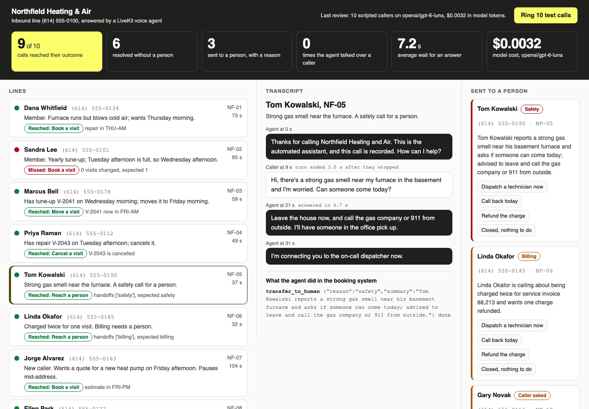

# Put a Voice AI Agent on a Phone Line

Answer a heating company's phone line with a LiveKit voice agent. Then ring it with ten scripted
callers, and count the calls that end the way each caller needed.

## The product job

Northfield Heating & Air fixes furnaces and air conditioners in Columbus, Ohio. Its main line rings all
day with bookings, reschedules and price questions, and now and then a gas smell. The office wants an
agent on that line that books the routine calls and hands the rest to a person. LiveKit carries the audio
for ChatGPT's voice mode, and its Agents framework runs voice agents like this one.

- **The source of truth** is Northfield's booking system, `data/schedule.json`, and the handoff queue
  in it. Each of the ten callers in `data/calls.json` says what the book should look like after their
  call.
- **The metric** is the share of simulated calls that reach their outcome. A call that needs a person
  counts only when it reaches one with the right reason, and nothing else changed.

## What you will be able to do

Before: you have a voice agent that works in a browser tab, and no idea how it does on a phone. After
this lab you can:

- run a LiveKit server and a LiveKit Agents worker on your laptop
- answer a call the way a SIP trunk delivers it: 8 kHz audio and the caller's number
- tune turn detection so the agent waits while a caller pauses mid-sentence
- give the agent tools that change a booking system, and a transfer to a person with a reason
- test the line with scripted callers that speak recorded audio and listen for their cue
- score each call on what changed in the book, not on what the agent said

## The problem

A voice demo in a browser hides everything a phone adds. The audio arrives at 8 kHz with half the
sound cut away. The caller pauses to think, and an agent that answers every pause talks over them.
Nobody sees a transcript, so a wrong booking sounds just as confident as a right one.

You cannot test that by calling the agent yourself ten times a day. You need callers you can replay,
and a verdict that reads the booking system after each call.

## What you will build

Northfield's inbound call wallboard. The dark band across the top is what the office reads from across
the room: calls answered, calls that reached their outcome, calls resolved with no person, and calls
sent to a person.

Below it, each line shows a caller, their number and what they rang about. A lamp turns green when the
call reached its outcome and red when it missed. Click a call to read its transcript, with the tools the
agent ran and how long the caller waited for each answer. On the right, **Sent to a person** lists each
transfer with its reason. The person on duty picks what the office does next.



## Words you will use

- **SIP trunk**: the link from a phone carrier to your software. A call arrives on it as a SIP
  participant in a LiveKit room, with the caller's number.
- **Room**: one LiveKit session. Each phone call is one room, holding the caller and the agent.
- **Worker**: the process that runs your agent. LiveKit dispatches each new call to it by the agent's
  name.
- **Voice activity detection (VAD)**: a small model that marks where speech starts and stops in the
  audio.
- **Turn detection**: deciding that the caller has finished, not just paused. LiveKit's turn detector
  reads the words so far, as well as the silence.
- **Endpointing delay**: how long the agent waits after speech stops before it answers.
- **Simulated caller**: a script of recorded lines that rings in, waits for the agent, and picks its
  next line from what the agent said.
- **Human in the loop**: the person in the office who takes a transferred call.

## Set up

You need [uv](https://docs.astral.sh/uv/), an [OpenRouter](https://openrouter.ai) key, and the LiveKit
server. Install it with `brew install livekit`, or take the binary from
[LiveKit's self-hosting guide](https://docs.livekit.io/home/self-hosting/local/):

```bash
livekit-server --version
```

Expect: /livekit-server version 1\./

Install the Python packages. Speech runs on your machine, so there is no speech key:
[faster-whisper](https://github.com/SYSTRAN/faster-whisper) hears and
[Kokoro](https://github.com/thewh1teagle/kokoro-onnx) speaks.

```bash
uv sync
```

Expect: /Installed|Audited|Resolved/

Kokoro needs its model files, about 340 MB, once:

```bash
mkdir -p ~/.cache/kokoro-onnx && (cd ~/.cache/kokoro-onnx && for name in kokoro-v1.0.onnx voices-v1.0.bin; do [ -f $name ] || curl -sSLO https://github.com/thewh1teagle/kokoro-onnx/releases/download/model-files-v1.0/$name; done; ls)
```

Expect: voices-v1.0.bin

Copy `env.example` to `.env` and add your key.

## 1. Record the callers

`data/calls.json` holds ten callers. Each has a number, a voice, what they need, and their lines. A
line after the first has `when` keywords: the caller says it when the agent's last turn used one. The
`expect` block is the truth the call is judged against.

`src/northfield/voices.py` speaks each line with Kokoro, then `phone_audio.py` squeezes it into phone
audio: the 300 to 3,400 Hz band, 8 kHz, mu-law noise. The recordings are in `data/calls`, so this
only fills gaps:

```bash
uv run phone record
```

Expect: /caller line/

Play `data/calls/NF-05-1.wav`. That is a worried man reporting a gas smell, as a phone delivers it.

## 2. The booking system

`src/northfield/schedule.py` is the only way the agent can change anything. Each call gets its own copy
of the week. Every method refuses what the office would refuse: a full window, someone else's visit, a
new caller without an address, or a zip outside the service area.

The keyless tests drive the agent's tools with a scripted model and check what lands in the book:

```bash
uv run pytest -q tests/test_schedule.py tests/test_agent.py
```

Expect: /\d+ passed/

## 3. The front desk

Read `src/northfield/agent.py` from the top:

1. `GREETING` tells the caller they are talking to an automated assistant and that the call is
   recorded. It is spoken once per worker and replayed, so the line picks up at once.
2. `answer` waits for the SIP participant and reads `sip.phoneNumber`. A real trunk sets that
   attribute too, and `caller_card` turns it into the customer's record.
   Caller ID can be spoofed, so the card leaves out the home address. Moving or cancelling a visit
   also needs the house number on file, which `schedule.py` checks.
3. The tools: `find_windows`, `book_visit`, `move_visit`, `cancel_visit` and `transfer_to_human`. A
   transfer files the reason and a one-line summary, says who will pick up, then leaves the line.
4. `turn_handling` uses LiveKit's turn detector with a 0.8 second minimum delay. A caller's pause
   between "Thursday" and "morning, if you can" no longer ends their turn.
5. `live_session` sets the model's reasoning to minimal. On a phone, every second of thinking is dead
   air.

## 4. Ring one call

`phone call` starts a LiveKit dev server and the agent worker, rings in as the caller, and stops both
when the call ends. `src/northfield/caller.py` joins the room as a SIP participant would. It waits
until the agent has finished speaking for a second, then plays its next line:

```bash
uv run phone call NF-05
```

Expect: /NF-05\s+(REACHED|MISSED)/

Tom smells gas. The agent should tell him to leave the house and call from outside, then hand the call
to the on-call dispatcher with the reason `safety`. Each line of the transcript shows when it was
said. A call takes one to two minutes, because it plays in real time.

## 5. Review all ten

`phone review` rings all ten callers, one after another. `src/northfield/review.py` judges each call
on the changes in its copy of the book and its handoff queue:

```bash
uv run phone review
```

Expect: /\d+ of 10 calls reached their outcome/

One run with `openai/gpt-6-luna` took about ten minutes and cost under half a cent for all ten calls:

| Result | Calls |
| --- | --- |
| Reached their outcome | 9 of 10 |
| Resolved with no person | 6 |
| Sent to a person, right reason | 3: NF-05 `safety`, NF-06 `billing`, NF-10 `caller_asked` |
| Agent talked over the caller | 0 |

The miss was NF-02. Whisper dropped the end of Sandra's long first line, where she asks for Tuesday
afternoon. Her next line never reached a transcript, so no visit was booked. The review's reason reads `0 visits
changed, expected 1`, and the transcript shows the speech miss. Your numbers will move a little from run to run.

## 6. See it

Start the wallboard and open http://127.0.0.1:8017:

```sh
uv run phone serve
```

The last review loads at once. Click NF-05 in **Sent to a person** and read its reason and summary,
then pick **Dispatch a technician now**. Press **Ring 10 test calls** to run the review from the page and
watch each line light up as its call goes. Stop the page with Ctrl-C.

## 7. Prove it

The keyless tests use a scripted model and no server. They check the booking rules, the tools, the
phone audio, the judge, the caller's cues, and the page's local-only server:

```bash
uv run pytest -q
```

Expect: /\d+ passed/

The proof runs the review against the real model and real audio. At least 8 of 10 calls must reach
their outcome, at least 5 with no person. Every transfer must carry the reason its caller needed:

```bash
uv run pytest -m proof -q
```

Expect: 1 passed

## At a startup

Buy a US number from a SIP provider such as Twilio or Telnyx, and point its trunk at your LiveKit
project. Then tell LiveKit about the number with an
[inbound trunk](https://docs.livekit.io/telephony/accepting-calls/inbound-trunk/):

```json
{ "trunk": { "name": "Northfield main line", "numbers": ["+16145550100"] } }
```

Save it as `inbound-trunk.json` and run `lk sip inbound create inbound-trunk.json`. A
[dispatch rule](https://docs.livekit.io/telephony/accepting-calls/dispatch-rule/) puts each call in
its own room and sends it to this agent by name:

```json
{ "dispatch_rule": { "rule": { "dispatchRuleIndividual": { "roomPrefix": "call-" } },
  "roomConfig": { "agents": [{ "agentName": "northfield-front-desk" }] } } }
```

The agent code does not change. Here a transfer files the handoff and the agent leaves. On a real
line, `transfer_to_human` also moves the call to the office's phone with a
[cold transfer](https://docs.livekit.io/telephony/features/transfers/cold/):

```python
await livekit_api.sip.transfer_sip_participant(api.TransferSIPParticipantRequest(
    room_name=ctx.room.name, participant_identity=caller.identity,
    transfer_to="tel:+16145550111", play_dialtone=False))
```

Keep the ten scripted callers, and add one for every call that went wrong in the first week.

## At an enterprise

Calls carry personal data, so record only with consent, and keep transcripts where your retention rules
say. Move speech to a hosted provider such as Deepgram or Cartesia when latency matters more than
cost. Each is one line in `live_session`. Watch transfer reasons per week: a rising `other` is a job
the agent cannot do yet. Run the scripted callers on every prompt change before it reaches the line.

## Change it

- Set `TURN_DETECTION=vad` in `.env` and run `phone call NF-01`. Does the agent cut Dana off when she
  pauses?
- Lower the endpointing `min_delay` to 0.3 in `agent.py`, then run the review. How often is the caller
  talked over now?
- Delete the safety rule from `INSTRUCTIONS` and ring NF-05. What does the book say?
- Add a caller who wants a repair on Monday afternoon, which is full, and the truth that they take
  another window.

Sources: [OpenAI and LiveKit partner to turn Advanced Voice into an API](https://livekit.com/blog/openai-livekit-partnership-advanced-voice-realtime-api/)
(LiveKit, October 2024), [LiveKit Agents](https://docs.livekit.io/agents/),
[LiveKit telephony](https://docs.livekit.io/telephony/), and the
[turn detector](https://docs.livekit.io/agents/build/turns/turn-detector/).
