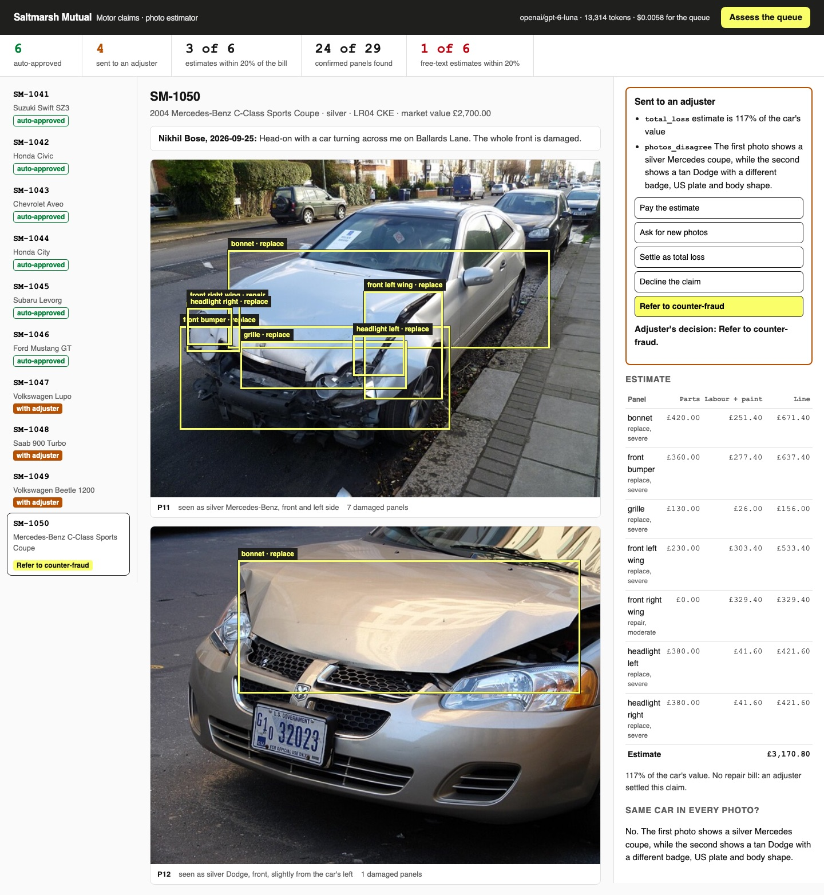

# Read Images with Vision LLMs

Read a motor claim's photos with a vision model into structured damage, price it in code from the
repairer's rate table, and send the doubtful claims to a human adjuster with a reason.

## The product job

Saltmarsh Mutual insures cars in the UK. After a crash, the customer reports the claim and uploads
photos from their phone. Saltmarsh wants a repair estimate from those photos within minutes, as
[Tractable](https://tractable.ai/) does for insurers such as [Aviva](https://tractable.ai/case-studies/aviva-testimonial/).

- **The source of truth** is the repairer's final bill for each claim that was repaired. The adjuster's
  file in `data/adjuster.json` also lists the damaged panels an adjuster confirmed on each photo.
- **The metric** is the share of estimates within 20% of the bill. Next to it: claims routed the way the
  adjuster would, and confirmed panels the model found.

## What you will be able to do

Before: you send a photo to a vision model, ask what the repair costs, and get a confident paragraph.
After this lab you can:

- send photos to a vision model as data URLs through an OpenAI-compatible API
- get a reading back in a strict JSON schema whose panel names match your rate table
- price the reading in code, so the same damage always costs the same
- compare that with a free-text estimate, graded on the same bills
- send a claim to an adjuster for a named reason: a poor photo, old damage, a write-off, or photos of
  another car
- show the estimate, the boxes on each photo and the routing on a page an adjuster works from

## The problem

A vision model is good at seeing that a wing is crushed. It does not know what a wing costs at your
repairer this month, and it will still name a price. Ask it in free text and the number changes with
the wording. Often there are three numbers, and your code has to guess which one counts.

Some claims should not be paid on photos at all. The photo is taken into the sun. The rust on the wing
is ten years old. The repair costs more than the car. The second photo is of a different car.

## What you will build

Saltmarsh Mutual's claim photo estimator. A queue down the left shows each claim as auto-approved or
with an adjuster. The middle shows the customer's account and photos, with a box on each damaged panel.
The right shows the itemised estimate against the repairer's bill. For a routed claim, it also shows
the reasons and the adjuster's decision.



The twelve photos are real, from [Wikimedia Commons](https://commons.wikimedia.org), taken in seven
countries. `data/PHOTOS.md` lists each source, author and license. The ten claims, accounts and bills
are written for this lab.

## Words you will use

- **First notice of loss (FNOL)**: the moment a customer reports a claim, often with photos.
- **Vision model**: a language model that also reads images sent in the message.
- **Structured output**: a reply the provider forces into a JSON schema you supply.
- **Rate table**: the repairer's prices for parts, labour hours and paint, in `data/rates.json`.
- **Total loss**: a car whose repair costs too large a share of its value. Saltmarsh's line is 60%.
- **Prior damage**: damage older than this incident, such as rust. The policy does not pay for it.
- **Human in the loop**: the adjuster, who decides every claim the code will not pay on its own.

## Set up

You need [uv](https://docs.astral.sh/uv/) and an [OpenRouter](https://openrouter.ai) key. The lab uses
`openai/gpt-6-luna`, which reads images and supports structured outputs, at a fraction of a cent per photo.

```bash
uv sync
```

Expect: /Installed|Audited|Resolved/

Copy `env.example` to `.env` and add your key.

## 1. Price confirmed damage in code

Start with no model. `src/saltmarsh/pricing.py` turns findings into an estimate from the rate table.
Feed it the adjuster's confirmed findings for SM-1041, a Suzuki with a crushed front wing:

```bash
uv run claims price SM-1041 --confirmed
```

Expect: /estimate\s+£704\.80/

The repairer billed £742.15, so a perfect reading lands within 20%. Lamps, glass, grilles and wheels
are always replaced, whatever a reading says. That rule lives in code, not in a prompt.

## 2. Read one photo

`src/saltmarsh/reader.py` sends the photo as a data URL with the customer's account. The `READING`
schema allows only the 24 panel names the rate table prices. P09 is a Saab with a rusty wing:

```bash
uv run claims read P09
```

Expect: /tokens in/

Look for `prior_damage` on the finding and a `box` around it. The prompt explains left and right as
the driver sits, because photos of the front are mirror images.

## 3. Assess the whole queue

`src/saltmarsh/assess.py` reads every photo, prices the new damage, and routes each claim with
`src/saltmarsh/triage.py`. Claims with two photos get one more call that sees both at once:

```bash
uv run claims assess
```

Expect: /\d+ of 6 estimates within 20% of the bill/

Across our five runs, 2 to 4 of 6 estimates were within 20% of the bill. All 10 claims were routed as
the adjuster would, each with the expected reason. The model found 24 to 26 of 29 confirmed panels, and
the queue cost under one cent.

The misses are worth reading in `out/run.json`. On the Subaru it called a torn bumper a repair. On the
Civic it missed the dented rear quarter beside the crushed door.

## 4. Ask for a free-text estimate

`free_text_estimate` sends the same photos with no schema and no rate table. `parse_amount` takes the
last pound figure, as a busy person would:

```bash
uv run claims naive
```

Expect: /Free text: \d of 6 estimates within 20%/

In our runs, only 1 of 6 landed within 20%. The model wrote £1,800 for a £742 repair and £4,000 for a
£1,047 one. Its answers often ended with "could rise to £4,000 or more", so the last figure was a worst
case.

## 5. Work the queue as the adjuster

Start the estimator and open http://127.0.0.1:8000:

```sh
uv run claims serve
```

Press **Assess the queue** to run it live, or read the saved run. Open SM-1050: the second photo shows
another car with a US government plate. Pick **Refer to counter-fraud**, and the decision is saved to
`out/decisions.json`. Stop the page with Ctrl-C.

## 6. Prove it

The keyless tests use a scripted model. They check the pricing sums, the schema's panel list, the
routing rules, the grading, and the page's local-only server:

```bash
uv run pytest -q
```

Expect: /\d+ passed/

The proof runs the queue and the free-text baseline on the real model. Structured estimates must match
or beat free text, at least 9 of 10 claims must route right, and SM-1050 must reach an adjuster:

```bash
uv run pytest -m proof -q
```

Expect: 1 passed

## At a startup

Start with the rate table and the routing rules, not the prompt. Ship auto-approval only for the
claims your proof shows are safe, and send the rest to a person. Keep every reading and the bill that
followed it. That pair is next quarter's test set.

## At an enterprise

Routing rules are policy, so they live in reviewed code with a named owner. Each routed claim carries
its reasons into the claims system, where audit and complaints teams can read them. Track the bill gap
by repairer and by car type. A drift there shows up long before a regulator asks.

## Change it

- Set `LLM_MODEL` to another vision model in `.env`, add its price to `PRICES`, and rerun the proof.
- Lower `total_loss_share` in `data/rates.json` to 0.5 and see which claims move to the adjuster.
- Add your own photo to `data/photos/` and a claim for it in `data/claims.json`.

## Sources

- [Tractable](https://tractable.ai/) and its [Aviva case study](https://tractable.ai/case-studies/aviva-testimonial/):
  photo-based damage appraisal for motor insurers.
- [OpenRouter structured outputs](https://openrouter.ai/docs/guides/features/structured-outputs) and
  [multimodal inputs](https://openrouter.ai/docs/guides/overview/multimodal/overview).
- [OpenRouter usage accounting](https://openrouter.ai/docs/cookbook/administration/usage-accounting):
  the billed cost returned with each call.
- [OpenAI structured outputs](https://developers.openai.com/api/docs/guides/structured-outputs) and
  [images and vision](https://developers.openai.com/api/docs/guides/images-vision).
- [GOV.UK: written-off vehicles](https://www.gov.uk/scrapped-and-written-off-vehicles): the salvage
  categories an adjuster uses when settling a total loss.
- [Wikimedia Commons](https://commons.wikimedia.org): every photo, credited in `data/PHOTOS.md`.
