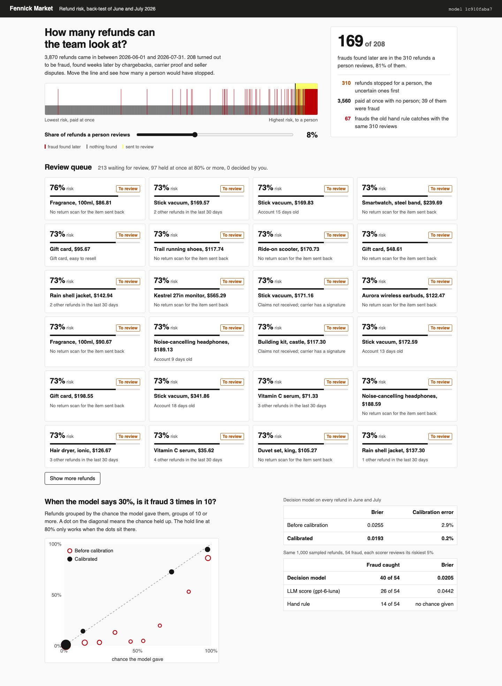

# Score Refund Risk with a Decision Model

Train a small model on refund history, turn its scores into chances you can trust, and set the lines
that decide which refunds are paid, held or sent to a person. Then grade it on the fraud found weeks
later.

## The product job

Fennick Market is an online shop that sells headphones, vacuums, gift cards and fragrance. Every day
about sixty buyers ask for a refund. Most are honest. A few claim a parcel never came when the carrier
has a signature, or send back an empty box. Stripe Radar does this job for card payments: it gives
every payment a risk score from 0 to 99, blocks the riskiest and puts the uncertain ones in a review
queue.

- **The source of truth** is the fraud found later: chargebacks, carrier proof of delivery and seller
  disputes. They arrive weeks after the refund was decided. `data/refunds.csv` holds 12,218 refunds
  from January to July 2026, each with what was found later.
- **The metric** is the fraud caught at a fixed review rate. Fennick's team can look at 5 of every
  100 refunds. Every scorer gets that same budget, and the one whose riskiest 5% holds the most fraud
  wins.

## What you will be able to do

Before: you ask an LLM "is this refund fraud, 0 to 100?" and treat the answer as a chance. After this
lab you can:

- train a gradient-boosted model on tabular history with scikit-learn
- split the history by time, so the test months are ones the model never saw
- calibrate the scores, so that 30% means fraud about 3 times in 10
- set a review line from the team's budget and a hold line from how sure the model must be
- compare scorers fairly: the same refunds, the same review budget, graded on what was found later
- log one audit row per decision with the model version and the lines it used

## The problem

The first idea is to ask an LLM. It reads the refund, writes a sensible reason and returns 85. But
nobody checked what 85 means. Fennick's old answer was a hand rule: one point for a new account, one
for a big amount, one for electronics. Each flag is sensible. Neither can weigh the evidence together.

A claim of "not received" with a signed delivery scan is a different claim from one with a parcel still
in transit. A history of 12,000 refunds knows the difference. A model trained on it can learn it, and
the history can grade it.

## What you will build

Fennick's refund risk review queue. At the top, a ribbon lays every June and July refund out from
lowest to highest risk, with a red mark for each fraud found later. Drag the slider to choose how many
refunds a person reviews. The count shows how much fraud that budget would have stopped, beside the
hand rule's count.

Below is the queue: the refunds sent to a person, with the risk, the item and the evidence a reviewer
checks first. Open one, choose **Pay the refund** or **Hold it and ask the buyer for proof**, and the
page reveals what was found later. At the bottom, a reliability chart shows whether the chances held
up.



## Words you will use

- **Risk score**: a number the model gives each refund. Higher means more likely to be fraud.
- **Calibrated**: a score you can read as a chance. Of refunds scored 0.3, about 3 in 10 turn out to
  be fraud.
- **Review line**: the score above which a refund goes to a person. The team's budget sets it.
- **Hold line**: the score above which a refund waits for proof with no person deciding. Fennick uses
  0.80.
- **Brier score**: the average squared gap between each chance and what happened. Lower is better.
- **Back-test**: running the model over past months as if each refund arrived that day.
- **Human in the loop**: the reviewer, who pays or holds each refund in the queue.

## Set up

You need [uv](https://docs.astral.sh/uv/). Only the LLM comparison needs an
[OpenRouter](https://openrouter.ai) key. The model is
[scikit-learn](https://scikit-learn.org/stable/modules/ensemble.html#histogram-based-gradient-boosting)
1.9.

```bash
uv sync
```

Expect: /Installed|Audited|Resolved/

## 1. The history

`src/fennick/history.py` writes Fennick's refunds from a fixed seed, so every run gets the same rows.
Each row has the item, the amount, the buyer's account, the delivery scan, and what was found later:

```bash
uv run refunds history
```

Expect: /12,218 refunds/

About 6 in 100 refunds were fraud. A model that says "never fraud" is right 94% of the time, which is
why accuracy is the wrong grade here.

## 2. Train and calibrate

`src/fennick/model.py` trains on January to April and calibrates on May. June and July stay unseen.
Read its docstring, then these parts:

1. `HistGradientBoostingClassifier` learns from columns of numbers and categories, with no scaling
   and no feature code.
2. `class_weight="balanced"` makes the rare fraud count as much as the common honest refund. That
   helps ranking but pushes every score up.
3. `CalibratedClassifierCV` with `method="isotonic"` maps the raw scores back to chances, fitted on
   May only.

```bash
uv run refunds train
```

Expect: /Model version [0-9a-f]+/

## 3. Back-test June and July

`src/fennick/backtest.py` picks the review line on May, freezes it, then decides every June and July
refund. `src/fennick/decide.py` holds the lines:

```bash
uv run refunds backtest
```

Expect: /Decision model\s+\d+/

In our run:

| Each scorer reviews its riskiest 5% | Fraud caught |
| --- | --- |
| Decision model | 155 of 208 |
| Hand rule | 61 of 208 |

With the frozen line, 217 refunds went to a person (5.6%) and 161 of 208 frauds were stopped. The hold
line held 97 refunds at once, and 92 of them were fraud. Calibration cut the error between the chance
and what happened from 2.9 points to 0.2.

Many refunds share a chance of 73%. Isotonic calibration maps scores to steps, so refunds that looked
alike in May get the same chance. Their order inside a step is not information.

## 4. Open one decision

Every decision leaves an audit row: the model version, the score, both lines and the action. Open one
the model sent to review:

```bash
uv run refunds case FM-268601
```

Expect: /Found later: carrier proof/

The buyer said the stick vacuum never came, though the carrier had a signature. Carrier proof later showed it was fraud.

## 5. Ask an LLM instead

`src/fennick/ask_llm.py` asks an LLM for a 0 to 100 fraud score on 1,000 sampled June and July
refunds, 25 to a call. Copy `env.example` to `.env` and add your key, then:

```bash
uv run refunds ask-llm
```

Expect: /Decision model\s+caught/

In our run with `openai/gpt-6-luna`, on the same 1,000 refunds and the same 5% budget:

| Scorer | Fraud caught | Brier |
| --- | --- | --- |
| Decision model | 40 of 54 | 0.0205 |
| LLM score | 26 of 54 | 0.0442 |
| Hand rule | 14 of 54 | no chance given |

The run took 40 calls and cost $0.0295. The LLM ranked better than the hand rule but missed 14 more
frauds than the model. Its Brier score is twice the model's, so its numbers are poor chances to set a
line on.

## 6. See it

Start the review queue and open http://127.0.0.1:8119:

```sh
uv run refunds serve
```

Drag the slider from 5% to 10% and watch the count rise. Open a refund, choose **Hold it and ask the
buyer for proof**, and see what was found later. Your choices are saved to `out/reviews.json`. Stop the
page with Ctrl-C.

## 7. Prove it

The keyless tests use a fake LLM. They check the time split, the lines, the calibration, the audit
rows, the LLM parsing and the page's local-only server:

```bash
uv run pytest -q
```

Expect: /\d+ passed/

The proof runs the LLM on the real model. The decision model must catch more fraud than the LLM and
the hand rule at the same 5% budget, with a lower Brier score:

```bash
uv run pytest -m proof -q
```

Expect: 1 passed

## At a startup

Start with the review budget, not the model. Ask how many refunds a person can look at, and set the
line from that. Log the score and the lines with every decision from day one. Fraud is found weeks
later, and without the log you cannot grade anything.

## At an enterprise

Retrain on a schedule and calibrate on the newest month, because fraud moves. Pick lines on one month
and grade them on the next, as the back-test does. Stripe lets merchants pick a risk setting that moves
the block line, and shows what each setting would have blocked. Show reviewers the evidence, not a
reason the model made up.

## Change it

- Return the raw scores in `model.risk` and rerun the back-test. What happens to the hold line?
- Set `REVIEW_RATE` to 0.02 in `decide.py`. How much fraud does the team miss?
- Drop `delivery_scan` from the features in `model.py`. Which refunds slip through?
- Change the LLM prompt to give it the base rate, about 6 in 100. Does its Brier score improve?

Sources: [Stripe Radar risk evaluation](https://docs.stripe.com/radar/risk-evaluation), the
[Radar review queue](https://docs.stripe.com/radar/reviews),
[Radar risk settings](https://docs.stripe.com/radar/risk-settings),
[Stripe on how Radar was built](https://stripe.com/blog/how-we-built-it-stripe-radar), and
scikit-learn's guide to [probability calibration](https://scikit-learn.org/stable/modules/calibration.html).
