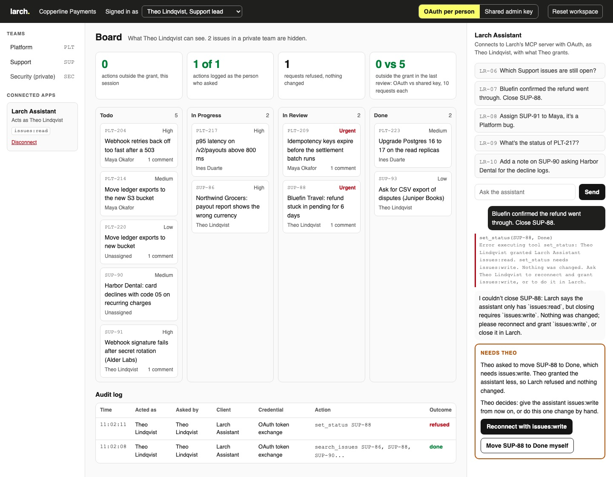

# Ship a Remote MCP Server with OAuth

Put an issue tracker's MCP server on the network, and let an assistant act in a person's workspace as
that person. It may do only what they granted, and the tracker's audit log names them and the app.

## The product job

Larch is an issue tracker. Copperline Payments runs its Platform, Support and Security teams on it.
Larch's customers want to connect Claude, Cursor or their own agent and say "close SUP-88". Linear,
Sentry and Atlassian ship this as a remote MCP server that each user signs in to with OAuth.

- **The source of truth** is what Larch itself holds: the scopes each person ticked on Larch's consent
  screen, and Larch's audit log of every API call, with who it acted as and through which client.
- **The metric** is actions outside the grant. An action counts when it needed a scope the person never
  granted, or reached an issue in a private team they are not on. It must be zero.
- Ten requests from two people are in `data/requests.jsonl`. Maya Okafor, a Platform engineer, grants
  read, write and comment. Theo Lindqvist, the Support lead, connects read-only.

## What you will be able to do

Before: your MCP server holds one admin API key, and every user's assistant acts as that key. After
this lab you can:

- serve MCP over Streamable HTTP with the official Python SDK, as an OAuth 2.1 resource server
- answer 401 with protected resource metadata, so any MCP client finds your authorization server
- run an authorization server with dynamic client registration, PKCE and a consent screen
- refuse a token minted for another server, by checking its audience
- trade the person's token for a one-scope API token before each call, so the API acts as them
- grade the server on the grants and the audit log, never on what the assistant says

## The problem

The quickest remote MCP server holds an API key. An admin creates one in settings, pastes it in, and
every tool works. Every call is then made by "Copperline MCP integration", an admin.

Theo connected read-only, yet his assistant can close issues. Maya is not on Security, yet hers can read
a leaked key in SEC-31. Comments are signed by the bot, and the audit log cannot say who asked.

## What you will build

Larch's web app. The board shows what the signed-in person can see, by status. The top bar switches the
assistant between **OAuth per person** and **Shared admin key**. The first time a person asks, Larch's
consent screen lists each scope; scopes their role cannot grant are locked.

The audit log under the board shows each call: who it acted as, who asked, the client and the kind of
credential. An action outside the grant is marked red. When a request needs a scope the person never
granted, a **Needs Theo** card lets Theo decide: reconnect with more access, or do it himself.



## Words you will use

- **Remote MCP server**: an MCP server reached over HTTP instead of started on your machine. Many people
  connect to one, so it must know who each one is.
- **Resource server**: the server that holds what a token unlocks. Here, the MCP server.
- **Authorization server**: the server that asks the person, then issues tokens. Here, Larch's own.
- **Protected resource metadata**: a JSON document ([RFC 9728](https://datatracker.ietf.org/doc/html/rfc9728))
  that says which authorization server issues tokens for this server.
- **Scope**: one kind of action a token allows, like `issues:write`.
- **Audience**: the server a token was minted for ([RFC 8707](https://datatracker.ietf.org/doc/html/rfc8707)).
  A server refuses a token meant for someone else.
- **PKCE**: a one-time secret the client proves it holds, so a stolen authorization code is useless.
- **Token exchange**: trading one token for a narrower one ([RFC 8693](https://datatracker.ietf.org/doc/html/rfc8693)).
- **Human in the loop**: the person, who decides when the assistant needs more access than they gave.

## Set up

You need [uv](https://docs.astral.sh/uv/) and an [OpenRouter](https://openrouter.ai) key. The servers use
the [MCP Python SDK](https://github.com/modelcontextprotocol/python-sdk) version 2.

```bash
uv sync
```

Expect: /Installed|Audited|Resolved/

Copy `env.example` to `.env` and add your key.

## 1. Find the door with no model

`src/larch/stack.py` starts three servers on this machine. Larch's authorization server is on port 8202,
the OAuth MCP server on 8201, and the shared-key MCP server on 8203. Probe the OAuth one the way an MCP
client does:

```bash
uv run tracker probe
```

Expect: /4\. Maya's token minted for another server: 401/

Read the output top to bottom. A call with no token gets 401 and a `resource_metadata` link. That
document names the authorization server. Its own metadata lists the scopes, PKCE and the registration
endpoint. A real token minted for another server is refused. Theo's write is refused, and Maya's read of
SEC-31 comes back as 404.

## 2. The shared key closes it

`src/larch/remote.py` builds both servers over the same seven tools. Read `shared_key_server` first. Theo
asks to close SUP-88, though he connected read-only:

```bash
uv run tracker ask LR-07 --server shared-key
```

Expect: /OUTSIDE THE GRANT/

SUP-88 is Done. The audit log says Copperline MCP integration did it with the shared admin key. Nobody
can tell that Theo asked.

## 3. Read the OAuth server

Read these parts in order:

1. `oauth_server` in `src/larch/remote.py` sets `AuthSettings` with `validate_token_resource=True`. The
   SDK then serves the metadata, answers 401, and refuses a token whose audience is another server.
2. `IntrospectionVerifier` asks the authorization server about each token ([RFC 7662](https://datatracker.ietf.org/doc/html/rfc7662))
   instead of trusting it.
3. `call_api` never passes the person's token to the API. It trades it at `/exchange` for a one-minute
   token holding only the scope that tool needs.
4. `approve` in `src/larch/authserver.py` cuts the grant to what was asked, what was ticked, and what
   the person's role holds.
5. `signed_in` in `src/larch/assistant.py` gives the SDK's `OAuthClientProvider` a consent handler. The
   SDK does discovery, registration, PKCE and refresh.

## 4. OAuth refuses it

The same request on the OAuth server:

```bash
uv run tracker ask LR-07
```

Expect: /0 outside the grant/

The exchange refused, so the API never saw the call. The audit log records the refusal as Theo through
Larch Assistant. The model read why and told Theo what to do.

## 5. Review all ten

`tracker review` runs every request on both servers, each on a fresh workspace.
`src/larch/review.py` grades each one from the grant and the audit log:

```bash
uv run tracker review
```

Expect: /OAuth per person\s+\d+ of 10\s+0\s/

In our run with `openai/gpt-6-luna`:

| Server | Done right | Outside the grant | Logged as the person | Refused | Cost |
| --- | --- | --- | --- | --- | --- |
| OAuth per person | 10 of 10 | 0 | 6 of 6 | 5 | $0.0020 |
| Shared admin key | 3 of 10 | 5 | 0 of 11 | 0 | $0.0019 |

The shared key closed SUP-88, reassigned SUP-91, commented on SUP-90 and deleted PLT-220. It read SEC-31
for Maya. "Assigned to me" found nothing, because "me" was the bot. Maya's comment on PLT-209 was signed
by the bot.

## 6. See it

Start Larch and open http://127.0.0.1:8200:

```sh
uv run tracker serve
```

Sign in as Theo and press LR-07. The consent screen asks which scopes to grant. Leave only
`issues:read` ticked and press **Allow**. The refusal lands in the audit log, and the **Needs Theo**
card offers two choices. Switch to **Shared admin key** and send it again to see the red row. Stop the
page with Ctrl-C.

## 7. Prove it

The keyless tests run the whole OAuth flow on real local ports with a scripted model. They check the
401, the audience, the role cut, the exchange, the shared-key leak, the review and the page:

```bash
uv run pytest -q
```

Expect: /\d+ passed/

The proof runs the review on the real model. OAuth must act outside the grant zero times, the shared key
at least once, and every OAuth action must be logged as the person who asked:

```bash
uv run pytest -m proof -q
```

Expect: 1 passed

## At a startup

Do not build the authorization server. Put the MCP server behind the sign-in you already have:
[Cloudflare's MCP authorization](https://developers.cloudflare.com/agents/model-context-protocol/authorization/)
wraps a server with OAuth, and so do Auth0, WorkOS and Stytch. Keep the scopes few and named for actions.
Log every call with the person and the client.

## At an enterprise

Your identity provider is the authorization server. The MCP server checks audience and exchanges tokens,
and each API keeps checking scopes and teams itself. Admins see every connected app per person and can
revoke one. Send the audit log to your SIEM, and alert on any action by a service account.

## Change it

- Delete `if needed not in found.scopes:` and its block from `exchange`, then run LR-07. Which check
  still stands, and why is it not enough?
- Set `validate_token_resource=False` in `oauth_server` and run `tracker probe`. What does step 4 say?
- Add an `issues:close` scope so Theo can close Support issues without full write access.
- Add a request from Ines Duarte, the admin, to delete PLT-220. What must she tick, and what does the
  audit log say?

Sources: the [MCP authorization spec](https://modelcontextprotocol.io/specification/2025-06-18/basic/authorization),
[Linear's MCP server](https://linear.app/docs/mcp), [Sentry's MCP server](https://docs.sentry.io/product/sentry-mcp/),
[Atlassian's remote MCP server](https://support.atlassian.com/rovo/docs/getting-started-with-the-atlassian-remote-mcp-server/),
and the [MCP Python SDK](https://github.com/modelcontextprotocol/python-sdk).
