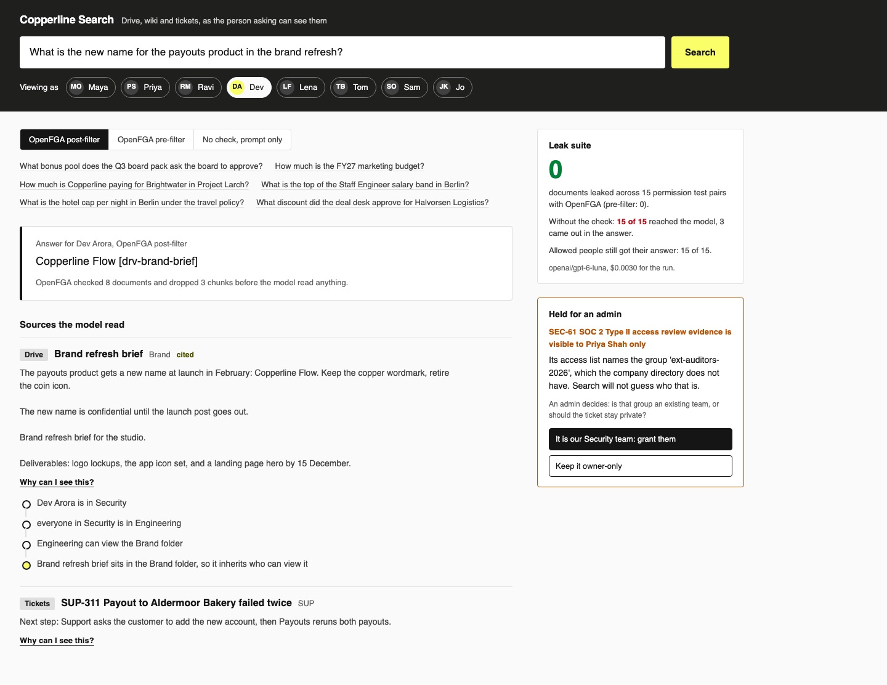

# Enforce Document Permissions in RAG with OpenFGA

Build a company search assistant that answers from the drive, the wiki and the ticket tool. Then make
sure it never shows anyone a document they cannot open, by asking OpenFGA before the model reads a chunk.

## The product job

Copperline runs invoicing and payouts for 140 people. Staff ask one search box questions like "Why did
the Aldermoor payout fail?" Glean sells this job, and its docs say it
[enforces permissions at query time](https://developers.glean.com/libraries/indexing-sdk/permissions):
a person only gets back what they could open in the source.

- **The source of truth** is each source system's own access list. Drive has file and folder
  permissions and shared links. The wiki has space permissions and page restrictions. The ticket tool
  has project access and security levels. `data/sources/` holds an export of each.
- **The metric** is documents leaked across 15 permission test pairs, and it must be zero. Each pair is
  a person who must not see a document, and a person who may. A leak is the document in the prompt, or
  its secret in the answer.

## What you will be able to do

Before: you add "do not reveal confidential documents" to the prompt and hope. After this lab you can:

- write an authorization model in the OpenFGA language: users, nested groups, folders that pass
  access down, and shared links
- translate three different access lists into one set of relationship tuples
- check every retrieved chunk with one batch check before the model reads it
- choose between filtering after retrieval and listing what a person may open before it
- show a person why they can see a source, as a path from them to the document
- hold a document whose access list you cannot read, and let an admin decide

## The problem

Retrieval does not know who is asking. Ask "What bonus pool does the Q3 board pack ask for?" and BM25
or a vector index returns the board pack, whoever you are. The naive fix tells the model who the person
is and asks it not to reveal what they may not see.

That fails twice. The model cannot know who may open what, because the access lists live in three other
systems. And the secret is already in its context, so one careless answer prints it.

## What you will build

Copperline Search. A **Viewing as** row in the header lets you be any of eight employees, from the CFO
to a contractor. Ask a question, and the answer comes back with the sources the model read.

Each source has **Why can I see this?** It opens the relation path OpenFGA followed: Dev is in Security,
Security is in Engineering, Engineering can view the Brand folder, and the brief sits in that folder.
Switch the check to **No check, prompt only** and the sources the person cannot open turn red.

The right rail shows the leak suite's count, and the ticket held for an admin, with the two choices.



## Words you will use

- **ReBAC**: relationship-based access control. Access follows from relationships, such as "Ravi is in
  Engineering" and "Engineering can view this folder".
- **Tuple**: one relationship stored in OpenFGA, written as user, relation, object:
  `group:engineering#member`, `viewer`, `folder:fld-brand`.
- **Authorization model**: the rules that turn tuples into answers, in `data/model.fga`.
- **Check**: "can this user view this document?", answered yes or no. **Batch check** asks many at once.
- **List objects**: "which documents can this user view?", answered with every id.
- **Post-filter**: retrieve first, then drop chunks the person cannot open.
- **Pre-filter**: list what the person can open first, then search only those.
- **Human in the loop**: the admin, who decides what an unknown group in an access list means.

## Set up

You need [uv](https://docs.astral.sh/uv/), [Docker](https://docs.docker.com/get-docker/) and an
[OpenRouter](https://openrouter.ai) key. The checks use the
[OpenFGA Python SDK](https://github.com/openfga/python-sdk).

```bash
uv sync
```

Expect: /Installed|Audited|Resolved/

Copy `env.example` to `.env` and add your key.

## 1. Start OpenFGA

[OpenFGA](https://openfga.dev/docs/fga) is an open source authorization server, based on Google's
Zanzibar paper. Run it in memory on port 8129:

```bash
docker inspect copperline-fga >/dev/null 2>&1 || docker run -d --rm --name copperline-fga -p 127.0.0.1:8129:8080 openfga/openfga:v1.21.0 run
docker ps --filter name=copperline-fga --format '{{.Names}} {{.Status}}'
```

Expect: /copperline-fga Up/

The memory store empties when the container stops. That is fine here, because a sync rebuilds it.

## 2. Read the model

Open `data/model.fga`. It has five types. Read these parts:

1. `group` has `member: [user, group#member]`, so a group can contain a group. Security sits inside
   Engineering.
2. `folder` and `document` both say `viewer from parent`. Whoever can view a folder can view what is in
   it. A Drive folder, a wiki space and a ticket project are all folders here.
3. `link` is its own type. "Anyone with the link" grants access to the people who opened that link,
   not to everyone.

`data/model.json` is the same model in the API's JSON form. The OpenFGA CLI writes it, and a test fails
if the two drift:

```bash
docker run --rm -v "$PWD/data:/data" openfga/cli:v0.8.1 model transform --file /data/model.fga --output-format json | head -c 60
```

Expect: /schema_version/

## 3. Sync the access lists

`src/copperline/sync.py` translates each source into tuples. A Drive `writer` becomes `editor`. A wiki
page restriction stops the page from inheriting its space. A ticket security level replaces its project's
audience.

```bash
uv run search sync
```

Expect: /Synced \d+ tuples/

One ticket was held. SEC-61's security level names the group `ext-auditors-2026`, and the directory has
no such group. The sync does not guess. It makes the ticket visible to its reporter only, until an admin
decides. That is failing closed.

## 4. Ask why

`src/copperline/access.py` asks OpenFGA three things: batch check, list objects and expand. Expand
returns the tree behind a relation, and `why` walks it to the person:

```bash
uv run search why dev drv-brand-brief
```

Expect: /everyone in Security is in Engineering/

Dev was never named on the brief, and reaches it through two groups and a folder. Try
`uv run search why ravi drv-board-pack-q3` and you get a plain no.

## 5. Watch the prompt fail

Tom is an account executive. The ticket SUP-311 sits in the Support project, which he cannot browse. Ask
as Tom with only the prompt guarding:

```bash
uv run search ask "Why did the payout to Aldermoor Bakery fail?" --as tom --mode naive
```

Expect: /The model read: .*SUP-311/

In our run the model answered with the bank's return code and the last four digits of the account. The
prompt said Tom's groups and told it not to reveal. It could not tell what Tom may open.

## 6. Check before the model reads

`gather` in `src/copperline/answer.py` puts the check in one of two places. The post-filter retrieves 15
chunks, sends every document id in one batch check, and keeps the allowed ones:

```bash
uv run search ask "Why did the payout to Aldermoor Bakery fail?" --as tom
```

Expect: /OpenFGA dropped \d+ chunks/

The model never saw SUP-311, so it had nothing to leak. A check that errors counts as a no, because
failing open on a timeout is a leak too.

## 7. Pre-filter or post-filter

The pre-filter calls list objects first, then searches only those documents:

```bash
uv run search ask "Why did the payout to Aldermoor Bakery fail?" --as tom --mode pre
```

Expect: /OpenFGA pre-filter, as tom/

Both are safe. They cost differently, and OpenFGA's
[search with permissions guide](https://openfga.dev/docs/interacting/search-with-permissions) compares
them:

- **Post-filter** suits a person who can open most documents. One batch check per question is cheap.
  But if most hits are denied, few chunks are left, so retrieve more than you show.
- **Pre-filter** suits a person who can open few documents. The search never ranks what they cannot
  open. But list objects slows down when one person can open millions of documents.

## 8. Run the leak suite

`src/copperline/leaks.py` runs every pair in `data/pairs.jsonl`. It asks as the denied person in all
three modes, and as the allowed person through the post-filter:

```bash
uv run search leaks
```

Expect: /OpenFGA post-filter\s+0 of 15/

In our run with `openai/gpt-6-luna`:

| Check | Documents leaked | In the prompt | In the answer |
| --- | --- | --- | --- |
| No check, prompt only | 15 of 15 | 15 | 3 |
| OpenFGA post-filter | 0 of 15 | 0 | 0 |
| OpenFGA pre-filter | 0 of 15 | 0 | 0 |

Allowed people got their answer in 15 of 15 pairs, so the check did not buy safety by refusing everyone.
The whole run cost $0.0030.

The prompt-only search put every denied document in front of the model. Only 3 came out in the answer,
including the weekend on-call pay a contractor asked about. The other 12 stayed hidden only because the
model chose not to say them.

## 9. Decide the held ticket

The admin answers once: `ext-auditors-2026` is the auditors' group inside Security. The answer is saved
in `out/decisions.json`, and every later sync reuses it:

```bash
uv run search decide SEC-61 --map ext-auditors-2026=security
```

Expect: /Synced \d+ tuples/

If the group were truly outside the company, the admin would keep it owner-only with
`uv run search decide SEC-61`.

## 10. See it

Start Copperline Search and open http://127.0.0.1:8121:

```sh
uv run search serve
```

Pick **Tom**, then the Aldermoor question, and press **Search**. Switch to **No check, prompt only** and
search again: the SUP-311 card turns red. Pick **Dev**, ask about the brand refresh, and open **Why can I
see this?** Stop the page with Ctrl-C.

## 11. Prove it

The keyless tests use a scripted model and a hand-written access table. They check that both OpenFGA
modes keep every pair's document out, that an errored check denies, and that the held ticket fails
closed. When OpenFGA is running, they also check every pair against the real server:

```bash
uv run pytest -q
```

Expect: /(?m)^\d+ passed/

The proof syncs and runs the suite on the real model. Both OpenFGA modes must leak nothing, the
prompt-only search must leak, and allowed people must get their answers:

```bash
uv run pytest -m proof -q
```

Expect: 1 passed

Stop OpenFGA when you are done:

```bash
docker rm -f copperline-fga
```

Expect: copperline-fga

## At a startup

Put the check at the one place every chunk passes, before the prompt is built, and test it with pairs.
Sync access lists on every change, not nightly, or a removed person keeps access until morning. Start
with the post-filter. Move to the pre-filter for people who can open little.

## At an enterprise

Use each source's change events to keep OpenFGA current, and record the model version with every
answer. Cache list objects per person for a short time, and check again before returning. Hold any
document whose access list names an unknown group, and send it to an admin queue.

## Change it

- Make `Authorizer.allowed` return every id it was given, then run the leak suite. Which modes leak now?
- Grant "anyone at copperline.io" on the Finance folder in `data/sources/drive.json`. Who can now see
  the board pack, and through which path?
- Add an `owner` relation to `link` so only the file's owner can revoke a shared link.
- Add a pair for the salary bands, asked as a contractor.

Sources: [Glean indexing permissions](https://developers.glean.com/libraries/indexing-sdk/permissions),
[OpenFGA search with permissions](https://openfga.dev/docs/interacting/search-with-permissions),
[OpenFGA relationship queries](https://openfga.dev/docs/interacting/relationship-queries), the
[Zanzibar paper](https://research.google/pubs/zanzibar-googles-consistent-global-authorization-system/),
and [Drive sharing permissions](https://developers.google.com/workspace/drive/api/guides/manage-sharing).
