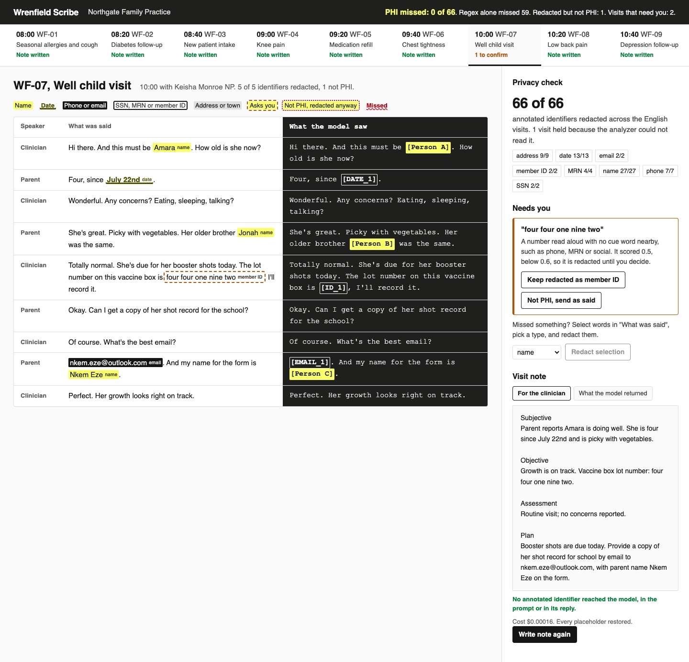

# Redact PII and PHI before the LLM

Strip patient identifiers from a visit transcript before an LLM writes the note, then put them back for
the clinician. Then count how many identifiers your redactor misses.

## The product job

Wrenfield builds a clinical scribe for Northgate Family Practice. The room is recorded, the transcript
is written down, and a model drafts the visit note. Abridge and Microsoft's Dragon Copilot sell this
product to hospitals. Under HIPAA, the transcript is protected health information (PHI).

- **The source of truth** is the PHI spans a person annotated in 14 visit transcripts in
  `data/visits.jsonl`. Each span has its type: name, date, phone, email, SSN, MRN, member ID or address.
- **The metric** is PHI missed: annotated spans that would reach the model as written. Recall per type,
  and precision, are graded too.

## What you will be able to do

Before: you run a regex for phones and emails over the prompt and call it redacted. After this lab you
can:

- find PHI with Microsoft Presidio and a spaCy model, and see what its defaults miss in speech
- add your own recognizers for an MRN format, a member ID and numbers read aloud
- keep doctors and drug names out of the redaction with a written rule
- swap each identifier for a stable placeholder, so one patient stays one person in the note
- put the real values back after the model, for the clinician only
- hold a transcript the analyzer cannot read, instead of sending it raw
- grade a redactor against annotations, by type, with the missed spans named

## The problem

A transcript is speech. Nobody says "SSN: 412-67-3398". They say "four one two, six seven, three three
nine eight". They say "the twelfth of June", "my daughter Adaeze", and spell their name letter by letter.
A regex built for forms finds almost none of it.

The model vendor is a third party. Every name or date that slips through is a disclosure, and one missed
span in a thousand visits is still a breach. So the measure is recall, and a failure must stop the visit.

## What you will build

Wrenfield's transcript editor. The day's visits run across the top. Each line of the transcript shows
what was said, with every identifier highlighted by type, beside what the model saw: placeholders like
`[Person A]` and `[MRN_1]`.

The sign-off rail shows the privacy check: PHI missed, out of every annotated span. A **Needs you** card
holds anything the detector was unsure about, with the reason. The clinician keeps it redacted or sends
it as said. They can select missed words and redact them. The note appears with the real names back in.



## Words you will use

- **PHI**: health information tied to a person. HIPAA's Safe Harbor method lists 18 identifiers to
  remove, including names, dates more specific than the year, phone numbers and record numbers.
- **Recognizer**: a Presidio component that finds one kind of entity, by a model, a pattern or code.
- **Recall**: the share of annotated spans the redactor caught. A missed span is a leak.
- **Precision**: the share of redacted spans that were PHI. A wrong one blanks a word the note needed.
- **Placeholder**: the text that replaces an identifier, such as `[Person A]`. The same person always
  gets the same one.
- **Vault**: the map from placeholders back to real values. It never leaves the clinic.
- **Fail closed**: when the check breaks, block the send. Failing open turns every bug into a breach.
- **Human in the loop**: the clinician, who decides on the spans the detector was unsure about.

## Set up

You need [uv](https://docs.astral.sh/uv/) and an [OpenRouter](https://openrouter.ai) key. The detector
is [Microsoft Presidio](https://microsoft.github.io/presidio/analyzer/) with spaCy's `en_core_web_md`
model, which `uv sync` installs.

```bash
uv sync
```

Expect: /Installed|Audited|Resolved/

Copy `env.example` to `.env` and add your key. The model is `openai/gpt-6-luna`.

## 1. Try regex

WF-06 is a patient with chest tightness. He reads his MRN off his wristband and gives his phone number
out loud. `regex_spans` in `src/wrenfield/detect.py` looks for phones, emails and SSNs the way they are
typed:

```bash
uv run scribe redact WF-06 --detector regex
```

Expect: /0 spans redacted\. Annotated PHI still in the text: 'Marcus'/

Nothing was redacted. His brother's name, the date and both numbers would go to the model.

## 2. Presidio with the clinic's recognizers

`PhiDetector` in `src/wrenfield/detect.py` runs Presidio's analyzer with spaCy, then adds the clinic's
own recognizers in `clinic_recognizers`. Read these parts:

1. `SpokenNumberRecognizer` finds digits said as words, and names the type from a cue word nearby:
   "social" makes an SSN, "wristband" or "MRN" makes an MRN.
2. `NorthgateMrn` is the clinic's MRN format, HL and seven digits. Every EHR has its own.
3. `keep` applies the Safe Harbor rule: clinicians and the formulary are not PHI, and a state on its
   own is not an identifier.

```bash
uv run scribe redact WF-06
```

Expect: /4 spans redacted\. Annotated PHI still in the text: none/

`src/wrenfield/redact.py` swaps each span for a placeholder through a custom Presidio anonymizer
operator. "Marcus" is now `[Person A]` every time he comes up.

## 3. Grade every detector

`scribe grade` runs three detectors over the 13 English visits and compares each with the annotations:

```bash
uv run scribe grade
```

Expect: /Presidio \+ clinic: PHI missed 0 of 66/

In our run:

| Detector | Recall | PHI missed | Extra | Names | Dates | MRNs |
| --- | --- | --- | --- | --- | --- | --- |
| Regex only | 0.106 | 59 of 66 | 0 | 0 of 27 | 0 of 13 | 0 of 4 |
| Presidio as installed | 0.667 | 22 of 66 | 0 | 21 of 27 | 11 of 13 | 1 of 4 |
| Presidio + clinic | 1.0 | 0 of 66 | 1 | 27 of 27 | 13 of 13 | 4 of 4 |

Presidio's defaults missed a spelled-out name, "the twelfth of June", and every MRN but one. The extra
span is a vaccine lot number, "four four one nine two". It scored 0.5, below 0.6, so it waits for the
clinician.

## 4. Fail closed

WF-14 is a visit in Spanish. The analyzer only has English recognizers, so it raises an error:

```bash
uv run scribe redact WF-14
```

Expect: /HELD\. The analyzer could not read this transcript/

`prepare` in `src/wrenfield/scribe.py` catches any analyzer error and holds the visit. Nothing in a held
visit is passed to the model. The clinician writes that note, or sends it to someone who reads Spanish.

## 5. Write the notes

`scribe notes` sends each redacted transcript to the model, saves exactly what was sent, and checks the
prompt and the reply for every annotated span:

```bash
uv run scribe notes
```

Expect: /Annotated PHI that reached the model: 0\./

In our run, 13 notes were written and one was held, with no annotated PHI in any prompt or note. All 13
cost about $0.002. The stored note keeps its placeholders. `reidentify` puts the real values back only when
a clinician opens it.

## 6. See it

Start the transcript editor and open http://127.0.0.1:8240/?visit=WF-07:

```sh
uv run scribe serve
```

Point at "Amara" to light up `[Person A]`. Decide on the lot number in **Needs you**. Select a word in
**What was said**, pick a type and press **Redact selection**. Press **Write note** to see the note.
Open WF-14 to see a held visit. Stop the page with Ctrl-C.

## 7. Prove it

The keyless tests use a scripted model. They check recall on every visit, the hard cases, placeholders,
re-identification, the clinician's decisions, the held visit and the page's local-only server:

```bash
uv run pytest -q
```

Expect: /\d+ passed/

The proof writes every note on the real model. No annotated span may appear in a prompt or a stored
note, the Spanish visit must be held, and Presidio must miss fewer spans than regex:

```bash
uv run pytest -m proof -q
```

Expect: 1 passed

## At a startup

Annotate a few dozen real transcripts, with consent and a business associate agreement, before you
trust any redactor. Grade recall per type on every change. Add a recognizer for each format your EHR
uses. Hold anything the analyzer cannot read, and show the clinician what was held and why.

## At an enterprise

Keep the vault in the clinic's own database, encrypted, and log only placeholders. Sign a business
associate agreement with the model vendor anyway, because recall is never 1.0 on new speech. Run the
annotated set in CI, and add every miss a clinician finds as a new case.

## Change it

- Remove `SpokenNumberRecognizer` from `clinic_recognizers` and run `scribe grade`. Which types drop?
- Set `REVIEW_BELOW` to 0.4 and run `scribe redact WF-07`. Who decides about the lot number now?
- Make `prepare` send the raw transcript when the analyzer fails, then run the tests. Which one catches
  it?
- Add a Spanish spaCy model and a Spanish `NlpEngineProvider` config, so WF-14 is redacted.

Sources: [HHS guidance on de-identifying PHI](https://www.hhs.gov/hipaa/for-professionals/special-topics/de-identification/index.html),
the Safe Harbor list in [45 CFR 164.514(b)(2)](https://www.ecfr.gov/current/title-45/subtitle-A/subchapter-C/part-164/subpart-E/section-164.514),
the [Presidio analyzer](https://microsoft.github.io/presidio/analyzer/) and
[anonymizer](https://microsoft.github.io/presidio/anonymizer/) docs, and
[Abridge on clinical documentation](https://www.abridge.com/ai).
