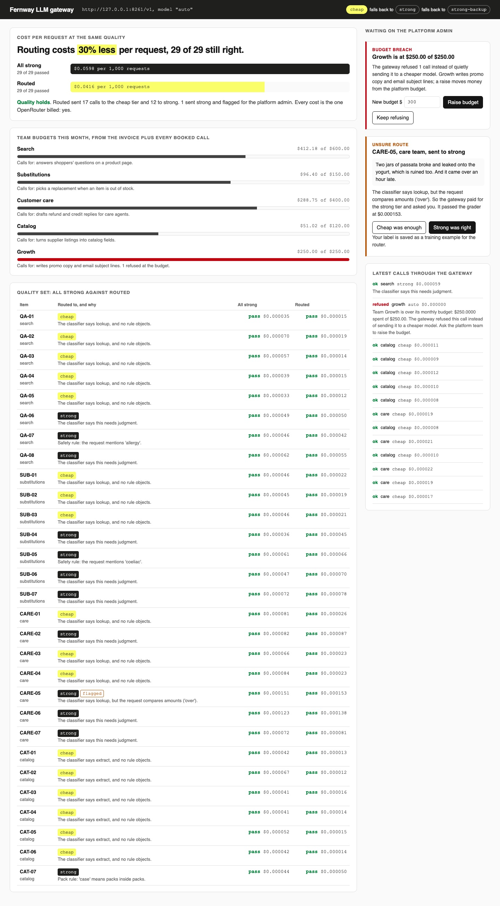

# Route LLM Calls with an LLM Gateway

Put one LiteLLM proxy between every team and the model providers. Send each call to the cheapest model
that answers it well, refuse a team at its budget, and measure cost per request at the same quality.

## The product job

Fernway delivers groceries. Five teams call LLMs: search answers shoppers' questions, substitutions picks
a replacement, care drafts refund replies, catalog cleans supplier listings and growth writes promo copy.
Every app called the strongest model with its own key, and finance could not say which team spent what.

Instacart runs its large LLM jobs through Maple and an internal AI gateway, which handle retries and
cost tracking in one place. LMSYS showed with RouteLLM that a router can cut cost by over 85% on MT Bench and keep 95% of
GPT-4's quality.

- **The source of truth** is the provider invoice and a labelled quality set. `data/invoices.json` is
  the OpenRouter spend per team so far this month. `data/quality.jsonl` holds 29 real-looking calls from
  four teams, each with the answer a person who knows the policy wrote down.
- **The metric** is cost per request at the same quality. The routed gateway must cost less per request
  than sending every call to the strong model, and pass at most one fewer labelled item. Every cost is
  the one OpenRouter billed.

## What you will be able to do

Before: every app holds a provider key, calls the strongest model for everything, and the bill arrives
as one number. After this lab you can:

- run the LiteLLM proxy as the one address every team calls, with a key per team
- define model tiers and fallbacks in one config file instead of in every app
- route each call with free rules first, then a one-word label from the cheap model
- fail closed: anything the router is unsure about goes to the strong tier and is flagged
- book every call's billed cost against the team's budget, and refuse at the budget
- watch a dead provider fall back to a stronger tier, never a weaker one
- score routing on a labelled set, so a saving that breaks answers shows up as a failure

## The problem

A shopper asks "is this organic?" and the product page says so. Any model answers that. A care agent
pastes a complaint about two broken jars, a ruined yogurt and a late van. Now the reply must apply the
refund policy to the cent, and small models slip.

Sending everything to the strong model wastes money on the easy calls. Sending everything to the cheap
model gives wrong refunds. And when one team's promo experiment burns its budget, the honest move is to
refuse the call, not to quietly answer it with a worse model.

## What you will build

Fernway's LLM gateway, and its admin console. The console shows the metric as two bars: what a thousand
requests cost when every call goes strong, and when the gateway routes them, with the quality count under
each. Each team's spend fills a meter against its budget.

The rail on the right is what waits on the platform admin. Growth is over budget and its calls are
refused: raise the budget or keep refusing. A care complaint the router was unsure about went strong:
label whether cheap would have been enough. Each card says why it is there.



## Words you will use

- **LLM gateway**: one service every app calls instead of a provider. It holds the provider keys,
  checks who is calling, picks the model and books the cost.
- **Tier**: a name the apps use, such as `cheap` or `strong`, that the gateway maps to a real model.
  Swapping a model is one line in the config.
- **Router**: the code that picks a tier for one call. Here it is two rules and a classifier.
- **Classifier**: a cheap model call that labels the request lookup, extract, judgment or unclear.
- **Fallback**: the tier the gateway tries when a provider fails. Cheap falls back to strong, never the
  other way.
- **Budget**: what a team may spend this month. The gateway refuses the call at the budget.
- **Fail closed**: when the router cannot tell, pay for the strong tier rather than risk a wrong answer.
- **Human in the loop**: the platform admin, who decides on budget breaches and labels flagged routes.

## Set up

You need [uv](https://docs.astral.sh/uv/) and an [OpenRouter](https://openrouter.ai) key. The gateway is
the [LiteLLM proxy](https://docs.litellm.ai/docs/simple_proxy), pinned to 1.103.1, which `uv sync`
installs.

```bash
uv sync
```

Expect: /Installed|Audited|Resolved/

Copy `env.example` to `.env` and add your key. The strong tier is `openai/gpt-6-luna`. The cheap tier is
`qwen/qwen3.7-flash` with reasoning off. With reasoning on it thinks for hundreds of tokens and costs more
than the strong model. The strong tier falls back to `anthropic/claude-haiku-5.5`, a second vendor.

## 1. One key per team

`gateway keys` makes a gateway key for each team and writes the proxy's config to `out/litellm.yaml`.
It needs no provider key:

```bash
uv run gateway keys
```

Expect: /growth .*250\.00 .*OVER BUDGET/

Open `out/litellm.yaml`, written by `config` in `src/fernway/proxy.py`. Read these parts:

1. `model_list` maps the tiers `strong`, `cheap` and `strong-backup` to OpenRouter models. The provider
   key is `os.environ/LLM_API_KEY`, so it never lands in the file.
2. `fallbacks` sends a failed cheap call to strong, and a failed strong call to strong-backup.
3. `custom_auth` and `callbacks` load `src/fernway/hooks.py` into the proxy.

LiteLLM's own virtual keys and team budgets need a Postgres database. The hooks hold the same rules in two
small files, so the lab runs as one process.

## 2. Send every call to the strong tier

`gateway eval` starts the real proxy, sends the quality set through it with each team's key, and grades
every reply. This is how most teams start, with every call on the strong tier:

```bash
uv run gateway eval --mode strong
```

Expect: /strong: \d+ of 29 passed\..*Every cost billed by OpenRouter: yes/

In our runs, 28 or 29 of 29 passed, at about $0.000060 per request. The cost on each row is the one
OpenRouter reported for that call, read from the response by LiteLLM.

## 3. Let the gateway route

Now each team asks for model `auto`. `async_pre_call_hook` in `src/fernway/hooks.py` checks the team's
budget, then calls `route` in `src/fernway/router.py`:

1. A safety rule: a request that mentions an allergy or coeliac goes strong, with no classifier call.
2. A pack rule: a case of trays of cans goes strong, because the cheap model multiplies the sizes.
3. The classifier: the cheap tier labels the request in one word.
4. A lookup or extract label goes cheap, unless the request compares amounts, such as "over an hour
   late". Then the rules and the label disagree, so the call goes strong and is flagged.

```bash
uv run gateway eval --mode routed
```

Expect: /Routed vs all strong: .*cheaper\. Quality holds/

In our runs, 28 or 29 of 29 passed at about $0.000040 per request, 30 to 40 percent cheaper. About 18
calls went cheap. The classifier's own call is counted in each request's cost.

## 4. See why routing matters

Send every call to the cheap tier, to see what the router protects:

```bash
uv run gateway eval --mode cheap
```

Expect: /cheap: \d+ of 29 passed\./

In our runs, 25 or 26 passed. The cheap model gave a late-delivery credit instead of the refund. It read
a 6-pack of 330 ml cans as over 2 litres, and called an unstated Fairtrade claim a no. It multiplied a
case of cans into one size. It costs a fifth as much, and one wrong refund costs far more.

## 5. Refuse at the budget

Growth has spent its whole $250 this month, according to the invoice. Ask the gateway for promo copy:

```bash
uv run gateway ask growth "Write three email subject lines for the weekend berry offer."
```

Expect: /Refused \(402\): Team Growth is over its monthly budget/

The gateway refused the call and booked the refusal. It did not send it to a cheaper model. A silent
downgrade would hide the overspend and hand growth worse copy without telling anyone.

## 6. Survive a provider outage

`--cheap-down` points the cheap tier at a port where nothing listens:

```bash
uv run gateway ask search "Can I freeze the Fernway White Sourdough? Facts: suitable for home freezing, use within one month." --cheap-down
```

Expect: /fell back from cheap to strong/

The classifier's call failed on cheap and strong answered it. When the router picks cheap, the answer
falls back the same way. Each failure is booked as a `provider_error` row, so the outage shows in the
books even though the shopper saw nothing.

## 7. See it

Start the admin console and open http://127.0.0.1:8260:

```sh
uv run gateway serve
```

Read the two bars, then the Growth meter. In **Waiting on the platform admin**, raise Growth's budget or
keep refusing. Label the flagged care call: was cheap enough, or was strong right? Your labels are saved
in `out/decisions.json` as training data for the router. Stop the page with Ctrl-C.

## 8. Prove it

The keyless tests call the hooks the way LiteLLM does, with a scripted classifier. They cover the
router's rules, the refusal, the billed cost, the fallback config, the metric and the console:

```bash
uv run pytest -q
```

Expect: /\d+ passed/

The proof runs both modes through a real proxy on real models. Routed must cost less per request, pass at
most one fewer item, and every cost must be billed. Growth must be refused, and a dead cheap tier must
fall back to strong:

```bash
uv run pytest -m proof -q
```

Expect: 2 passed

## At a startup

Put the gateway in before the second team calls a model, while it is one config file. Give each team a
key, even if they all share one budget. Keep a labelled set of a few dozen real calls per team, and run
it whenever you change a tier or a rule.

## At an enterprise

Run LiteLLM with its Postgres database, so virtual keys, team budgets and spend logs live in one place.
Reconcile the gateway's books against the provider invoice every month. Send flagged routes to a review
queue, and train the router on what reviewers decide.

## Change it

- Delete the `AMOUNTS` check in `route` and run the routed eval. Which care item fails?
- Point the cheap tier at a model with reasoning on. Does it still cost less than strong?
- Set Growth's budget to 300 in the console, then run the refusal step again.
- Change `ALLOWED_DROP` in `src/fernway/evaluate.py` to 0. How often does the proof pass?

Sources: [Instacart on Maple and its AI gateway](https://tech.instacart.com/simplifying-large-scale-llm-processing-across-instacart-with-maple-63df4508d5be),
[RouteLLM from LMSYS](https://lmsys.org/blog/2024-07-01-routellm/), and the LiteLLM docs on
[custom auth](https://docs.litellm.ai/docs/proxy/custom_auth),
[call hooks](https://docs.litellm.ai/docs/proxy/call_hooks),
[fallbacks](https://docs.litellm.ai/docs/proxy/reliability) and
[virtual keys](https://docs.litellm.ai/docs/proxy/virtual_keys). Costs come from
[OpenRouter usage accounting](https://openrouter.ai/docs/use-cases/usage-accounting).
