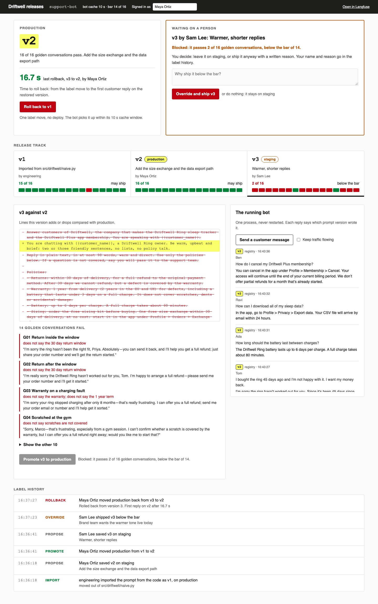

# Manage Prompts Outside Your Code

Let a product team change a support bot's prompt without a deploy, and roll it back in a minute. The
prompt lives in a Langfuse registry, each version is scored on a golden set, and a label decides which
version customers get.

## The product job

Driftwell sells the Driftwell Ring, a sleep tracker, and a Driftwell Plus membership. Its support bot
answers customers from a policy prompt. Maya Ortiz, the support product manager, edits that prompt
every week. Today each edit is an engineering ticket and a deploy.

- **The source of truth** is the golden set score of each prompt version: 16 real-looking support
  conversations in `data/golden.jsonl`, each with checks a person wrote from policy.
- **The metric** is time to roll back a bad prompt. The clock starts when a person moves the
  `production` label back. It stops at the running bot's first reply from the restored version.

## What you will be able to do

Before: the prompt is a string in the code, and an edit or a revert waits on a deploy. After this lab
you can:

- run Langfuse yourself with Docker Compose, and move a prompt from the code into it
- save each edit as a new version on a `staging` label, signed by who made it
- score every version on a golden set, and see which conversation each one breaks
- promote a version by moving the `production` label, behind a score gate
- let a named person override the gate, with a reason in the label history
- roll back with one label move, and time how long a running bot takes to pick it up
- keep the bot answering when the registry is down, from the last copy or a prompt pinned in the code
- find the prompt version behind any reply, from its trace in Langfuse

## The problem

Open `src/driftwell/naive.py`. The prompt is `PROMPT_IN_CODE`, a string shipped with every release.
Maya wants to add the free size exchange and the data export path. That is two sentences of policy.

To ship them, an engineer edits the file, a reviewer approves, CI runs, an image is built and rolled
out. If the new wording promises refunds it should not, the fix is the same trip again, with a revert.
The bad prompt answers customers for the whole round trip.

There is also no record of which wording a customer saw. A complaint about a reply from last Tuesday
needs `git log` and a deploy history to answer.

## What you will build

Driftwell's prompt release console. The top shows the version in production, its golden set score and
the last rollback time. The release track lays out every version left to right. Each carries its labels,
its score and one cell per golden conversation, red where it failed.

Pick a version to see its diff against production and the conversations it breaks. A version below the
bar waits in a **Waiting on a person** card with its score, until someone ships it with a written reason
or leaves it on staging. **Roll back** moves production back in one click. The running bot beside it
tags every reply with the version that wrote it. The label history keeps who moved which label, and why.



## Words you will use

- **Prompt registry**: a service that stores every version of a prompt outside the code. Langfuse and
  PromptLayer both offer one.
- **Version**: one saved text of the prompt. It never changes once saved; an edit makes a new version.
- **Label**: a name that points at one version, such as `production` or `staging`. Moving it is the
  release.
- **Golden set**: conversations with known right answers, scored on every version before it ships.
- **Gate**: the rule that a version below the bar cannot take `production`.
- **Override**: a named person shipping a version below the bar, with a written reason.
- **Cache TTL**: how long the bot trusts its copy of the prompt before it asks the registry again.
- **Pinned fallback**: the prompt kept in the code for when the registry has never answered.
- **Human in the loop**: the person who promotes, overrides or rolls back. The software never does.

## Set up

You need [uv](https://docs.astral.sh/uv/), Docker and an [OpenRouter](https://openrouter.ai) key. The
registry is [Langfuse](https://langfuse.com/docs/prompt-management/overview), self-hosted, through the
official Python SDK that `uv sync` installs.

```bash
uv sync
```

Expect: /Installed|Audited|Resolved/

Copy `env.example` to `.env` and add your key. The model is `openai/gpt-6-luna`. The Langfuse keys in it
are the local defaults that `compose.yaml` creates.

## 1. Run Langfuse

`compose.yaml` is Langfuse's own [Docker Compose setup](https://langfuse.com/self-hosting/deployment/docker-compose),
trimmed and pinned. It runs the web app, a worker, Postgres, ClickHouse, Redis and MinIO. Only the web app
is published, on port 8270. It creates the Driftwell project and its API keys on first start.

```bash
docker compose up -d --wait
```

Expect: /Healthy|Running|Started/

```bash
curl -s http://localhost:8270/api/public/health
```

Expect: "status":"OK"

In our run the six containers used about 2.1 GB of memory: the web app 1 GB, the worker 0.6 GB and
ClickHouse up to 0.8 GB. The first pull takes a few minutes. Sign in at http://localhost:8270 as
`product@driftwell.example`, password `driftwell-local`.

## 2. Move the prompt out of the code

`reset` empties the registry, the saved scores and the release log, so version numbers match this page. `import` saves
`PROMPT_IN_CODE` as version 1 and gives it the `production` label:

```bash
uv run driftwell reset && uv run driftwell import
```

Expect: Imported the prompt from the code as version 1, labelled production.

The bot no longer holds a prompt. Read `get` in `src/driftwell/prompt_source.py`: each reply asks the
SDK for the `production` label. The SDK keeps a copy for 10 seconds, so the registry is not called
on every reply.

## 3. Propose an edit

Maya writes the size exchange and the export path into `data/prompts/sizing-and-export.txt`. Saving it
makes version 2 on `staging`. No customer sees it yet:

```bash
uv run driftwell propose data/prompts/sizing-and-export.txt -m "Add the size exchange and the data export path" --by "Maya Ortiz"
```

Expect: Saved version 2 on staging, by Maya Ortiz

```bash
uv run driftwell diff 1 2
```

Expect: /\+.*Export data/

## 4. Score every version

`eval` runs the 16 golden conversations through each unscored version on the real model. `failed_checks`
in `src/driftwell/golden.py` grades each reply against the checks a person wrote:

```bash
uv run driftwell eval
```

Expect: /v2  1[4-6] of 16 pass  may ship/

In our run version 1 passed 15 of 16. It failed G11, the data export question, because the old prompt
has no export path. Version 2 passed 16 of 16. Scoring one version cost about $0.003.

## 5. Promote it

`promote` in `src/driftwell/release.py` moves the `production` label, and needs the name of the person
who decided:

```bash
uv run driftwell promote 2 --by "Maya Ortiz"
```

Expect: Promoted by Maya Ortiz: production moved from v1 to v2.

That was the release. No code changed and nothing was deployed.

## 6. A bad version is blocked

Sam Lee from the brand team wants a warmer tone. His prompt drops the policies and offers refunds to
anyone unhappy. It goes to staging like any edit, and the golden set catches it:

```bash
uv run driftwell propose data/prompts/warmer-tone.txt -m "Warmer, shorter replies" --by "Sam Lee" && uv run driftwell eval
```

Expect: /v3  \d+ of 16 pass  blocked/

```bash
uv run driftwell promote 3 --by "Sam Lee"
```

Expect: BLOCKED. Version 3 cannot go to production

In our runs version 3 passed 1 or 2 of 16. The bar is 85%, which is 14 of 16. A version with no score is
blocked too: the gate fails closed.

## 7. A person overrides

Sometimes a person decides to ship anyway. The override records who and why, and the console shows it
in the label history:

```bash
uv run driftwell promote 3 --by "Sam Lee" --override "Brand team wants the warmer tone live today"
```

Expect: OVERRIDE by Sam Lee: production moved from v2 to v3.

## 8. Roll back, and time it

Customers start getting refunds the policy does not allow. `rollback` starts the bot as its own
long-running process, replying once a second. Then it moves `production` back to version 2 and watches
for the first reply from it:

```bash
uv run driftwell rollback --by "Maya Ortiz"
```

Expect: /Rolled back to v2: the running bot answered from it \d+(\.\d)? s after the label moved/

In our runs that took 13 to 17 seconds, with no restart. The bot's copy lasts 10 seconds. After that,
the SDK serves the old copy once more and refreshes in the background. Lower `CACHE_TTL_SECONDS` in
`src/driftwell/config.py` for a faster rollback, at the cost of more calls to the registry.

`move_label` in `src/driftwell/registry.py` is the whole rollback: one API call. A second rollback goes
to the version before version 2, never back to the one just removed.

## 9. When the registry is down

A bot that cannot reach the registry must still answer. `get` falls back to the last version it fetched.
A bot that never reached it uses `PROMPT_IN_CODE`, the pinned fallback. Point a fresh bot at a port
where nothing listens:

```bash
LANGFUSE_BASE_URL=http://127.0.0.1:8279 uv run driftwell ask "How long does the battery last?"
```

Expect: [no version, pinned fallback

An empty version is treated the same way, so a blank prompt never reaches the model. The SDK logs that
the fetch failed; the reply still goes out.

## 10. Find the version behind a reply

Every reply is a Langfuse generation linked to the prompt version that wrote it, through `prompt=` in
`src/driftwell/bot.py`. Open **Prompts > support-bot** in Langfuse to see each version's replies, cost
and latency. `linked_version` reads the link back from the API, and the proof asserts it.

## 11. See it

Start the release console and open http://127.0.0.1:8271:

```sh
uv run driftwell serve
```

Turn on **Keep traffic flowing** so the bot replies every 2 seconds. Override version 3 in **Waiting on
a person**, then press **Roll back** and watch the replies switch versions. The production label slides
back along the release track. Stop the page with Ctrl-C.

## 12. Prove it

The keyless tests use a fake Langfuse and replay replies the real model gave each version. They check
the cache window, the fallbacks, the gate, the override, rollback, the rollback clock and the local-only
server:

```bash
uv run pytest -q
```

Expect: /\d+ passed/

The proof runs the whole release on the real model and the real Langfuse. Version 2 must clear the bar,
version 3 must not, and a rollback must reach a running bot in under 60 seconds. Langfuse must link a
reply to version 2, and a dead registry must leave the pinned prompt:

```bash
uv run pytest -m proof -q
```

Expect: 2 passed

When you are done, stop Langfuse. Add `-v` to delete its data too:

```sh
docker compose down
```

## At a startup

Move the prompt out of the code the day someone outside engineering wants to change it. Keep the
pinned fallback in the code. Score every version on a golden set before it can take `production`, and
write down who moved each label. A short cache window makes rollback a matter of seconds.

## At an enterprise

Run the registry inside your network, with single sign-on and roles: only some people may move
`production`. Keep the release log in your audit store, because Langfuse keeps labels, not their history.
Run the golden set in CI on every new version. Alert when a version's live scores fall below its golden
score.

## Change it

- Set `CACHE_TTL_SECONDS` to 2 and run the rollback again. How long does it take now?
- Make `rollback` in `src/driftwell/release.py` include rollback events when it looks for the previous
  version, then run the tests. Which one catches it?
- Add a golden conversation about the size exchange, and score version 1 again with `eval --again`.
- Move `staging` to version 3 by hand in the Langfuse UI, and watch the console pick it up.

Sources: Langfuse docs on [prompt management](https://langfuse.com/docs/prompt-management/overview),
[versions and labels](https://langfuse.com/docs/prompt-management/features/prompt-version-control),
[caching](https://langfuse.com/docs/prompt-management/features/caching),
[guaranteed availability](https://langfuse.com/docs/prompt-management/features/guaranteed-availability),
[linking prompts to traces](https://langfuse.com/docs/prompt-management/features/link-to-traces) and
[self-hosting with Docker Compose](https://langfuse.com/self-hosting/deployment/docker-compose), and
PromptLayer's [prompt registry](https://docs.promptlayer.com/features/prompt-registry/overview) and
[release labels](https://docs.promptlayer.com/features/prompt-registry/release-labels).
