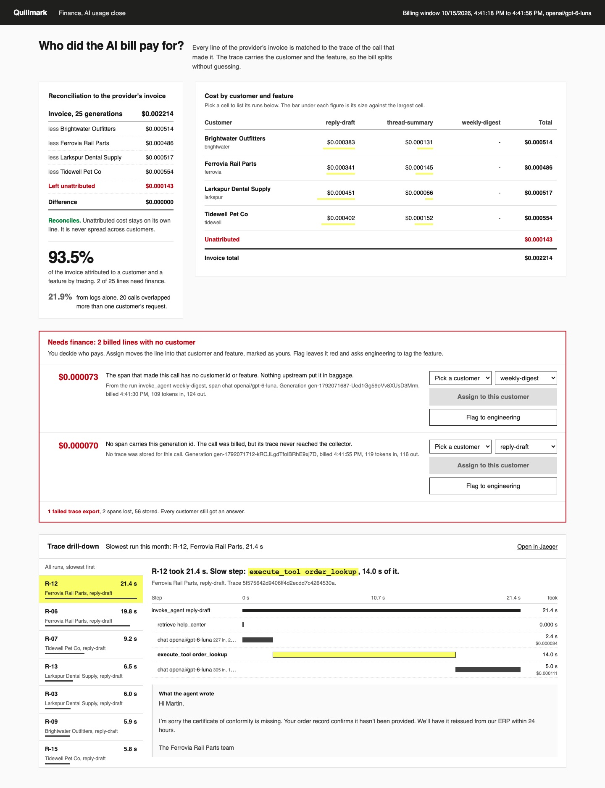

# Trace AI Agents with OpenTelemetry

Trace every model call and tool call your agent makes, with the OpenTelemetry GenAI conventions. Then
split the provider's invoice by customer and feature, and find the step that made a run slow.

## The product job

Quillmark sells a helpdesk to online shops and suppliers. Its AI drafts replies with an order lookup,
summarises long threads, and writes a weekly digest for support leads. Zendesk and Intercom sell the
same features. One OpenRouter key pays for every customer's calls.

Finance asks two questions at month end. What did each customer's AI usage cost? And why did Ferrovia
wait 20 seconds for a draft last week?

- **The source of truth** is the provider's invoice: one line per generation, with the cost OpenRouter
  billed for it. The lab records it at the HTTP client, below the app and outside OpenTelemetry.
- **The metric** is the share of the invoice attributed to a customer and a feature by tracing. A line
  that cannot be attributed is never spread across customers. It waits for finance.

## What you will be able to do

Before: you log each model call with its tokens, and try to match it to a customer by timestamp. After
this lab you can:

- trace an agent with the OpenAI instrumentation, so each call is a `chat` span with the GenAI attributes
- add your own spans for retrieval and tool calls, named the way the conventions name them
- carry the customer and the feature in baggage, onto every span, without passing them by hand
- join each invoice line to its span by the generation id, and reconcile to the cent
- send the lines nobody tagged to finance, with the reason, instead of guessing
- read a slow run as a waterfall and name the step that made it slow
- keep a broken collector from breaking a customer's request

## The problem

Four requests are in flight at once on a busy afternoon. Each makes two or three model calls. The app
logs every call with its tokens and timing, and logs every request with its customer. Nothing ties the
two together.

So a call can only be matched by time, and that works when one request is open. With four open, the
match is a guess. In our runs, logs alone attributed 22 to 28% of the invoice. A finance team that bills from
that guess bills the wrong customer.

The latency question has the same gap. A log line says the request took 21 seconds. It does not say
whether the model, the search or the customer's order system was slow.

## What you will build

Quillmark's month-end close for finance. On the left is a reconciliation statement. It starts from the
invoice total, subtracts each customer, and leaves the unattributed amount in red. The difference must
be zero.

On the right, the cost is split by customer and feature. A **Needs finance** card holds each billed line
with no customer, with the reason. Finance assigns it to a customer or flags it to engineering. Below,
every run is listed slowest first, with its steps on one time axis and the slow step named.



## Words you will use

- **Span**: one timed step, with a name, a parent and attributes. A trace is the tree of spans for one run.
- **GenAI conventions**: OpenTelemetry's standard names for AI work. A model call is `chat <model>`
  with `gen_ai.usage.input_tokens` and `gen_ai.response.id`. A tool call is `execute_tool <name>`.
- **Baggage**: key and value pairs that travel with the trace context, into child spans and outbound
  calls. Here it carries `customer.id` and `feature`.
- **OTLP**: the OpenTelemetry protocol that ships spans to a collector. Jaeger accepts it directly.
- **Generation id**: the id the provider gives each completion. It is on the invoice line and on the span.
- **Fail closed**: when attribution is not certain, leave the line unattributed. Spreading it would hide
  a tagging bug inside every customer's bill.
- **Human in the loop**: the finance analyst, who decides who pays for each line tracing could not place.

## Set up

You need [uv](https://docs.astral.sh/uv/), [Docker](https://docs.docker.com/get-docker/) and an
[OpenRouter](https://openrouter.ai) key. Tracing uses the
[OpenTelemetry Python SDK](https://opentelemetry.io/docs/languages/python/) and the
[OpenAI instrumentation](https://github.com/open-telemetry/opentelemetry-python-contrib/tree/main/instrumentation-genai/opentelemetry-instrumentation-openai-v2).

```bash
uv sync
```

Expect: /Installed|Audited|Resolved/

Copy `env.example` to `.env` and add your key. The model is `openai/gpt-6-luna`.

## 1. Start Jaeger

[Jaeger](https://www.jaegertracing.io/docs/latest/getting-started/) stores the spans and shows them. It
takes OTLP on port 8282 and serves its UI on 8281:

```bash
docker inspect quillmark-jaeger >/dev/null 2>&1 || docker run -d --rm --name quillmark-jaeger -p 127.0.0.1:8281:16686 -p 127.0.0.1:8282:4318 jaegertracing/jaeger:2.21.0
docker ps --filter name=quillmark-jaeger --format '{{.Names}} {{.Status}}'
```

Expect: /quillmark-jaeger Up/

Jaeger keeps spans in memory here, so they are gone when the container stops.

## 2. Trace the agent

Read `src/quillmark/telemetry.py` first. `Tracing` builds one tracer provider with three parts:

1. `BaggageSpanProcessor` copies `customer.id` and `feature` from baggage onto every span as it starts.
   Only those two keys pass, because baggage can arrive from a caller's header.
2. `BatchSpanProcessor` exports off the request thread, through `CountingExporter`. A failed export is
   counted, never raised into the customer's request.
3. `OpenAIInstrumentor` wraps the OpenAI client, so each call becomes a `chat` span on its own.

Then read `src/quillmark/agent.py`. `handle_request` puts the customer in baggage with `attributed_to`.
`run_agent` opens an `invoke_agent` span and never reads the customer again. `order_lookup` is an
`execute_tool` span with the GenAI tool attributes.

`handle_job` is the weekly digest. It runs on a schedule with no signed-in account, and nobody added
the baggage there. That gap is real in most codebases.

## 3. Run the month

`quill month` runs 17 tickets from `data/runs.jsonl`, four at a time. The last run happens while the
exporter points at a collector that is down:

```bash
uv run quill month
```

Expect: /Failed exports: [1-9]/

Every run should print `ok`, including the one during the outage. In our run, 25 generations were
billed for $0.002214, and 56 spans reached Jaeger.

`src/quillmark/billing.py` builds the invoice. OpenRouter returns the billed cost on each response when
asked with `usage.include`. An httpx response hook records it, so every call the key paid for is a line.

## 4. Split the invoice

`quill report` reads the month's spans back from Jaeger's API and joins each invoice line to its span by
`gen_ai.response.id`:

```bash
uv run quill report
```

Expect: /Books reconcile to the invoice: yes/

In our runs:

| Method | Share of the invoice attributed | Lines unattributed or ambiguous |
| --- | --- | --- |
| Logs alone, matched by time | 22 to 28% | 19 to 20 of 25 |
| Tracing with baggage | 93 to 94% | 2 of 25 |

The two unattributed lines are the ones the month planted. Line #1 is the digest job, whose span has no
customer. Line #2 was billed during the outage, so no span exists. `attribute` in
`src/quillmark/attribution.py` puts both in their own bucket, with the reason.

The report also names the slowest run. In our run, R-12 for Ferrovia took 21.4 seconds, and
`execute_tool order_lookup` took 14.0 of them. Ferrovia's order system is an on-premises ERP behind a
VPN. The model was not the problem.

## 5. Finance decides

The support lead at Tidewell asked for the weekly digest, so finance assigns it:

```bash
uv run quill assign 1 --customer tidewell --feature weekly-digest
```

Expect: /After finance's review: \d+\.\d%/

The line moves into Tidewell's digest cell, marked as finance's. The metric keeps tracing's share apart
from the share after review, so tracing never takes credit for a person's call. The lost line has no
trace to read, so finance sends it back:

```bash
uv run quill flag 1
```

Expect: /Flagged to engineering/

## 6. See it

Start the close and open http://127.0.0.1:8280:

```sh
uv run quill serve
```

Pick a customer for a line in **Needs finance** and press **Assign to this customer**. Pick a cell in the
split to list its runs. Pick a run to see its waterfall, and press **Open in Jaeger** for the full trace.
Stop the page with Ctrl-C.

## 7. Prove it

The keyless tests run the whole month on a scripted provider through the real OpenAI client and the
real instrumentation. They check baggage on the chat spans, reconciliation, the two unattributed lines,
finance's decisions, logs against traces, the slow step, the dead collector and the local-only server:

```bash
uv run pytest -q
```

Expect: /\d+ passed/

The proof runs the month on the real model and reads the spans from Jaeger. Tracing must attribute at
least 90% of the invoice, beat the logs, reconcile, and name the order lookup as Ferrovia's slow step:

```bash
uv run pytest -m proof -q
```

Expect: 1 passed

Stop Jaeger when you are done:

```bash
docker rm -f quillmark-jaeger
```

Expect: quillmark-jaeger

## At a startup

Install the instrumentation for your model client and add baggage at the one place a request learns its
customer. Send spans to a hosted backend that reads the GenAI conventions, such as
[Langfuse](https://langfuse.com/docs/opentelemetry/get-started). Reconcile against the provider's invoice
monthly, and treat each unattributed line as a tagging bug.

## At an enterprise

Run an OpenTelemetry Collector in front of the backend, so a redeploy queues spans instead of losing
them. Allow only vetted baggage keys at the edge. Feed the per-customer split into your billing system,
and alert when the unattributed share grows. Keep prompts out of spans unless a policy allows them.

## Change it

- Remove the `BaggageSpanProcessor` line in `Tracing` and run the tests. Which ones catch it?
- Add `attributed_to(None, "weekly-digest")` around `handle_job`, then rerun the month and the report.
  What does finance still have to decide?
- Set `PARALLEL` to 1 in `src/quillmark/config.py` and rerun. How close do the logs get to the traces?
- Lower Ferrovia's `latency_ms` in `data/accounts.json` to 200. Which step is slow now?

Sources: the [OpenTelemetry GenAI semantic conventions](https://opentelemetry.io/docs/specs/semconv/gen-ai/),
their [model spans](https://opentelemetry.io/docs/specs/semconv/gen-ai/gen-ai-spans/) and
[agent spans](https://opentelemetry.io/docs/specs/semconv/gen-ai/gen-ai-agent-spans/),
[OpenTelemetry baggage](https://opentelemetry.io/docs/concepts/signals/baggage/), the
[baggage span processor](https://github.com/open-telemetry/opentelemetry-python-contrib/tree/main/processor/opentelemetry-processor-baggage),
the [OTLP specification](https://opentelemetry.io/docs/specs/otlp/), and
[OpenRouter usage accounting](https://openrouter.ai/docs/use-cases/usage-accounting).
