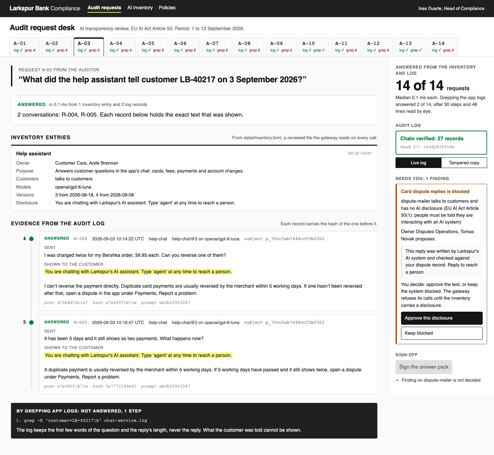

# Govern AI Systems with an Inventory and Audit Log

Keep a reviewed list of every AI system a bank runs, send every model call through one gateway that
checks it, and log each call in a chain nobody can quietly edit. Then answer an auditor's letter in
milliseconds.

## The product job

Larkspur Bank is an online bank in the EU. Four teams use a model: a help chat, a dispute mailer, a
fraud scorer and a staff search. A marketing script calls the model too, and nobody listed it.

From 2 August 2026, Article 50 of the EU AI Act says people must be told when they are talking to an AI
system. An auditor writes to the bank's compliance team with 14 questions. Which systems talk to
customers? Were customers told? What did the help assistant tell one customer on 3 September?

- **The source of truth** is two things. The AI inventory in `data/inventory.toml` is a reviewed file
  that says what runs, who owns it and which models it may call. The audit log in `out/audit.sqlite`
  holds every call the gateway saw.
- **The metric** is the time to answer an audit request, counted only when the answer is correct and
  complete. `data/audit_requests.json` holds the 14 requests with their right answers.

## What you will be able to do

Before: each team logs what it likes, in its own format, and an audit request means a week of email and
grep. After this lab you can:

- keep an AI inventory as code, validated by a JSON Schema on every load
- route every model call through a gateway that refuses unlisted systems, unlisted models and systems
  with no disclosure
- add the AI disclosure in the gateway, so no team can forget it or word it away
- name audit record fields with the OpenTelemetry GenAI conventions
- chain each record to the one before it with SHA-256, so an edit or a deletion shows
- store customer numbers as keyed pseudonyms, so the log is not a second customer database
- answer an auditor's request from the inventory and the log, graded against a labelled set
- leave the open finding and the signature to a compliance officer

## The problem

The app logs were written for debugging, not for an auditor. The chat service logs the first words of
the question and the reply's length, never the reply. The mailer logs a ticket number. The fraud log
keys on a transaction. The marketing script logs nothing at all.

So "what did we tell this customer?" has no answer, and "which systems talk to customers?" means asking
every team. Even a good answer proves little, because anyone with access can edit a plain log file.

## What you will build

Larkspur's audit request desk, the compliance team's own tool. The auditor's 14 requests run across the
top, each marked for the log and for grep. The request sheet quotes the auditor, gives the answer in a
sentence, and shows the inventory cards and log records it rests on.

Each record shows the disclosure the customer saw, highlighted, and the hash it points back to. The
rail holds the metric, the chain's seal, the open finding on the mailer and the sign-off.



## Words you will use

- **AI inventory**: the list of AI systems an organisation runs, with an owner, a purpose and the
  models each may call. NIST's AI Risk Management Framework and ISO/IEC 42001 both start here.
- **Disclosure**: the line that tells a person they are dealing with an AI system. Article 50(1) of the
  EU AI Act requires it for systems that interact with people.
- **Gateway**: the one service that holds the model key. Every team calls it instead of the provider.
- **Hash chain**: each record stores the hash of the record before it. Change one and every hash after
  it stops matching. Certificate Transparency logs use the same idea.
- **Anchor**: the chain's last hash, written into the signed answer pack. It catches records cut off the
  end, which the chain alone cannot see.
- **Pseudonym**: a keyed hash of the customer number. The same customer always gets the same one.
- **Human in the loop**: the compliance officer, who decides each finding and signs the answer pack.

## Set up

You need [uv](https://docs.astral.sh/uv/) and an [OpenRouter](https://openrouter.ai) key.

```bash
uv sync
```

Expect: /Installed|Audited|Resolved/

Copy `env.example` to `.env` and add your key. Every system in the inventory runs on
`openai/gpt-6-luna`.

## 1. Read the inventory

`load` in `src/larkspur/inventory.py` checks `data/inventory.toml` against
`data/inventory.schema.json`. Then it checks what a schema cannot: no system listed twice, and every
prompt file present.

```bash
uv run govern inventory
```

Expect: /Inventory valid: 4 systems/

The dispute mailer talks to customers with no disclosure, so it is a finding. Its owner has proposed a
line. Until compliance approves one, the gateway refuses every mailer call.

## 2. Replay the fortnight through the gateway

`replay` in `src/larkspur/services.py` sends 27 real requests from 1 to 12 September through
`governed_call` in `src/larkspur/gateway.py`. Read it in this order:

1. `refusal` checks the inventory before a token is spent: listed system, listed model, a disclosure if
   the system talks to customers, a prompt version in effect that day.
2. The disclosure is added in front of the reply for customer-facing systems.
3. Every call, refused, failed or answered, becomes one record through `AuditLog.append`.

```bash
uv run govern replay
```

Expect: /27 calls: \d+ answered, 7 refused/

In our runs, 20 calls were answered and 7 refused, for $0.0015 to $0.0016. The refusals were the two marketing
calls, four mailer calls and one fraud call that asked for a bigger model. Each service also wrote its
own app log to `out/app-logs/`, as it always did.

## 3. Answer one request

A-03 asks what the help assistant told customer LB-40217 on 3 September. `Desk` in
`src/larkspur/audit.py` looks up the pseudonym and reads the records for that day:

```bash
uv run govern answer A-03
```

Expect: /ANSWERED in [\d.]+ ms/

Both replies come back word for word, each starting with the disclosure, each with its prompt version
and hash. The app logs cannot answer: they kept the reply's length, not the reply.

## 4. Answer the whole letter

`answer_all` runs all 14 requests and grades each against `data/audit_requests.json`. `naive.py` tries
the same requests the old way, with `ls` and `grep` over the app logs, and counts every step.

```bash
uv run govern answer
```

Expect: /14 of 14 answered correctly and completely/

| Path | Answered | Time per request | Work |
| --- | --- | --- | --- |
| Inventory and audit log | 14 of 14 | 0.2 ms median | one query each |
| Grep over app logs | 2 of 14 | not timed | 30 steps, 48 lines read |

Grep found the right count for A-10 and the refused mailer calls for A-13. On A-06 it returned a wrong
answer that looked right, because the fraud log never names the customer.

## 5. Try to edit the log

The table has triggers that refuse `UPDATE` and `DELETE`. Anyone with the file can drop them, so
`src/larkspur/tamper.py` does exactly that on a copy. First it deletes record 9:

```bash
uv run govern tamper --mode delete --seq 9
```

Expect: /Chain BROKEN at record 9: record 9 is missing/

Then it rewrites the reply in record 4, the edit someone would want after a complaint:

```bash
uv run govern tamper --mode edit --seq 4
```

Expect: /Chain BROKEN at record 4: record 4 was changed/

`verify` in `src/larkspur/auditlog.py` walks the chain from the first record and stops at the first
break. The real log is untouched:

```bash
uv run govern verify
```

Expect: /Chain verified: 27 records/

## 6. Decide and sign

The desk assembles the answers, but a person signs them. `sign` in `src/larkspur/signoff.py` refuses
while the chain is broken, an answer is wrong or a finding is undecided:

```bash
uv run govern signoff --by "Ines Duarte"
```

Expect: Cannot sign: Finding on dispute-mailer is not decided

The compliance officer keeps the mailer blocked until its owner rewrites the disclosure:

```bash
uv run govern decide dispute-mailer keep-blocked --by "Ines Duarte"
uv run govern signoff --by "Ines Duarte"
```

Expect: /Answer pack signed by Ines Duarte: 14 answers, anchored at record 27/

The pack in `out/answer-pack.json` holds each answer, its evidence records and the chain's head.

## 7. See it

Start the desk and open http://127.0.0.1:8300/?request=A-03:

```sh
uv run govern serve
```

Pick a request in the top row to see its answer, the inventory cards and the chained records. Switch
the seal to **Tampered copy** to see record 4 turn red. Stop the page with Ctrl-C.

## 8. Prove it

The keyless tests use a scripted model. They check the inventory rules, every gateway refusal, the
disclosure, the triggers, the chain against edits and deletions, the anchor, the 14 answers and the
page's local-only server:

```bash
uv run pytest -q
```

Expect: /\d+ passed/

The proof replays the fortnight on the real model. Every customer-facing reply must start with the
disclosure, all 14 requests must be answered, grep must answer fewer, and both edits must be caught:

```bash
uv run pytest -m proof -q
```

Expect: 1 passed

## At a startup

Start the inventory the day the first model call ships, as a file in the repo with a schema check in
CI. Put one gateway in front of the provider and give no team the key. A SQLite chain and a signed head
in a pull request are enough until someone asks for more.

## At an enterprise

Keep the inventory in the model risk system, and send records to a write-once store with its own
retention rules. Anchor the chain's head somewhere the log's owners cannot write, such as a timestamping
service. Keep the pseudonym key in a vault that log readers cannot open.

## Change it

- Remove the disclosure line from `governed_call` and run the tests. Which ones catch it?
- Approve the mailer's disclosure with `govern decide`, copy the proposed line into `disclosure` in the
  inventory, and replay. What happens to A-02 and A-13?
- Add `promo-writer` to the inventory with an owner and a disclosure. Which requests change answers?
- Delete the last record on a copy and run `verify` with and without the signed anchor.

Sources: [EU AI Act Article 50](https://artificialintelligenceact.eu/article/50/), the
[implementation timeline](https://artificialintelligenceact.eu/implementation-timeline/), the
[regulation on EUR-Lex](https://eur-lex.europa.eu/eli/reg/2024/1689/oj), the
[NIST AI Risk Management Framework](https://www.nist.gov/itl/ai-risk-management-framework),
[ISO/IEC 42001](https://www.iso.org/standard/42001),
[OpenTelemetry GenAI conventions](https://opentelemetry.io/docs/specs/semconv/gen-ai/),
[RFC 6962 on Certificate Transparency](https://datatracker.ietf.org/doc/html/rfc6962),
[SQLite triggers](https://www.sqlite.org/lang_createtrigger.html),
[jsonschema](https://python-jsonschema.readthedocs.io/) and
[OpenRouter usage accounting](https://openrouter.ai/docs/use-cases/usage-accounting).
