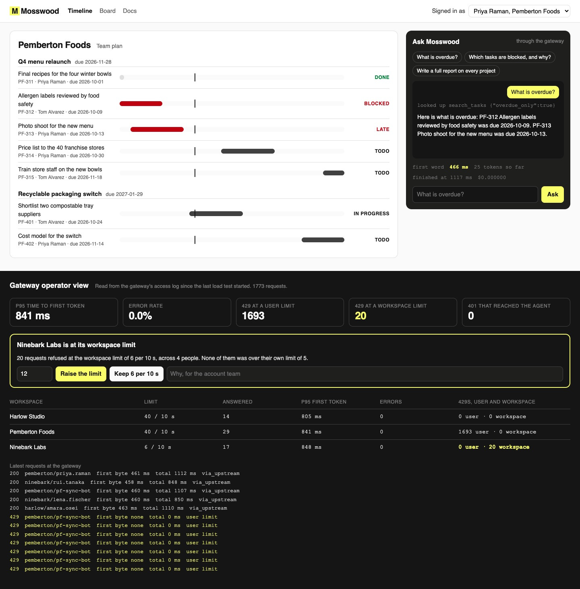

# Ship a Streaming AI Agent API with an API Gateway

Serve an in-app assistant to a web app over Server-Sent Events, behind an API gateway that checks a
short-lived token and rate limits each user and each tenant. Then read the gateway's own log to see
how fast the first word arrives under load.

## The product job

Mosswood sells project management software to teams. Its assistant answers questions like "what is
overdue?" from inside the app, like the AI features in Notion and Asana. Every customer workspace is a
tenant, and every tenant shares one model account.

- **The source of truth** is the gateway's access log under a load test. Envoy writes one line per
  request, including the ones it refused, with the time the first byte came back from the agent.
- **The metric** is time to first token at p95, and the error rate, both read from that log. The
  load test also counts the 429s served to the noisy client while everyone else stays fast.

## What you will be able to do

Before: the agent returns one JSON body when the whole answer is ready, anyone can call it, and one
script can use up the model account for every customer. After this lab you can:

- stream an agent's answer from FastAPI as Server-Sent Events, with tool calls as their own events
- put Envoy in front of it, checking a five-minute JWT before anything reaches the agent
- copy the token's user and tenant into headers the agent trusts, and strip any a caller sends
- rate limit each user and each tenant, with a 429 and a `Retry-After` header
- pass the stream through the gateway with no buffering, and prove the first token arrives early
- stop the model call when the person closes the tab
- turn a model failure into an error event, never a spinner
- read p95 time to first token and the error rate from the gateway's log, under a Locust load test
- show an operator which tenant is at its limit, and let them raise it or keep it

## The problem

A model writes its answer a few words at a time. Sent as one JSON body, a long answer is a blank
panel until the last word. OpenAI, Anthropic and the Vercel AI SDK all stream for this reason: the
person starts reading while the model is still writing.

Streaming alone is not enough for a product. The endpoint is public, so it needs to know who is
asking. The model account is shared, so one customer's script must not slow down everyone else. And a
stream that the person abandons should stop costing money. OpenRouter's docs say that closing a
streaming connection stops processing and billing for supported providers. A non-streaming request is
billed in full.

## What you will build

Mosswood's project timeline, with the assistant docked beside it. Ask a question and the answer is
drawn word by word, with the time the first word arrived. Press **Stop** to hang up mid-answer.

Under the app sits the gateway operator view. It shows p95 time to first token, the error rate and the
429s, per tenant, read from Envoy's log. A tenant refused at its workspace limit gets a card. The
operator raises that tenant's limit or keeps it, and the gateway reloads.



## Words you will use

- **Server-Sent Events (SSE)**: a response that stays open and sends `event:` and `data:` lines as
  they happen. It is plain HTTP, so gateways and proxies can pass it through.
- **Time to first token (TTFT)**: from the request leaving to the first word of the answer arriving.
  It is what the person feels as speed.
- **API gateway**: the one front door for an API. Here it is Envoy, the proxy Istio is built on.
- **JWT**: a signed token. The web app signs one for each person, valid for five minutes, and Envoy
  checks the signature, issuer, audience and expiry.
- **Rate limit**: a bucket of requests per window. Each user gets 5 per 10 seconds, and each tenant
  gets its plan's number.
- **Tenant**: one customer workspace. Its people share its limit.
- **Fail closed**: when a check fails, refuse. A missing token is a 401 at the gateway, never a request
  the agent has to judge.
- **Human in the loop**: the operator, who decides whether a tenant at its limit gets more.

## Set up

You need [uv](https://docs.astral.sh/uv/), Docker and an [OpenRouter](https://openrouter.ai) key. The
gateway is [Envoy](https://www.envoyproxy.io/) 1.39.1, pinned by digest. The agent is
[FastAPI](https://fastapi.tiangolo.com/) with [sse-starlette](https://github.com/sysid/sse-starlette),
and the load test is [Locust](https://docs.locust.io/en/stable/).

```bash
uv sync
```

Expect: /Installed|Audited|Resolved/

Copy `env.example` to `.env` and add your key. The model is `openai/gpt-6-luna`. The load test never
calls it: it runs on a stand-in model in `src/mosswood/stub_model.py`, which costs nothing.

## 1. Start the stack on the stand-in

`assistant up` starts the stand-in model, the agent and Envoy in Docker. The stand-in speaks the same
streaming API as OpenAI, writes 40 words a second, and refuses past 16 open streams, like a real
account limit.

```bash
uv run assistant up --upstream stub
```

Expect: /Gateway ready on http:\/\/127\.0\.0\.1:8310/

## 2. The first version: whole JSON, no gate

`/v1/answer` in `src/mosswood/agent.py` is what most teams ship first. It takes the tenant from the
request body, waits for the whole answer, and returns one JSON body:

```bash
uv run assistant ask "What is overdue?" --whole
```

Expect: /First visible text after [\d.]+ s, when the whole answer arrived at once/

Anyone who can reach the agent can ask about any tenant. Nothing is on screen until the end.

## 3. Stream it through the gateway

`/v1/chat` runs the same tool loop in `answer_events`, but yields each step as an event: `tool`,
`token`, then `done` or `error`. Read these parts:

1. `held_until_first_word` holds the response headers until the first word. So the gateway's
   "first byte" in its log is the time to first token.
2. `EventSourceResponse` sends each event as it is made, with a ping every 10 seconds.
3. `envoy_config` in `src/mosswood/gateway.py` sets no total timeout on the route. A long answer is a
   healthy one. A stream silent for 30 seconds is cut instead.

```bash
uv run assistant ask "What is overdue?"
```

Expect: /Gateway log: status 200, first byte \d+ ms, whole stream \d+ ms/

The first byte comes well before the whole stream ends, in the gateway's own log. The client sees the
tool call, then the words, with the time to first token.

## 4. The token is checked at the gateway

Envoy's `jwt_authn` filter checks each token against the web app's public key. Before that, a header
mutation filter drops any `x-tenant-id` or `x-user-id` a caller sent. Then the filter copies the
token's `sub` and `tenant` claims into those headers, and the agent trusts nothing else.

```bash
uv run assistant ask "What is overdue?" --no-token
```

Expect: /401 from the gateway: Jwt is missing/

```bash
uv run assistant ask "What is overdue?" --expired
```

Expect: /401 from the gateway: Jwt is expired\s+Reached the agent: no/

The log line for each has no upstream host, so the agent never saw them.

## 5. Hanging up stops the model

The person closes the tab. Envoy closes its stream to the agent, Starlette cancels the handler, and
leaving `async with stream` closes the call to the provider. The stand-in counts how far it got:

```bash
uv run assistant ask "Write a full report on every project" --hang-up-after 20
```

Expect: /Stand-in model: stopped writing after \d+ of 400 words/

A model error goes the other way: the agent sends an `error` event with a plain message and status
502, and the gateway counts it as an error. The keyless tests prove both.

## 6. Load test it, both ways

The Locust file `src/mosswood/locustfile.py` runs eight people and `pf-sync-bot`, a script one
Pemberton Foods engineer wrote. It runs in 20 threads and asks again every 200 ms. First, against the
naive endpoint, hit directly:

```bash
uv run assistant load --target direct
```

Expect: /People, as their laptops saw it: \d+ asked, \d+ answered/

In our run, 59% of the people's questions failed. The script filled the model account's 16 streams,
and the stand-in refused the rest.

Now through the gateway, streamed, with the limits on:

```bash
uv run assistant load --target gateway
```

Expect: /Gateway log: \d+ requests, p95 time to first token \d+ ms, error rate/

In our run, p95 time to first token was 494 ms with no errors. The script got 1,659 429s at its user
limit, and nobody else did. The stand-in needs 450 ms for a tool call and a first word, so that is
close to the floor.

| Run | People's p95 to first text | People's error rate | 429s to pf-sync-bot |
| --- | --- | --- | --- |
| Whole JSON, direct | 1,514 ms, at the end | 59.7% | 0 |
| Streamed, through Envoy | 494 ms (gateway log) | 0.0% | 1,659 |

Error rate counts only requests the gateway let through. A 429 or a 401 is the gateway doing its job.

## 7. The operator decides

Ninebark Labs is on the Starter plan, 6 requests per 10 seconds. Its four scientists asked more than
that, and none of them was over their own limit. That is not abuse. It may be a customer who has
outgrown its plan, which is a call for a person:

```bash
uv run assistant report
```

Expect: /Needs the operator: Ninebark Labs\./

The operator raises it, with a reason the account team can read. `decide` writes the decision to
`out/limits.json`, and the gateway reloads with the new bucket:

```bash
uv run assistant limit ninebark --raise-to 12 --reason "four scientists before a month-end audit"
```

Expect: /Ninebark Labs: raise, limit now 12 per window\./

## 8. On the real model

Restart the agent on `openai/gpt-6-luna` and ask for a report:

```bash
uv run assistant up
```

Expect: /answering with openai\/gpt-6-luna/

```bash
uv run assistant ask "Write a short report on every project: what is late, what is blocked, and why."
```

Expect: /First token after [\d.]+ s\. Answer finished after/

In our runs the first token came after 4 to 8 seconds. Most of that is the two tool calls before the
answer starts. The whole-JSON version of the same question took 5.4 seconds to show anything.

## 9. See it

Start the app and open http://127.0.0.1:8313:

```sh
uv run assistant serve
```

Pick a person, ask a question, and watch the first word arrive. Press **Stop** mid-answer. In the
operator view below, decide on Ninebark Labs. Stop the page with Ctrl-C.

## 10. Prove it

The keyless tests run the real agent over the stand-in model in threads. They cover the stream, the
error event, the hang-up, the Envoy config, the log metrics and the operator's decision:

```bash
uv run pytest -q
```

Expect: /\d+ passed/

The proof runs Envoy in Docker. It runs both load tests and asserts the metric from the gateway's
log. It checks that 401s never reach the agent and that the operator's raise is live in Envoy. Then,
on the real model, it checks that the first token lands before the end and that a hang-up cancels the
call:

```bash
uv run pytest -m proof -q
```

Expect: /5 passed/

```bash
uv run assistant down
```

Expect: /Stopped the agent, the stand-in model and the gateway\./

## At a startup

Put the gateway in from the first public endpoint, even with one customer. Issue short tokens from
the app you already have, and limit per user and per tenant from day one. Log time to first token at
the gateway and alert on its p95. Load test on a stand-in model before a launch, never on the real
bill.

## At an enterprise

Run the gateway the platform team already runs, such as Envoy Gateway, Kong or a cloud gateway. Use
global rate limiting with a shared store, because local buckets count per gateway copy. Fetch keys
from the identity provider's JWKS URL so they rotate. Ship the access log to the same place as every
other service's. Write each limit change to an audit trail with who and why.

## Change it

- Set `"timeout": "15s"` on the route in `envoy_config`, then ask for a full report. What does a
  person see at 15 seconds?
- Remove the user `rate_limit_filter` from `envoy_config` and rerun the gateway load test. Who at
  Pemberton Foods gets refused now?
- Make `held_until_first_word` return at once. How does the gateway's first byte change, and why
  does that make the metric lie?
- Lower `USER_REQUESTS_PER_WINDOW` to 2 and rerun the load test. Who gets refused now?

Sources: OpenAI's [streaming guide](https://platform.openai.com/docs/guides/streaming-responses),
Anthropic's [streaming messages](https://docs.claude.com/en/docs/build-with-claude/streaming), the
Vercel AI SDK's [stream protocol](https://ai-sdk.dev/docs/ai-sdk-ui/stream-protocol), OpenRouter's
[stream cancellation](https://openrouter.ai/docs/api-reference/streaming), Envoy's
[JWT authentication](https://www.envoyproxy.io/docs/envoy/latest/configuration/http/http_filters/jwt_authn_filter)
and [local rate limit](https://www.envoyproxy.io/docs/envoy/latest/configuration/http/http_filters/local_rate_limit_filter)
filters, [MDN on Server-Sent Events](https://developer.mozilla.org/en-US/docs/Web/API/Server-sent_events/Using_server-sent_events),
and 429 with Retry-After in [RFC 6585](https://datatracker.ietf.org/doc/html/rfc6585#section-4).
