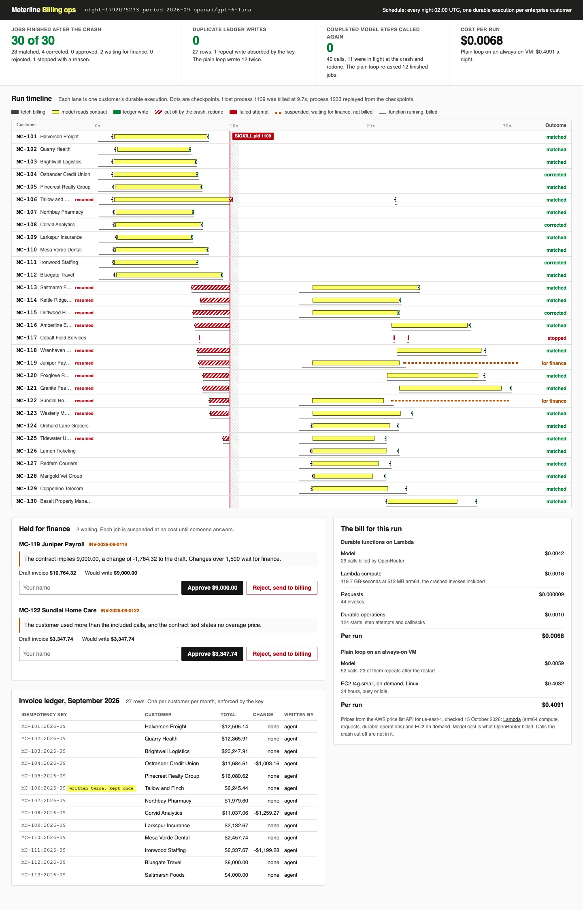

# Run AI Agents on Serverless with Durable Functions

Run a nightly agent job as AWS Lambda durable functions, kill the process halfway through the night, and
watch every job finish from its checkpoints. Then count what the crash cost.

## The product job

Meterline sells a metered API to 30 enterprise customers. Each night an agent checks every draft
invoice against the customer's contract and usage, before the invoices go out. Contracts are free text
from sales, so a model reads them.

- **The source of truth** is the job ledger, the runner's history of each execution, and finance's
  hand-checked totals in `data/checked-totals-2026-09.json`. The cloud bill is computed from AWS's
  published prices.
- **The metric** is jobs finished after a crash, and cost per run. Duplicate ledger writes and completed
  model steps called again must both be zero.

## What you will be able to do

Before: your nightly agent is a loop on a small VM. When the box dies at 2 a.m., systemd restarts it
from the top. After this lab you can:

- write an agent job as a durable function, with each paid model call and each write in its own
  checkpointed step
- run it on AWS's own local runner and kill the host with SIGKILL, not a flag the code checks politely
- read the runner's history to show which steps replayed and which ran again
- make a write safe to repeat with an idempotency key, because a step can finish and die before its
  checkpoint lands
- stop a job past its retry budget with its reason
- hold a job for finance on a callback that costs nothing while it waits
- price the night on Lambda against an always-on VM

## The problem

A plain loop keeps its progress in memory. When the process dies, the progress dies with it. The
restart pays for every model call again and writes every finished invoice again. Twelve customers
billed twice is a support queue, a refund run and a lost renewal.

Retrying is not the fix by itself. A row can commit and the process die a millisecond before anything
records that it did. Whatever runs the job again must find the work already done.

## What you will build

Meterline's nightly job scheduler. Each customer is one lane on a run timeline. Steps are bars, and
checkpoints are dots. A red line marks the SIGKILL, and a hatched band marks the minute with no
process. Steps the crash cut off are hatched red, then run again in the new process.

Below the timeline are the held jobs with their reasons, for finance to approve or reject. Next to
them are the ledger, with one row per invoice, and the bill for Lambda against the VM.



## Words you will use

- **Durable function**: a Lambda function whose progress is saved by the service as it runs. The
  handler is written as ordinary code with `context.step` calls in it.
- **Step**: one unit of work whose result is checkpointed. A finished step is never run again.
- **Checkpoint**: the saved result of a step. On the next invoke, the SDK returns it instead of running
  the step.
- **Replay**: the handler runs again from the top after a crash or a wait, and finished steps return
  their checkpoints at once.
- **Callback**: a wait for an outside answer. The function is suspended and billed nothing until
  finance answers.
- **Idempotency key**: one key per invoice, `MC-104:2026-09`, so a second insert of the same row
  is a no-op.
- **Retry budget**: how many tries a step gets. Past it, the job stops with its reason.
- **Fail closed**: when the agent is unsure, hold the write. A wrong invoice costs more than a late one.
- **Human in the loop**: the finance reviewer, who decides on each held job.

## Set up

You need [uv](https://docs.astral.sh/uv/) and an [OpenRouter](https://openrouter.ai) key. You do not
need an AWS account. The job uses AWS's
[durable execution SDK for Python](https://github.com/aws/aws-durable-execution-sdk-python). It runs
on that project's local runner, which speaks the same API as Lambda.

```bash
uv sync
```

Expect: /Installed|Audited|Resolved/

Copy `env.example` to `.env` and add your key. The model is `openai/gpt-6-luna`.

The local runner comes from a pinned commit of AWS's repository, not from PyPI. The PyPI release saves
a stale copy of the execution over its checkpoints after a crashed invoke, so finished steps run
again. The fix is on AWS's main branch, and `pyproject.toml` says which commit.

## 1. Read the job

Open `src/meterline/job.py`. The handler takes one customer and runs four steps:

1. `fetch_billing` gets the draft invoice, the contract and the usage. It gets three tries a second
   apart.
2. `read_terms` asks the model to read the contract into a strict JSON schema. This is the paid step.
3. `decide` in `src/meterline/terms.py` is plain code. Every number must sit inside a quote from the
   contract. A change over $1,500 or a missing price is held.
4. `write_ledger` inserts one row with the key `customer:period`.

A held job calls `context.wait_for_callback` and waits up to 24 hours for finance.

## 2. Run the night with a crash

`nightly run` starts the local runner and the host process, then starts 30 durable executions. After
the 12th ledger write the host kills itself with SIGKILL. The runner sees the invokes fail, a new
host comes up, and the runner invokes each execution again:

```bash
uv run nightly run --crash-after 12
```

Expect: /Jobs that reached an outcome after the crash: 30 of 30/

In our run, the host died 9.7 seconds in. A new process was up at 10.4 seconds, and the night
finished at 31 seconds:

| What | Count |
| --- | --- |
| Jobs that reached an outcome | 30 of 30 |
| Matched / corrected / held / stopped | 23 / 4 / 2 / 1 |
| Ledger rows | 27 |
| Duplicate ledger writes | 0 |
| Repeat writes absorbed by the key | 1 |
| Model calls cut off by the crash and run again | 11 |
| Completed model steps called again | 0 |

One write committed and the process died before its checkpoint landed. The step ran again, and the
key turned the second insert into a no-op.

MC-117 has no usage export. It stopped after 3 attempts, with the reason in its lane, and wrote
nothing. MC-119's change is $1,764.32, over the limit. MC-122's overage price is in a separate order
form. Both wait for finance.

## 3. Run the plain loop

`nightly naive` runs the same job with the same model in one process, the way a VM would. It dies
after 12 writes, and is restarted from the top, as systemd's `Restart=always` would do:

```bash
uv run nightly naive --crash-after 12
```

Expect: /12 duplicate writes/

In our run the loop wrote 12 invoices twice, MC-101 to MC-112. It made 52 model calls, 23 of them
repeats. Twelve were for jobs that already had an answer, paid for twice.

## 4. The bill

Prices are from the AWS price list API for us-east-1, checked on 15 October 2026. Lambda arm64 costs
$0.0000133334 per GB-second, $0.20 per million requests and $8 per million durable operations. An
EC2 t4g.small on demand costs $0.0168 an hour.

| Per night | Durable functions on Lambda | Plain loop on a VM |
| --- | --- | --- |
| Model | $0.0042 | $0.0059 |
| Compute | $0.0026 (44 invokes, 119.7 GB-s, 124 operations) | $0.4032 (24 hours) |
| Per run | $0.0068 | $0.4091 |

`src/meterline/bill.py` does the sums. Compute is counted at 512 MB for the whole time each invoke ran,
the crashed ones included. The model cost is what OpenRouter billed for each finished call.

## 5. Answer a held job

MC-119 is suspended on its callback. Approve it, and the runner invokes the handler again. The
handler replays fetch and model from their checkpoints and runs only the write:

```bash
uv run nightly review MC-119 approve --reviewer "Priya Nair, finance"
```

Expect: /MC-119 approved by Priya Nair, finance\. Ledger rows for MC-119: 1, total \$9,000\.00\./

## 6. See it

Start the run console and open http://127.0.0.1:8330:

```sh
uv run nightly serve
```

Point at a bar to see its step and times. Find the hatched red bars at the crash line, and the lanes
marked **resumed**. Type your name and reject MC-122 in **Held for finance**. Its lane ends red, and
no row is written. Stop the page with Ctrl-C.

## 7. Prove it

The keyless tests use a scripted model behind a local endpoint. They run the real SDK runner, the real
host and a real SIGKILL. They also check the contract reader, the ledger key and the console:

```bash
uv run pytest -q
```

Expect: /\d+ passed/

The proof runs the whole night on the real model in its own folder. Every job must reach an outcome,
with no duplicate write and no completed model step called again. Held jobs must have no row. Every
row must match finance's totals, and the plain loop must write at least one invoice twice:

```bash
uv run pytest -m proof -q
```

Expect: 1 passed

## At a startup

Ship the same handler to Lambda with the AWS SAM CLI. In `template.yaml`, declare an
`AWS::Serverless::Function` with a `DurableConfig` block, `ExecutionTimeout` and
`RetentionPeriodInDays`. Attach the `AWSLambdaBasicDurableExecutionRolePolicy` policy and set an
`AutoPublishAlias`.

Then build and deploy:

- `sam build`
- `sam deploy --guided`
- an EventBridge Scheduler rule that starts one execution per customer at 02:00

With the CDK, set `durableConfig` on the function and run `cdk deploy`. Keep the ledger in a database
with the same unique key, such as DynamoDB with a condition on the key or Postgres with `on conflict`.

Amazon Bedrock AgentCore Runtime solves a different problem. It hosts an agent as a long session, up
to 8 hours on a microVM, each session isolated. It bills CPU only while the agent computes, not while
it waits on a model. Pick AgentCore for a chat or a long agent session. Pick durable functions for a
batch of short jobs that must each finish exactly once.

## At an enterprise

Put each step's side effect behind its own idempotency key, and test the crash, not just the happy
path. Alarm on executions that end `FAILED` or `TIMED_OUT`, and on callbacks near their timeout. Send
held jobs to the queue finance already works from, with the reason and the quoted contract text.

## Change it

- Remove `on conflict (idempotency_key) do nothing` from `src/meterline/ledger.py` and run the tests.
  Which one fails, and with what count?
- Set `--crash-after 3` and run the night. How many model calls are cut off now?
- Raise `UNATTENDED_LIMIT` to 2000 in `src/meterline/config.py`. Which job writes without finance?
- Give `fetch_billing` 5 attempts and run the night. What happens to MC-117's lane and the bill?

Sources: [Lambda durable functions](https://docs.aws.amazon.com/lambda/latest/dg/durable-functions.html),
[deploying them with SAM or the CDK](https://docs.aws.amazon.com/lambda/latest/dg/durable-getting-started-iac.html),
[AWS's launch post](https://aws.amazon.com/blogs/aws/build-multi-step-applications-and-ai-workflows-with-aws-lambda-durable-functions/),
the [durable execution SDK docs](https://docs.aws.amazon.com/durable-execution/) and
[source](https://github.com/aws/aws-durable-execution-sdk-python),
[AgentCore Runtime](https://docs.aws.amazon.com/bedrock-agentcore/latest/devguide/agents-tools-runtime.html)
and its [pricing](https://aws.amazon.com/bedrock/agentcore/pricing/),
[Lambda pricing](https://aws.amazon.com/lambda/pricing/) and
[EC2 on-demand pricing](https://aws.amazon.com/ec2/pricing/on-demand/).
