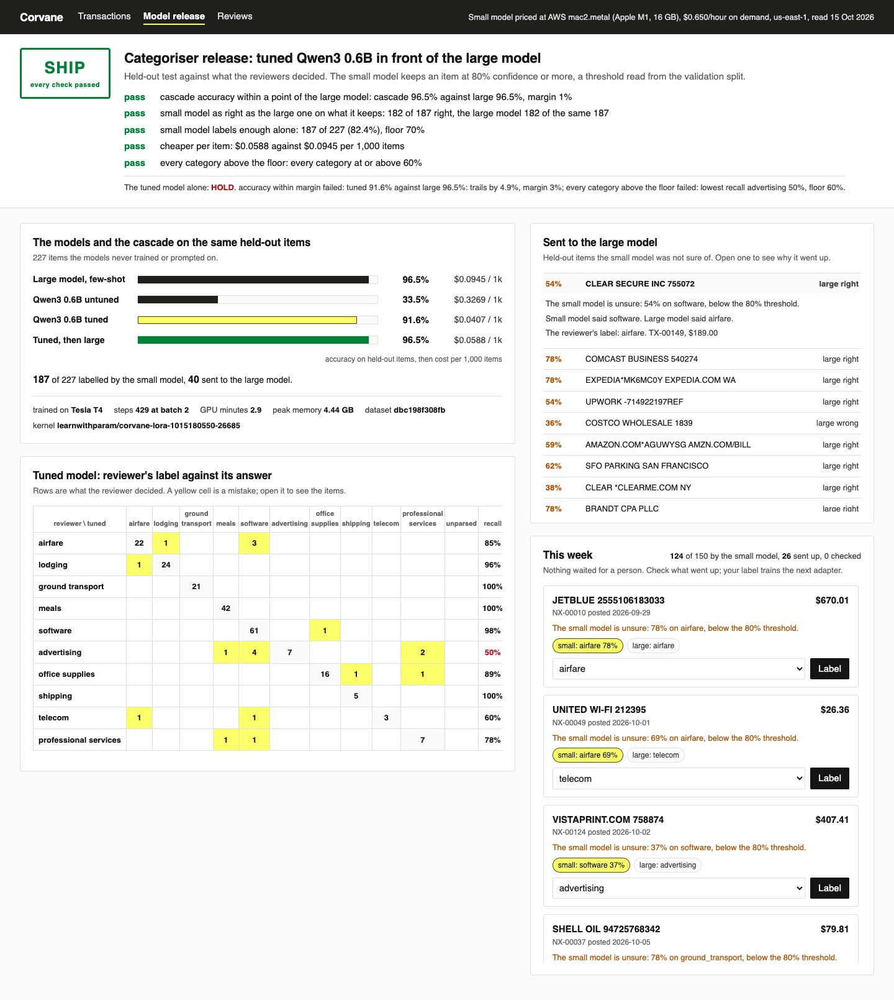

# Fine-Tune a Small LLM with Reviewed Data

Train a 0.6B model on your reviewers' labels with LoRA, on a free Kaggle GPU. Then prove where it can
replace the large model on items it never saw, and send the rest up, before you let it ship.

## The product job

Corvane runs corporate cards and spend management. Every card transaction gets a spend category, so
finance teams can close the month. Today a large model labels each one with a few-shot prompt, and
reviewers check the unclear ones in a queue.

Checkr did this job for background checks. It replaced GPT-4 with a fine-tuned Llama 3 8B, and got
higher accuracy, 30 times lower latency and 5 times lower cost. Ramp fine-tuned models on Modal for
receipt processing, and cut the receipts that needed a person by 34%.

- **The source of truth** is the labels from the human review queue: 1,200 transactions in
  `data/reviewed.jsonl`, each with the category a reviewer chose.
- **The metric** is accuracy and cost per item against the large model, on a held-out test split no
  model trained or was prompted on. Recall per category is graded too.

## What you will be able to do

Before: you pay a large model per token to do a narrow job your team already labels by hand. After
this lab you can:

- export reviewed labels into train, valid and test splits that never leak, with a dataset version
- LoRA-train Qwen3 0.6B on a Kaggle GPU in under 3 GPU minutes, and bring the adapter back
- score three models on the same held-out items, per category, with a confusion table
- price a small model from measured throughput and a published hourly rate
- gate a release on a margin, a per-category floor and cost, failing closed with reasons
- put the small model in front of the large one, keeping only what it is sure of
- read the confidence threshold from the validation split, never from the test
- feed reviewer decisions on the hard items into the next training set

## The problem

Corvane's reviewers have habits nobody wrote down. Mailchimp is software, not advertising. Costco is
meals, because it is team food. A CLEAR membership is airfare. The written policy says none of this, so
a prompt cannot carry it. The labels do.

The large model is good, but it is billed per token on every item, forever. A small model trained on
the labels can learn the habits and run on one machine. On its own, though, a 0.6B model is wrong more
often. The question is which items it can be trusted with.

## How the data was made

`data/generate.py` writes the data from seed 34, so every run gets the same rows. It invents 1,200
reviewed transactions across 10 categories from merchant templates: card descriptors like
`COSTCO WHSE #1234` or `AMZN MKTP US*2K4`, cut at 25 characters the way card networks cut them.

The hard cases are on purpose:

- ambiguous merchants such as Expedia, FedEx Office, PayPal, Amazon and Eventbrite, where the amount
  or descriptor decides the category
- the unwritten habits above, which reviewers applied and the policy does not state
- 2% reviewer slips, labels a careful person would call wrong, because real queues have them

It also writes 150 unlabelled transactions for this week in `data/incoming.jsonl`. No real customer's
data is in this lab.

## What you will build

Corvane's model release console. A **SHIP** or **HOLD** stamp sits at the top with each check of the
cascade and its numbers. Under it, the tuned model's own verdict stays visible. Four rows score the same
held-out items: the large model, the untuned and tuned small model, and the cascade.

A count reads how many items the small model labelled alone and how many it sent up. Open any item that
was sent up to read the small model's confidence and why it went. This week's items sit below, for a
reviewer to check after the fact.



## Words you will use

- **Fine-tuning**: training a model further on your own examples, so it learns your task.
- **LoRA**: low-rank adaptation. The base model is frozen and two thin matrices beside some layers
  are trained. The result is an adapter of a few MB.
- **Adapter**: the trained LoRA weights. They load on top of the unchanged base model.
- **Held-out test**: labelled items kept out of training and out of every prompt, so the score is
  honest.
- **Validation split**: labelled items the adapter never trained on, used to choose settings, so the
  test split only checks them.
- **Recall per category**: the share of one category's items a model labelled right. One weak category
  can hide inside a good overall accuracy.
- **Cascade**: a cheap model answers first, and anything it is unsure of goes to a stronger model.
- **Confidence**: the small model's own probability for the answer it gave.
- **Shadow mode**: running the new setup on live items while people still check its work.
- **Human in the loop**: the reviewer, who checks the items sent up and whose labels train the next
  adapter.

## Set up

Evaluation needs a Mac with Apple silicon and 16 GB of memory: the small model runs in
[mlx-lm](https://github.com/ml-explore/mlx-lm), pinned to 0.31.3. You also need
[uv](https://docs.astral.sh/uv/) and an [OpenRouter](https://openrouter.ai) key for the large model.
The base model is [Qwen3-0.6B](https://huggingface.co/Qwen/Qwen3-0.6B), Apache 2.0 and not gated,
pinned to one commit.

Training runs on [Kaggle](https://www.kaggle.com), not on the Mac. Make a free account, verify your
phone so GPU kernels are allowed, and save an API token to `~/.kaggle/kaggle.json`.

```bash
uv sync
```

Expect: /Installed|Audited|Resolved/

Copy `env.example` to `.env` and add your key. The large model is `openai/gpt-6-luna`.

## 1. Export the reviewed labels

`export` in `src/corvane/labels.py` splits by a hash of each id, so an item lands in the same split on
every run. The test split goes to `out/heldout.jsonl`, outside the folder the trainer reads:

```bash
uv run tune export
```

Expect: /858 train, 115 valid, 227 test/

`chat_example` turns each row into a system line, the transaction and the reviewer's category as the
answer. The system line lists the categories and nothing else.

## 2. Score the baselines

`baseline` runs the large model and the untuned Qwen3 0.6B on the 227 test items. Both get the same
few-shot prompt: the written policy and two training examples per category.

```bash
uv run tune baseline
```

Expect: /Qwen3 0.6B untuned, few-shot\s+accuracy/

In our run the large model scored 96.5% and the untuned small model 33.5%. The large model's cost is
what OpenRouter billed. The small model's cost is its measured seconds per item, priced at what AWS
charges for the same Mac (`SMALL_MODEL_HOURLY` in `src/corvane/config.py`).

## 3. Train the adapter on Kaggle

`train` in `src/corvane/train.py` stages the train and valid splits with the `Recipe` and its dataset
version. `kaggle/train.sh` uploads them as a private dataset and pushes `kaggle/train_lora.py` as a GPU
kernel. It waits, downloads the adapter and deletes the dataset.

Read the `Recipe`: rank 8 on the attention projections, one pass of batch 2, capped at 450 steps.
`adapter.py` converts the PEFT adapter so MLX can load it. The held-out test never leaves your machine.

```bash
uv run tune train
```

Expect: /\d+(\.\d+)? GPU minutes/

Our run took 429 steps on a Tesla T4, 2.9 GPU minutes in all, at 4.44 GB peak memory. When the data and
recipe have not changed, `train` reuses that adapter instead of paying for the GPU again.

## 4. Gate the tuned model alone

`evaluate` scores the tuned model on the same test items and runs `decide_release` in
`src/corvane/release.py`. A model ships alone only when it is within `MARGIN` of the large model,
every category is at or above `CLASS_FLOOR`, and it is cheaper:

```bash
uv run tune evaluate
```

Expect: /The tuned model alone: HOLD\./

| Model | Accuracy | Cost per 1,000 items |
|---|---|---|
| Large model, few-shot | 96.5% | $0.0945 |
| Qwen3 0.6B untuned, few-shot | 33.5% | $0.3269 |
| Qwen3 0.6B tuned | 91.6% | $0.0407 |

Tuning took the small model from 33.5% to 91.6%, for under half the large model's price. It is still
held. It trails by 4.9 points, and advertising recall is 50%, under the 60% floor.

## 5. Put it in front of the large model

`cascade` in `src/corvane/release.py` lets the small model keep an item when it is sure, and sends every
other item to the large model. Nothing waits for a person. `pick_threshold` reads the threshold from the
validation split: the strictest one that sends at most `ROUTE_BUDGET` of items up.

`decide_cascade` then gates it on the test split, failing closed:

1. cascade accuracy within `CASCADE_MARGIN` of the large model
2. on the items it keeps, the small model is within `CASCADE_MARGIN` of the large one, since the large
   model's answers vary a little between runs
3. it labels at least `COVERAGE_FLOOR` of items alone
4. cheaper per item, paying the small model on every item and the large one on what goes up
5. every category at or above `CLASS_FLOOR`

```bash
uv run tune cascade
```

Expect: /\d+ of 227 labelled by the small model, \d+ sent to the large model\.[\s\S]*The cascade: SHIP\./

In our run threshold 80% kept 92 of 115 validation items. On the test, the run printed
187 of 227 labelled by the small model, 40 sent to the large model. The small model got 182 of its 187
right, as did the large model on those same items. The cascade scored 96.5% at $0.0588 per 1,000 items.

A small model earns its place on the items it is sure of. The adapter card in `out/adapter/card.json`
records the data version, the recipe, the Kaggle kernel, the threshold and this decision.

## 6. Run in shadow and review

`shadow` runs the cascade on this week's 150 transactions. Only the items sent up are paid for at the
large model's price:

```bash
uv run tune shadow
```

Expect: /\d+ of 150 labelled by the small model, \d+ sent to the large model\./

In our run 124 stayed with the small model and 26 went up, mostly Expedia, in-flight wifi and Costco.
Those are the items the small model finds hard, so a reviewer's label on them is worth the most.
Label one. The decision goes to `out/decisions.jsonl`, and `export` adds it to the training split only:

```bash
uv run tune review NX-00010 airfare
```

Expect: /NX-00010 labelled airfare\. \d+ decisions join the next training set\./

## 7. See it

Start the console and open http://127.0.0.1:8340:

```sh
uv run tune serve
```

Open an item under **Sent to the large model** to read its confidence and why it went. Open a yellow
cell in the confusion table to read the tuned model's mistakes. Label an item under **This week**. Stop
the page with Ctrl-C.

## 8. Prove it

The keyless tests use a scripted large model and stand-in predictions. They pin every gate number and
check each gate check alone, the threshold rule, routing, the Kaggle staging, the adapter conversion and
the console's local-only server:

```bash
uv run pytest -q
```

Expect: /\d+ passed/

The proof runs export, both baselines, evaluate and cascade for real, on the adapter Kaggle trained. It
spends no GPU time. The tuned model alone must be held and the cascade must ship. The README's
small-model figures must match the run:

```bash
uv run pytest -m proof -q
```

Expect: 1 passed

## At a startup

Export the labels your review queue already has. Keep a test split that never moves, and choose
settings on validation. Kaggle gives a free GPU quota each week, which fits a run like this many times
over. For a larger model, rent a GPU by the second from a serverless provider.

Serve the adapter on the base model with vLLM or any server that loads LoRA adapters. Keep the large
model behind it for the items it is unsure of.

## At an enterprise

Version the label export, the recipe and the adapter together, so any release can be rebuilt. The
adapter card is that record. Track the share sent up week by week: a rise means the data has moved.
Retrain on a schedule from reviewer decisions, and gate every retrain on the same test split and floors.

## Change it

- Set `ROUTE_BUDGET` to 0.40 in `src/corvane/config.py` and run `uv run tune cascade`. Which check
  holds it?
- Set `CLASS_FLOOR` to 0.95. Which categories hold the tuned model, and does the cascade survive?
- Label five items under **This week**, export and train again. Did the dataset version change?
- Set `COVERAGE_FLOOR` to 0.90. How sure would the small model need to be?

Sources: [How Checkr streamlines background checks with fine-tuned small language models](https://web.archive.org/web/20250121213934/https://predibase.com/blog/how-checkr-streamlines-background-checks-with-fine-tuned-small-language)
(Predibase, 2024), [Computerworld on Checkr](https://www.computerworld.com/article/3541362/checkr-ditches-gpt-4-for-a-smaller-genai-model-streamlines-background-checks.html),
[Modal's Ramp case study](https://modal.com/blog/ramp-case-study),
[Kaggle's GPU docs](https://www.kaggle.com/docs/efficient-gpu-usage), the
[PEFT LoRA guide](https://huggingface.co/docs/peft/main/en/conceptual_guides/lora), the
[LoRA paper](https://arxiv.org/abs/2106.09685) and
[mac2.metal pricing](https://instances.vantage.sh/aws/ec2/mac2.metal) read 15 Oct 2026.
