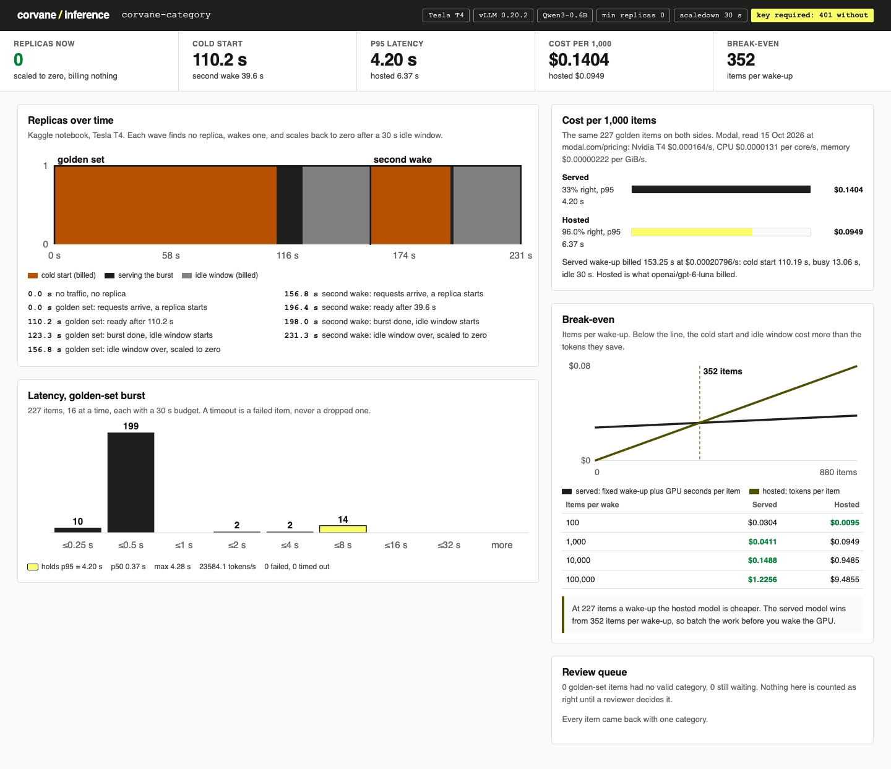

# Serve Open LLMs with Serverless vLLM

Serve an open model with vLLM on a GPU that runs only while there is work. Measure the cold start, the
p95 and the bill per wake-up, then find the batch size where it beats a hosted model.

## The product job

Corvane issues corporate cards to mid-size companies. Every card swipe needs a spend category before
finance closes the month. A small open model can pick it, so Corvane wants to serve that model on its own
GPUs and stop paying per token.

- **The source of truth** is `data/golden.jsonl`: 227 card transactions, each labelled by a finance
  reviewer. The served model and the hosted model answer the same items with the same prompt.
- **The metric** is cost per 1,000 items and p95 latency, for both sides. Every failed or timed-out
  item stays in the count.

Ramp, another corporate card company, fine-tunes open models and serves them on demand on Modal. The
[Modal case study](https://modal.com/blog/ramp-case-study) covers that. It does not say which GPUs Ramp
uses or whether its endpoints scale to zero, so this lab measures those parts itself.

## What you will be able to do

Before: your category model is a hosted API, billed per token, and you have no idea what owning the
GPU would cost. After this lab you can:

- serve an open model with vLLM behind an OpenAI-compatible endpoint that needs a key
- start from zero replicas, time the cold start and watch the endpoint scale back to zero
- measure p50, p95 and failures on a burst, with every timeout counted
- price a wake-up as cold start plus busy time plus the idle window
- find the break-even batch size against a hosted model, and say honestly when hosted wins
- send each item without one valid category to a person instead of guessing
- deploy the same server to Modal with `modal deploy`

## The problem

A hosted model bills per token, so ten items cost ten items. A serverless GPU bills every second a
replica is up. That includes the minute it spends loading vLLM and the weights, and the idle window
before it shuts down.

So the GPU has a fixed cost per wake-up and a small cost per item. At low volume the fixed cost loses.
You need the measured cold start, not a guess, to know where it starts to win.

## What you will build

Corvane's GPU endpoint console for the platform team. A step chart shows replicas over time, from zero
to one and back to zero, twice. Beside it are the cold start, a latency histogram with the p95 bucket
marked, and the cost per 1,000 items against the hosted model. A break-even chart shows both costs by
batch size, and a review queue lists every item that came back without one category.



## Words you will use

- **Replica**: one container with the model loaded on a GPU. Serverless means the platform starts and
  stops replicas for you.
- **Scale to zero**: no replica runs when nobody calls, so nothing is billed.
- **Cold start**: the seconds from the first request until a new replica answers. Every wake-up pays it.
- **Scaledown window**: how long an idle replica waits for more work before it stops. Here it is 30
  seconds, and those seconds are billed.
- **vLLM**: an open-source inference server. It batches concurrent requests on the GPU and speaks the
  OpenAI chat API.
- **p95**: the latency that 95 percent of answered requests beat.
- **Break-even**: the batch size per wake-up at which the GPU costs no more than the hosted model.
- **Fail closed**: an item without exactly one valid category is not done until a person decides it.
- **Human in the loop**: the finance ops reviewer who decides each item in the queue.

## Set up

You need [uv](https://docs.astral.sh/uv/) and an [OpenRouter](https://openrouter.ai) key. You do not
need a GPU on your laptop, and nothing here serves a model on it. The GPU run happens on a Kaggle T4.

```bash
uv sync
```

Expect: /Installed|Audited|Resolved/

Copy `env.example` to `.env` and add your key. The hosted model is `openai/gpt-6-luna`. The served
model is [Qwen3 0.6B](https://huggingface.co/Qwen/Qwen3-0.6B), Apache 2.0, pinned to one commit in
`src/corvane_gpu/config.py`.

The served model is the base model, with no adapter yet. A fine-tuned LoRA adapter can be served on
the same endpoint with vLLM's `--enable-lora`, and the measurements below would not change shape.

## 1. Rehearse the GPU run

GPU time is scarce, so the whole run is rehearsed on your laptop first. A tiny stand-in server takes the
place of vLLM. It hangs on FIGMA items and rambles on MARRIOTT items, so the timeout and the review
queue both get exercised:

```bash
uv run gpu rehearse
```

Expect: /golden set: 227 items, cold start/

The rehearsal follows the same plan as the real run. It checks the key, wakes a replica from zero, sends
the golden set in a burst of 16 at a time, waits out the idle window and scales to zero. Then it does
it again for a second wake of 40 items.

## 2. Run it on a real GPU

`kaggle/run_on_kaggle.sh` uploads the lab's code as a private dataset and pushes a notebook on one T4.
It waits, downloads `results.json` into `data/gpu-run/` and deletes the dataset on exit:

```sh
kaggle/run_on_kaggle.sh
```

The notebook refuses to run without a GPU. It installs vLLM 0.20.2 and fetches the weights. Then it runs
`vllm serve` with the flags in `src/corvane_gpu/gpu_run.py`, under the same key check and the same two
waves.

A wall-clock guard ends the run after 8 minutes, two minutes before the 10 minute limit the notebook is pushed with. Any
item the guard cut off counts as failed. If setup fails, every item is written as failed with the
reason, so a broken install reads as an outage.

### What happened when we ran it

No Modal run happened for this lab. The GPU numbers come from one Kaggle T4 run on 15 October 2026,
the third attempt. It used about 4.6 GPU minutes, and the results are in `data/gpu-run/`.

The first run failed at import. PyPI's vLLM 0.20.2 wheel is built for CUDA 13, and Kaggle's image has
torch for CUDA 12.8. vLLM stopped with `libcudart.so.13: cannot open shared object file`. Every item was
written as failed, as designed.

The second run tried vLLM 0.19.1 from PyPI. Its install pulled a different torch and ran past its own
time budget of 170 seconds. That run ended before it wrote a results file, and the notebook now writes
one whatever setup does.

The third run used vLLM's own CUDA 12.9 wheel from its GitHub release, which keeps the image's torch.
The endpoint refused a missing key and a wrong key with 401, and took the right key.

| Wave | Items | Cold start | p50 | p95 | Failed | Billed |
| --- | --- | --- | --- | --- | --- | --- |
| Golden set | 227 | 110.2 s | 0.37 s | 4.20 s | 0 | 153.3 s, $0.0319 |
| Second wake | 40 | 39.6 s | 0.35 s | 0.46 s | 0 | 71.2 s, $0.0148 |

The weights were fetched once before both waves, so neither cold start includes the download. The
first start also paid for a cold machine's first imports, and the second started warm at 39.6 s. Both
waves started from zero replicas and ended at zero.

The served model got 76 of 227 right, 33.5 percent. That is the untuned base model, so read the run for
latency and cost, not accuracy. A tuned adapter on the same endpoint is what would move that number.

## 3. Run the hosted model

The hosted side runs the same golden set through the same burst code, 8 at a time. OpenRouter reports
what it billed for each call, and that is the cost used:

```bash
uv run gpu hosted
```

Expect: /227 items in .* 0 failed/

Our run on 15 October 2026 answered 218 of 227 right, 96.0 percent. It was billed $0.021532, which is
$0.0949 per 1,000 items. The p50 was 2.93 seconds and the p95 6.37 seconds. That run is in
`data/hosted-run.json`.

## 4. Read the report

The report sets the GPU run against the hosted run. It recomputes the GPU bill from the measured
seconds and Modal's published prices:

```bash
uv run gpu report
```

Expect: /Cost per 1,000 items: served/

Modal bills the T4 at $0.000164 a second. It also bills the container's 2 CPU cores and 8 GiB for every
second the GPU is up. A replica therefore costs $0.00020796 a second, about $0.75 an hour.

## 5. The break-even

One wake-up costs the cold start plus the idle window, whatever the batch size. Each item then adds its
share of the busy seconds. The hosted model costs $0.0000949 an item at any volume.

So the GPU wins only on batches past the break-even:

```text
break-even items = fixed seconds per wake x price per second / (hosted cost per item - GPU cost per item)
```

Take a 90 second cold start and the 30 second idle window. That is 120 fixed seconds, or $0.025 a wake.
At 20 items a second, each item costs $0.0000104 of GPU time. The break-even is then about 296 items
per wake.

Those inputs are an example, not a measurement. `uv run gpu report` prints the break-even from the real
run. Below it, hosted is cheaper, and at ten items a wake-up it is cheaper by far.

## 6. Decide the review queue

Every golden item without exactly one valid category waits for a person. On the T4 run every answer
was one category, so its queue is empty. The rehearsal from step 1 hung on FIGMA and rambled on
MARRIOTT on purpose, so its queue holds ten items. Decide one there, a hotel bar, which Corvane's
policy files under meals:

```bash
uv run gpu review TX-00241 meals --reviewer "Dana Okafor, finance ops" --run out/rehearsal/results.json
```

Expect: /set to meals by Dana Okafor, finance ops/

The decision is saved in `out/decisions.jsonl`, not in the run. The run stays as measured. On your own
GPU run, `uv run gpu report` lists the items that wait, if any.

## 7. See it

Start the endpoint console and open http://127.0.0.1:8350. `--run` points it at the rehearsal, the run
with a queue; leave it out to see the T4 run:

```sh
uv run gpu serve --run out/rehearsal/results.json
```

Find the two wake-ups in the replica chart and the cold start marked on each. Find the p95 bucket in
the histogram, and where the GPU line crosses the hosted line in the break-even chart. Type your name
and decide an item in the review queue. Stop the page with Ctrl-C.

## 8. Prove it

The keyless tests run the stand-in server as a real child process. They check the key, both wake-ups
from zero, the bill per wake, the time guard and a broken install. They also cover the percentiles, the
break-even, the console and the Modal app:

```bash
uv run pytest -q
```

Expect: /\d+ passed/

The proof runs the hosted model live on the golden set. It then reads the real GPU run. That must be a
Kaggle T4 that refused callers without the key, and woke from zero twice and ended at zero.

The proof prices that run against the live hosted run, and checks the break-even both ways. At ten
items a wake-up, hosted must be cheaper:

```bash
uv run pytest -m proof -q
```

Expect: 2 passed

## At a startup

Deploy the same server to Modal. `modal_app.py` imports the vLLM wheel, flags, model commit and idle
window from the package, so it cannot drift from what was measured. Create the key, then deploy:

```sh
uv run modal secret create corvane-vllm VLLM_API_KEY=<a long random key>
uv run modal deploy modal_app.py
```

The app asks for a T4 with `min_containers=0` and `scaledown_window=30`. A volume keeps the weights
between containers, so a cold start loads them without downloading them. `@modal.concurrent` lets one
replica take 32 requests at once, which vLLM batches on the GPU.

Point `LLM_BASE_URL` at the printed URL with `/v1` added, and the same burst code measures it.

Do not serve a model yourself for a few hundred items a day. Run it hosted until your batches clear
the break-even with room to spare.

## At an enterprise

Run nightly batches on the GPU, where the volume is, and keep live single requests on the hosted model.
Alarm on cold starts that grow and on the timeout rate, not only on p95. Keep the golden set as a
release check, so a new model or adapter ships only if it matches the hosted model's accuracy.

## Change it

- Set `SCALEDOWN_WINDOW_SECONDS` to 300 in `src/corvane_gpu/config.py` and run the report again. What
  happens to the break-even?
- Set `CONCURRENCY` to 4 and rehearse. Which number moves, the p95 or the wall time?
- Make `failed_items` in `src/corvane_gpu/replica.py` return an empty list, and run the tests. Which
  tests fail, and what would the report have hidden?
- Change `GPU_TYPE` to `L4` with its price from Modal's page. Does the break-even rise or fall?

Sources: the [Ramp case study on Modal](https://modal.com/blog/ramp-case-study) (26 March 2024),
[Modal pricing](https://modal.com/pricing), [cold starts on Modal](https://modal.com/docs/guide/cold-start),
[concurrent inputs](https://modal.com/docs/guide/concurrent-inputs),
[Modal's vLLM example](https://modal.com/docs/examples/vllm_inference),
[`modal deploy`](https://modal.com/docs/reference/cli/deploy),
[vLLM's OpenAI-compatible server](https://docs.vllm.ai/en/latest/serving/openai_compatible_server.html),
the [vLLM 0.20.2 release](https://github.com/vllm-project/vllm/releases/tag/v0.20.2),
[Qwen3 0.6B](https://huggingface.co/Qwen/Qwen3-0.6B) and
[Kaggle's GPU guide](https://www.kaggle.com/docs/efficient-gpu-usage).
