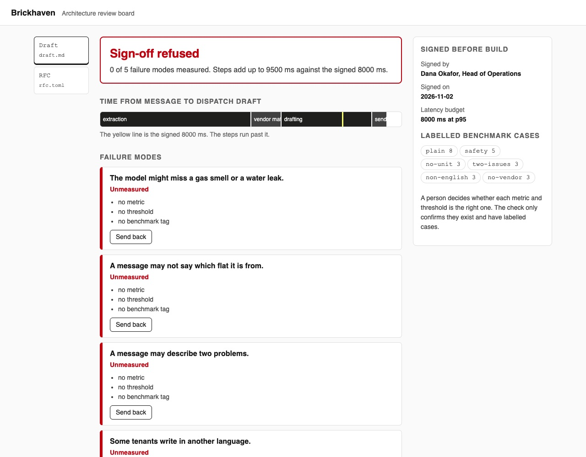
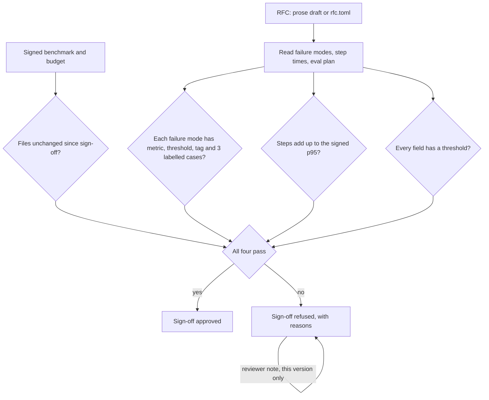

# Scope a Production AI System with an Architecture RFC

Write an architecture RFC for your capstone with latency budgets, failure modes and a labelled eval
plan, and get it signed off before you write the system.

## The product job

Brickhaven manages rental flats. Tenants send maintenance messages by text or the portal, and an AI
assistant turns each one into a work order: the trade, the urgency, the flat, a safety flag and the
hours the tenant is home. It then picks a vendor and drafts the dispatch for a coordinator to send.
Stripe's engineering teams write an RFC that names the failure modes and the metrics before code, and
the same habit applies here.

Dana Okafor, the head of operations, has signed two things before any code exists. One is a benchmark
of 25 real tenant messages, each labelled with the work orders a person would write. The other is a
latency budget: the dispatch draft must be ready within 8000 ms at p95.

- **The source of truth** is `data/benchmark.jsonl` and `data/latency_budget.toml`, plus
  `data/signoff.toml`, which records a hash of each so a later edit shows.
- **The metric** is architecture sign-off with zero unmeasured failure modes. The proof test asserts the
  draft has 5 unmeasured failure modes and the RFC has none, inside the signed budget.

## What you will be able to do

Before: you write the RFC as prose, list the risks you can think of and start building. After this lab
you can:

- turn each risk into a failure mode with a metric, a threshold and a tag on the benchmark
- check that every failure mode has enough labelled cases to measure it
- split a latency budget across the steps and see it fail when the steps run past the signed time
- write an eval plan with a pass-rate threshold for every field the system fills in
- notice when someone changes the benchmark after it was signed
- let a reviewer send one failure mode back, with a reason, for one exact version of the RFC

## The problem

An RFC in prose reads well and measures nothing. "The model might miss a gas smell" is a worry. It
has no number that says how often is too often, and no set of messages to count it on. Nobody can say
when it is fixed.

A latency budget has the same trap. Each step is "about a few seconds", and the steps never get added
up against the time the business agreed to.

## What you will build

The review board page for the RFC. Versions sit on the left, the RFC is in the middle and the signed
inputs are on the right. A banner says whether sign-off is approved or refused. The steps of the budget
are drawn as one bar against a yellow line at the signed time.

Each failure mode is a card, measured or unmeasured, with the reason. A reviewer can send a card back
with their name and a reason. The check only confirms the metric exists and has enough labelled cases.
A person decides whether it is the right metric.



## How it works

The review reads the RFC, then checks each failure mode, the time and the eval plan against the signed files.



## Words you will use

- **RFC**: a short design document the team agrees to before building.
- **Failure mode**: one way the system can be wrong, with a metric and a threshold that say how wrong is too wrong.
- **Latency budget**: the time each step may take at p95. The steps must add up to the signed total.
- **Benchmark**: messages a person labelled with the right answer. The model never wrote them.
- **Tag**: the label on a benchmark case that says which failure mode it exercises.
- **Eval plan**: the lowest pass rate each field may have on the benchmark.
- **Sign-off**: the written agreement that the benchmark and the budget are the truth to build against.
- **Human in the loop**: the reviewer who can send a failure mode back, in writing.

## Set up

You need [uv](https://docs.astral.sh/uv/). No key and no model: the review reads the signed files on
disk, so everything runs on your laptop.

```bash
uv sync
```

Expect: /Installed|Audited|Resolved/

## 1. Review the prose draft

`rfc/draft.md` is the first version most teams write. It has a plan, a time for each step and five
risks. Run the review:

```bash
uv run brickhaven-rfc review rfc/draft.md
```

Expect: sign-off refused: 5 unmeasured failure modes

Read the output. The five risks have no metric, no threshold and no tag. The steps add up to 9500 ms
against the signed 8000 ms. None of the five fields has a pass-rate threshold. Open `read_draft` in
`src/brickhaven_rfc/rfc.py` to see how the review reads a draft, and `review` in
`src/brickhaven_rfc/review.py` to see each rule.

## 2. Review the structured RFC

`rfc/rfc.toml` says the same things as numbers. Each failure mode names the field it hurts, a metric, a
threshold and the benchmark tag that holds its cases:

```bash
uv run brickhaven-rfc review rfc/rfc.toml
```

Expect: sign-off approved: 0 unmeasured failure modes

The steps add up to 7200 ms, which leaves 800 ms of room inside the signed 8000 ms. Every failure mode
has at least 3 labelled cases.

## 3. Take away the labels

A metric with no cases behind it is a guess. Ask what happens if the benchmark had no safety cases:

```bash
uv run brickhaven-rfc review rfc/rfc.toml --without-tag safety
```

Expect: sign-off refused: 1 unmeasured failure modes

The missed-hazard failure mode has 0 labelled cases and needs 3. A threshold of 1.0 on nothing proves
nothing.

## 4. Change the benchmark after sign-off

The easy way to pass a gate is to change what it checks. Add a blank line to the signed benchmark, run
the review, then restore the file:

```bash
echo "" >> data/benchmark.jsonl && uv run brickhaven-rfc review rfc/rfc.toml; git checkout data/benchmark.jsonl
```

Expect: benchmark.jsonl changed after sign-off

The hash in `data/signoff.toml` no longer matches, so approval is blocked. Dana signs the new file
again, or the change goes.

## 5. Send a failure mode back

A reviewer reads the RFC and disagrees with one failure mode. Send it back with a reason:

```bash
uv run brickhaven-rfc send-back rfc/rfc.toml guessed-unit --reviewer "Dana Okafor" --reason "Nobody is named to read messages with no flat"
```

Expect: sent back: guessed-unit by Dana Okafor

The note is tied to the hash of this exact `rfc/rfc.toml`. Review it again, then clear the note:

```bash
uv run brickhaven-rfc review rfc/rfc.toml; rm -f out/send_backs.jsonl
```

Expect: sign-off refused: 1 unmeasured failure modes

Edit the RFC to name who reads those messages and the old note no longer applies. The new version is
reviewed fresh.

## 6. See it

Start the review board and open http://127.0.0.1:8360:

```sh
uv run brickhaven-rfc serve
```

Switch between **Draft** and **RFC**. Watch the time bar run past the yellow line on the draft. Press
**Send back** on a failure mode of the RFC, give your name and a reason of at least 4 words, and watch
the banner flip. Stop the page with Ctrl-C and run `rm -f out/send_backs.jsonl` to clear your note.

## 7. Prove it

The keyless tests cover the draft, the RFC, each rule breaking, the benchmark's own shape and the page's
server:

```bash
uv run pytest -q
```

Expect: /\d+ passed/

The proof asserts the numbers: 5 unmeasured failure modes in the draft, none in the RFC, every failure
mode with at least 3 labelled cases, and the steps inside the signed time:

```bash
uv run pytest -m proof -q
```

Expect: 1 passed

## Swap in your own capstone

Replace the Brickhaven files with yours and the review works unchanged.

- Write 20 to 30 messages of your own system's input, label each with the output a person signed off, and tag each with the failure mode it exercises.
- Put your agreed p95 in `data/latency_budget.toml` and have your owner sign it.
- Rewrite `rfc/rfc.toml`: your steps, your failure modes, a threshold for each field your system fills in.
- Record the new hashes in `data/signoff.toml`.

## At a startup

Write the RFC in one page, with five failure modes and a benchmark of 20 cases a person labelled. The
founder signs the benchmark and the time budget. Build only after the review is green.

## At an enterprise

The architecture board keeps the signed benchmark in version control and treats a change to it as a
review of its own. Every failure mode has an owner. A send-back is stored with the name and the reason,
and an RFC that changes after a send-back is reviewed again from the start.

## Change it

- Add a sixth failure mode with no tag. What does the review say, and why does it refuse?
- Raise `MIN_CASES_PER_FAILURE_MODE` to 4 in `src/brickhaven_rfc/config.py`. Which failure modes lose their sign-off?
- Raise the time of `extraction` in `rfc/rfc.toml` to 4500. Which rule fails, and by how much?
- Add 3 cases for a failure mode of your own to the benchmark. What else must change before the review passes?
