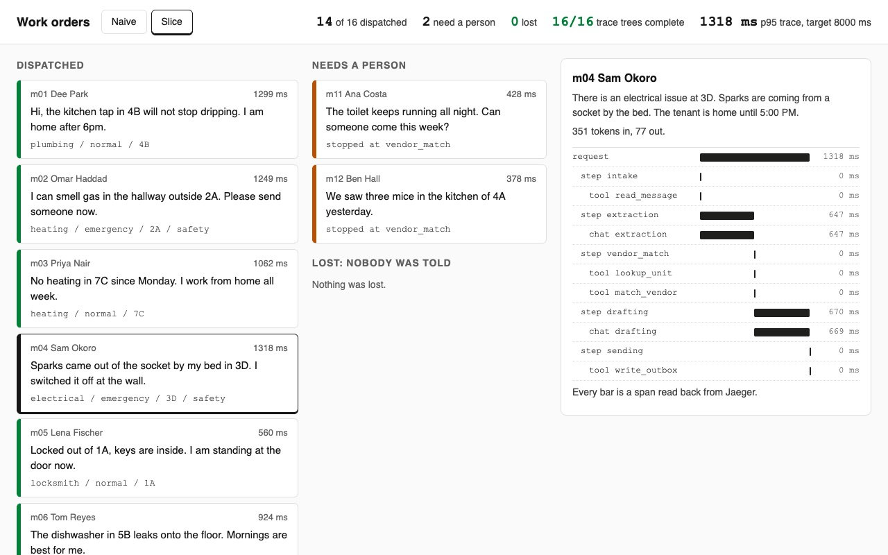
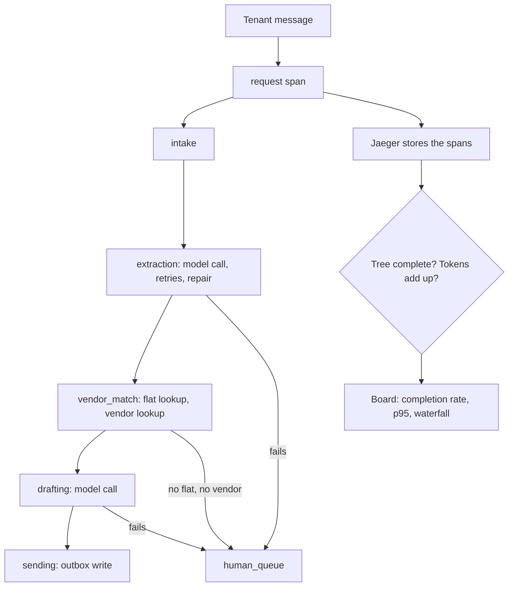

# Ship an End-to-End AI Pipeline with OpenTelemetry

Build the working vertical slice of your capstone with full span traces, token accounting and error
handling.

## The product job

Brickhaven manages rental flats. A tenant sends a maintenance message and the pipeline turns it into a
work order: the trade, the urgency, the flat, a safety flag and the hours the tenant is home. It then
matches a vendor from the flat and vendor lists and drafts the dispatch message for a coordinator.
Datadog and other tracing vendors show teams an LLM request in production the same way: one trace per
request, a span for every step, and the tokens on each model call.

The architecture RFC for this system set a latency budget per step, and the slice must stay inside it.

| Step | Budget (ms) |
| --- | --- |
| intake | 200 |
| extraction | 3500 |
| vendor_match | 600 |
| drafting | 2500 |
| sending | 400 |
| Total | 7200 |

The p95 target for a whole request is 8000 ms. The numbers live in `STEP_BUDGET_MS` and
`P95_TARGET_MS` in `src/brickhaven_slice/config.py`, and a test pins them.

- **The source of truth** is the OpenTelemetry span tree of each request, read back from Jaeger's own
  API. The app's log is never used to judge the app.
- **The metric** is the end-to-end completion rate and the p95 trace latency. The proof test asserts a
  completion rate of at least 80%, a p95 of at most 8000 ms, and a complete span tree for every request.

## What you will be able to do

Before: you wire a model call into a script, trace the model call and nothing else, and find out
about failures from tenants. After this lab you can:

- put one root span on a request and a span on every step and every tool under it
- count tokens and cost on each model call and add them up on the request
- retry a transient error inside a deadline, so the retries cannot push a request past its budget
- repair a broken structured answer before you pay for another model call
- send a request you cannot finish to a human queue with the step that failed and why
- read each request's span tree back from Jaeger and fail the build when a tree has a gap

## The problem

The first version of a pipeline has no error handling and traces only the model calls. It works on the
demo. In production a timeout ends the request and nobody is told. A model that wraps its JSON in a
code fence crashes the parser. A message with no flat number crashes the vendor lookup.

The trace is worse than the failure. Each model call is a trace of its own, so no trace shows the
request. You see model calls but never the request that made them, and you cannot say how long a tenant
waited.

In our proof run the naive version dispatched 14 of 16 messages and
none of its traces showed a whole request. The slice dispatched 13 of 16,
sent 3 to a person with a reason, lost none, and had a complete span tree for
16 of 16.

## What you will build

The dispatcher's work order board. Dispatched requests are on the left and the human queue is in the
middle. Pick any request and its trace waterfall opens on the right: one bar per span, read back from
Jaeger. Switch between **Naive** and **Slice** to see the same 16 messages both ways.



Two of the 16 messages can never be dispatched. One names no flat and one needs a pest controller, and
Brickhaven has none. They belong in the human queue, so the best possible completion rate is 14 of 16.

## How it works

The slice runs five steps under one request span. A step that cannot finish hands the request to a
person. A separate check reads the spans back from Jaeger and judges each tree.



## Words you will use

- **Span**: one timed piece of work, with a name, a start, a length and attributes.
- **Trace**: all the spans of one request, joined by parent links into a tree.
- **Vertical slice**: a thin working path through every layer of the system, instead of one layer done well.
- **Waterfall**: the trace drawn as one bar per span, so you see where the time went.
- **p95**: the time that 95% of requests finish within.
- **Token accounting**: the tokens and cost of each model call, summed on the request that made it.
- **Deadline**: the time budget for the whole request. Every retry must fit inside what is left.
- **Repair step**: fixing a broken JSON answer, first with code and then with one short model call.
- **Human queue**: where a request goes when the slice cannot finish it. A coordinator decides.
- **Complete tree**: a trace with every step the outcome promises, every span under the request span, and token totals that add up.

## Set up

You need [uv](https://docs.astral.sh/uv/), [Docker](https://docs.docker.com/get-docker/) and an
[OpenRouter](https://openrouter.ai) key. Tracing uses the
[OpenTelemetry Python SDK](https://opentelemetry.io/docs/languages/python/).

```bash
uv sync
```

Expect: /Installed|Audited|Resolved/

Copy `env.example` to `.env` and add your key. The model is `nvidia/nemotron-3.5-lightning`.

## 1. Start Jaeger

[Jaeger](https://www.jaegertracing.io/docs/latest/getting-started/) stores the spans and answers
queries about them. It takes OTLP on port 8372 and serves its UI and API on 8371:

```bash
docker inspect brickhaven-slice-jaeger >/dev/null 2>&1 || docker run -d --rm --name brickhaven-slice-jaeger -p 127.0.0.1:8371:16686 -p 127.0.0.1:8372:4318 jaegertracing/jaeger:2.21.0
docker ps --filter name=brickhaven-slice-jaeger --format '{{.Names}} {{.Status}}'
```

Expect: /brickhaven-slice-jaeger Up/

Jaeger keeps spans in memory here, so they are gone when the container stops.

## 2. Run the naive version

Read `run_naive` in `src/brickhaven_slice/pipeline.py`. It has no error handling and spans only on the
two model calls, which is how a first prototype is written. Run the 16 messages through it:

```bash
uv run brickhaven-slice run --mode naive
```

Expect: /naive: \d+ of 16 dispatched/

Every timeout, fenced JSON answer, missing flat and uncovered trade ends a request. The run counts the
crashes only so it can carry on.

## 3. Read the naive traces back

`report` asks Jaeger for the run's spans and judges each request's tree. It does not read the app's log:

```bash
uv run brickhaven-slice report --mode naive
```

Expect: Trace trees complete: 0 of 16

No request has a `request` span, and its model calls sit in separate traces. In our proof run the
naive completion rate was 88%, because it counts a dispatch as a success and has no trace to check it against.

## 4. Run the slice

Read `Request` and `run_slice` in `src/brickhaven_slice/pipeline.py`. Each step is a `step` span, each
tool is a `tool` span, and each model attempt is a `chat` span, all under one `request` span. Four
things protect the request:

1. `ask` retries a timeout, a dropped connection or a rate limit, and each attempt is its own span.
2. `attempt_timeout_ms` shrinks a step's timeout so the steps after it still have their budget.
3. `parse_work_order` in `src/brickhaven_slice/repair.py` repairs a fence or a trailing comma with code, and the extraction step spends one model call on a repair if that fails.
4. `hand_to_person` writes the request to the human queue with the step that failed and why.

```bash
uv run brickhaven-slice run --mode slice
```

Expect: /slice: \d+ of 16 dispatched/

## 5. Read the slice traces back

```bash
uv run brickhaven-slice report --mode slice
```

Expect: Trace trees complete: 16 of 16

The report prints the completion rate, the p95 trace latency and the tokens. In our proof run the
completion rate was 81%, the p95 was 1675 ms against
the 8000 ms target, and the 16 requests used 5142 tokens in and
1071 out.

`tree_problems` in `src/brickhaven_slice/trace_check.py` holds each rule a tree must pass.

## 6. See it

Start the board and open http://127.0.0.1:8370:

```sh
uv run brickhaven-slice serve
```

Switch between **Naive** and **Slice**. Pick a card in **Needs a person** and read why it stopped and
what the dispatcher decides. Pick a dispatched card and read its waterfall. A failed attempt is a red
bar, and a retry is the bar after it. Stop the page with Ctrl-C.

## 7. Prove it

The keyless tests run both versions on a scripted model through an in-memory span exporter. They check
the pinned budgets, the repair rules, vendor matching, every crash of the naive version, every save of
the slice, each kind of gap in a tree, Jaeger's answer format and the local-only server:

```bash
uv run pytest -q
```

Expect: /\d+ passed/

The proof runs both versions on the real model and reads the spans back from Jaeger. The slice must
complete at least 80% of requests, keep the p95 trace latency at or under 8000 ms, lose no request and
have a complete span tree for all 16:

```bash
uv run pytest -m proof -q
```

Expect: 1 passed

Stop Jaeger when you are done:

```bash
docker rm -f brickhaven-slice-jaeger
```

Expect: brickhaven-slice-jaeger

## Swap in your own capstone

Replace the Brickhaven files with yours. The tracing, the checker and the board work unchanged.

- Put 15 to 20 real inputs of your own system in `data/messages.jsonl`.
- Replace `data/units.json` and `data/vendors.json` with your systems of record, and rewrite `match_vendor`.
- Set your steps and your signed budget in `STEP_BUDGET_MS`, and your p95 in `P95_TARGET_MS`.
- Rewrite the three prompts in `src/brickhaven_slice/prompts.py` and the fields in `src/brickhaven_slice/repair.py`.
- Keep the rule that every step and tool has a span, and list the required children in `REQUIRED_CHILD`.

## At a startup

Trace every step from the first commit, send spans to one hosted backend, and keep the human queue as
a spreadsheet someone reads each morning. Set the deadline before you set the retries. A pipeline with
retries and no deadline is slower than one with neither.

## At an enterprise

Run an OpenTelemetry Collector in front of the backend so a redeploy queues spans instead of losing
them. Alert on the completion rate and the p95 from the trace store, and on the size of the human
queue. Give the queue an owner and a time limit, and keep prompts and tenant text out of span
attributes unless a policy allows them.

## Change it

- Make `MAX_ATTEMPTS` 1 in `src/brickhaven_slice/config.py` and run the slice. Which requests move to the human queue?
- Delete the `tool match_vendor` span in `vendor_match` and run the tests. Which test names the gap?
- Raise `MIN_ATTEMPT_MS` in `src/brickhaven_slice/pipeline.py` to 2000. What happens to a request that retries twice?
- Add a message with no flat number to `data/messages.jsonl`. Where does it end up, and why?

Sources: the [OpenTelemetry GenAI semantic conventions](https://opentelemetry.io/docs/specs/semconv/gen-ai/),
their [model spans](https://opentelemetry.io/docs/specs/semconv/gen-ai/gen-ai-spans/),
[OpenTelemetry traces](https://opentelemetry.io/docs/concepts/signals/traces/), the
[OTLP specification](https://opentelemetry.io/docs/specs/otlp/), the
[Jaeger HTTP query API](https://www.jaegertracing.io/docs/latest/apis/), and
[Datadog LLM Observability](https://docs.datadoghq.com/llm_observability/).
