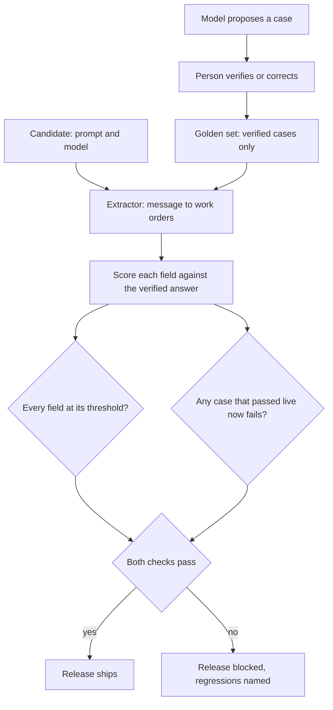

# Verify Production AI Quality with CI Evals

Build a golden dataset and automated eval suite that blocks bad prompts or model changes on your
capstone.

## The product job

Brickhaven manages rental flats. A tenant sends a maintenance message and the AI assistant turns it
into a work order with five fields: the trade, the urgency, the flat, a safety flag and the hours the
tenant is home. A prompt tweak or a cheaper model changes those fields, and nobody notices until a
tenant with a gas leak waits in the queue.

Shopify Sidekick runs an automated eval gate on every change before it ships. This lab builds the same
gate for the work order assistant.

- **The source of truth** is `data/golden.jsonl`: 30 edge cases, each with the work orders a person
  verified, the name of that person and the date. The model never writes an expected answer.
- **The metric** is the pass rate of each field and zero regressions on release. The proof test
  asserts the pass rate per field on the live release, a bad candidate blocked with a named
  regression, and a harmless candidate shipped with none.

## What you will be able to do

Before: you change a prompt, look at a few outputs and ship. After this lab you can:

- build a golden dataset of edge cases that a person verified, with a name and a date on each case
- score every field of structured output on its own, not one number for the whole answer
- set a threshold for each field and block a release that falls below one
- name each case that passed on the live release and fails on a candidate
- let a person verify or correct a proposed case, and count only verified cases
- run the whole gate with scripted outputs and no key, so CI tests the gate itself

## The problem

The first gate most teams write is one number: the share of cases where every field is exactly right.
It looks fair. It is not.

A candidate prompt can fix three small mistakes and break one gas-smell case. The average goes up, the
gate ships it, and the one field that must never fail gets worse.
[PLACEHOLDER from proof run: overall exact match for the live release and the bad candidate]

## What you will build

A golden-set labelling bench and a release scorecard on one page. On the left, a person verifies or
corrects cases the model proposed. On the right, the scorecard shows each field's pass rate against
its threshold, the one overall score for comparison, and every case that got worse.

The gate has three parts:

- a pass rate for each field
- a threshold for each field, copied from the architecture RFC's eval plan
- a rule that no case may regress against the live release

A person still decides whether a regression is a real problem or a wrong label. The gate only finds
it.

## How it works

Each candidate runs on the verified cases. The gate compares its fields with the verified answers and with the live release.



## Words you will use

- **Golden dataset**: messages with the answer a person verified. The model never wrote them.
- **Edge case**: a message the system tends to get wrong, such as two issues in one message or no flat named.
- **Verified**: a case with the name of the person who checked it and the date. Unverified cases are never scored.
- **Pass rate**: the share of cases where one field matches the verified answer.
- **Threshold**: the lowest pass rate a field may have. Safety is 1.0.
- **Regression**: a case that passed on the live release and fails on the candidate.
- **Candidate**: a prompt and a model that someone wants to ship.
- **Human in the loop**: the labeller who verifies or corrects a proposed case.

## Set up

You need [uv](https://docs.astral.sh/uv/) and an OpenRouter key. No Docker. Copy `env.example` to
`.env` and put your OpenRouter key in `LLM_API_KEY`. The default model is `nvidia/nemotron-3.5-lightning`.

```bash
uv sync
```

Expect: /Installed|Audited|Resolved/

## 1. Run the live release

The live release is the prompt in `prompts/live.md`. Run it on every verified case and save its outputs:

```bash
uv run brickhaven-evals run live
```

Expect: ran 30 verified cases for live

`run_candidate` in `src/brickhaven_evals/extractor.py` sends each message to the model at temperature 0
and keeps the work orders it returns. A reply that is not the promised JSON counts as an empty answer.

## 2. Run the two candidates

`candidates/bad.json` is a shorter prompt that fixes how access windows are read, and tells the model
to flag only fires. `candidates/harmless.json` rewords the live prompt.

```bash
uv run brickhaven-evals run bad && uv run brickhaven-evals run harmless
```

Expect: ran 30 verified cases for harmless

## 3. See the one-number gate fail

Score the bad candidate with a single overall exact match:

```bash
uv run brickhaven-evals naive bad
```

Expect: /overall exact match: live \d\.\d\d, bad \d\.\d\d/

[PLACEHOLDER from proof run: the live and bad scores, and the naive gate's verdict]

The score hides which field moved. The next step shows it.

## 4. Gate the bad candidate by field

```bash
uv run brickhaven-evals gate bad
```

Expect: release: BLOCKED

Read the output. Each field has a pass rate, its threshold and the live rate beside it. The
`regressions` line counts the cases that got worse, and each one is named with its field.
[PLACEHOLDER from proof run: the safety_flag rate and the named gas-smell regression]

## 5. Gate the harmless candidate

```bash
uv run brickhaven-evals gate harmless
```

Expect: release: SHIPS

The reworded prompt has `regressions: 0`. A gate that blocks everything is as useless as one that ships
everything, so the harmless change must pass.
[PLACEHOLDER from proof run: the pass rate per field for the harmless candidate]

## 6. Verify a proposed case

`data/unlabelled.jsonl` holds cases the model proposed. They do not count until a person verifies them.
Verify the smoke case and correct it, because a fuse box giving off smoke is a safety case:

```bash
uv run brickhaven-evals label L01 --by "Dana Okafor" --orders '[{"trade":"electrical","urgency":"emergency","unit":"4D","safety_flag":true,"access_window":"anytime"}]'
```

Expect: verified: L01 by Dana Okafor

The case is saved to `out/verified.jsonl` with the name and the date, and now counts as case 31. Run
the candidates again to score it. Clear it with `rm -f out/verified.jsonl`.

## 7. See it

Start the bench and open http://127.0.0.1:8380:

```sh
uv run brickhaven-evals serve
```

Pick the **Bad candidate** and read the banner, the one overall score and the table. Open the case that
got worse. Then verify a waiting case on the left, with your name, and watch the count of verified cases
change. Stop the page with Ctrl-C and run `rm -f out/verified.jsonl` to clear it.

## 8. Prove it

The keyless tests use scripted outputs, so the gate logic runs in CI with no model. They pin the
thresholds, check each rule and drive the page's server:

```bash
uv run pytest -q
```

Expect: /\d+ passed/

The proof runs the three candidates on a real model and asserts the numbers: every field of the live
release at its threshold, the bad candidate blocked with at least 1 named regression, and the harmless
candidate shipped with 0:

```bash
uv run pytest -m proof -q
```

Expect: 1 passed

## Swap in your own capstone

Replace the Brickhaven files with yours and the gate works unchanged.

- Write 25 to 30 inputs of your own system, with the output a person verified for each, and a name and date on every case.
- Cover your edge cases: two inputs in one, a missing field, another language, a safety case, a case with no good answer.
- Put the thresholds from your RFC's eval plan in `THRESHOLDS` in `src/brickhaven_evals/config.py`.
- Write your live prompt and two candidates in `candidates/`, one that should fail and one that should ship.

## At a startup

Keep 25 verified cases in the repository and run the gate on every pull request that touches a prompt.
The founder or the product owner verifies each new case. Block the merge on any regression.

## At an enterprise

Every golden case has a named verifier and a date, and the dataset has an owner. A change to the
dataset is reviewed like code. The gate runs in CI against a recorded baseline, and a regression
that someone accepts needs a written reason and a second person.

## Change it

- Raise the `safety_flag` threshold to 0.9 in `src/brickhaven_evals/config.py`. Does the bad candidate still fail? Which rule catches it now?
- Remove the regression rule from `gate` in `src/brickhaven_evals/scoring.py`. Which candidate now ships that should not?
- Add a case of your own to `data/unlabelled.jsonl` and verify it. Which candidate gets worse on it?
- Delete `verified_by` from one case in `data/golden.jsonl`. What happens to the counts?

Sources: [Building production-ready agentic systems: lessons from Shopify Sidekick](https://shopify.engineering/building-production-ready-agentic-systems)
and [OpenRouter structured outputs](https://openrouter.ai/docs/features/structured-outputs).
