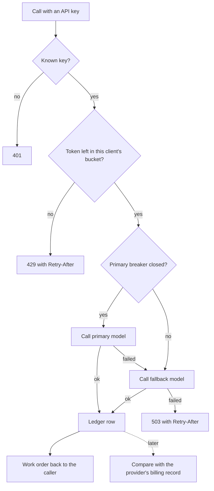

# Deploy a Hardened AI Service with Rate Limits

Put the work order assistant behind per-client keys, a token-bucket rate limit, fallback to a second model and a cost ledger that is checked against the provider's own bill.

## The product job

Brickhaven manages rental flats. A tenant sends a maintenance message and an AI assistant turns it into a work order: the trade, the urgency, the flat, a safety flag and the hours the tenant is home. Other systems call it over HTTP: the tenant portal, the text message line and a partner sync job.

Cloudflare's AI Gateway puts rate limits and fallback routing in front of model calls, so one caller cannot starve the rest and one provider outage does not take the product down. This lab does the same job inside your own service.

The architecture RFC signed two numbers. The work order must be ready within 8000 ms at p95, and the step budgets add up to 7200 ms. The hardened service has to hold them under a burst.

- **The source of truth** is the load test's own numbers and the provider's billing record for every generation, fetched with `GET /api/v1/generation?id=...`.
- **The metric** is p95 time to first token, error rate under load and cost per task. The proof test asserts all three, and that the ledger is within 5% of the bill.

## What you will be able to do

Before: the endpoint is open, anyone can call it, and nobody knows what a bad day costs. After this lab you can:

- give each caller its own API key and tell their usage and cost apart
- refuse a flood with a 429 and a Retry-After header, before any money is spent
- send a call to a second model when the first one fails, and stop calling a dead model with a circuit breaker
- book every call in a ledger and check it against the provider's billing record
- run a burst load test with a hard deadline and read its error rate, p95 and cost per task
- let an operator raise one client's limit, by name, with a reason, up to a ceiling

## The problem

An open endpoint works in a demo. Under a burst it fails in three ways. A partner job that retries without waiting sends half the traffic, so the tenants who matter wait behind it. One slow provider call holds a request for as long as the provider likes. And the bill arrives a month later with no way to say who caused it.

Each of these is invisible until you measure it. The naive service is measured first, so the fixes have a number to beat.

## What you will build

A developer portal for the operator. The meters sit across the top: tasks served, total cost, cost per task and the state of the primary model's breaker. API keys are on the left, each with its refill rate, its burst and how many calls were refused. Usage by client and the live cost ledger are on the right.

An operator can raise a client's limit from its key card, with their name and a reason. A button checks the last 20 ledger rows against the provider's billing record.

<!-- screenshot: add docs/developer-portal-with-api-keys-per-client-usage-and-a-live-cost-ledger.jpg after the proof run -->

## How it works

Every call passes the same four checks, in this order, and the ledger row is written before the answer is read.



## Words you will use

- **API key**: a secret that names one caller. The service stores only its hash.
- **Token bucket**: a bucket that refills at a steady rate and holds a burst. Each call takes one token.
- **429 and Retry-After**: the answer that says "too many calls" and how many seconds to wait.
- **Fallback routing**: sending the call to a second model when the first one fails.
- **Circuit breaker**: after a run of failures it stops calling a model for a cooldown, then tries one probe call.
- **Time to first token**: how long until the model's first word arrives. It includes any failed attempt before it.
- **p95**: the time 95 in 100 calls beat.
- **Ledger**: the service's own book of every model call, with its tokens and cost.
- **Generation id**: the provider's receipt number for a call. It links a ledger row to a billing record.
- **Human in the loop**: the operator who raises a client's limit.

## Set up

You need [uv](https://docs.astral.sh/uv/) and an [OpenRouter](https://openrouter.ai) key. There is no Docker: the service, the portal and the load test are one Python package. The keyless tests need no key.

```bash
uv sync && { test -f .env || cp env.example .env; } && echo ready
```

Expect: ready

Put your key on the `LLM_API_KEY` line of `.env`. The file also names the two model slots: the primary is `nvidia/nemotron-3.5-lightning` and the fallback is `openai/gpt-6-luna`.

## 1. Run the keyless tests

The tests use a fake provider that fails on demand, a fake billing record and a clock the test controls. They cover the key check, the limiter, the breaker, fallback, the ledger and the load test, with no key:

```bash
uv run pytest -q
```

Expect: /\d+ passed/

Open `src/brickhaven_api/limiter.py` and `src/brickhaven_api/breaker.py`. Each is short, and each has a test that moves the clock to show the rule.

## 2. Measure the naive service under a burst

`serve --naive` is the open endpoint: no key, no limit, no fallback. It still writes the ledger so the cost can be read. The load test sends 60 calls, half of them from the runaway sync job, 12 at a time, with a hard deadline. The server is stopped when the step ends, even if the test fails:

```bash
mkdir -p out
uv run brickhaven-api serve --naive --port 8371 > out/naive-server.log 2>&1 &
server=$!
trap 'kill $server 2>/dev/null' EXIT
timeout 150 uv run brickhaven-api load --port 8371 --timeout 120
```

Expect: /naive load: 60 requests/

Read the numbers: the error rate, the p95 time to first token and the cost per task. Every call from the runaway client was served and paid for. Nothing limited it. Placeholder, replace from the proof run: error rate TBD, p95 TBD ms, cost per task TBD.

## 3. Measure the hardened service

The same traffic, with keys, buckets, fallback and the ledger on:

```bash
mkdir -p out
uv run brickhaven-api serve --port 8371 > out/hardened-server.log 2>&1 &
server=$!
trap 'kill $server 2>/dev/null' EXIT
timeout 150 uv run brickhaven-api load --port 8371 --timeout 120
```

Expect: /hardened load: 60 requests/

The runaway client now gets a 429 after its burst of 3, so most of its calls cost nothing. The honest clients are served. Placeholder, replace from the proof run: error rate TBD, p95 TBD ms, cost per task TBD, limited TBD.

## 4. Break the primary model

`--break-primary` makes the primary model fail on every call. The first calls pay for the failure and go to the fallback. After three failures the breaker opens, and the rest skip the dead model at once:

```bash
mkdir -p out
uv run brickhaven-api serve --break-primary --port 8371 > out/fallback-server.log 2>&1 &
server=$!
trap 'kill $server 2>/dev/null' EXIT
timeout 90 uv run brickhaven-api load --port 8371 --requests 12 --concurrency 3 --timeout 60
```

Expect: /served by fallback: [1-9]/

Look at the `breakers` line: the primary is `open`. A caller never learns which model answered, only that the slot was `fallback`.

## 5. Check the ledger against the bill

The ledger costs each call from list prices. The provider bills what it bills. This step fetches the billing record of every generation in the hardened ledger and compares the two:

```bash
uv run brickhaven-api reconcile
```

Expect: ledger within tolerance: yes

A row the provider has no record of fails the check, because money may have been spent that nobody can account for. Placeholder, replace from the proof run: gap TBD%.

## 6. See it

Start the hardened service and open the portal at http://127.0.0.1:8372:

```sh
uv run brickhaven-api serve --port 8371
```

In another terminal run `uv run brickhaven-api load --port 8371 --requests 20`. Watch the meters and the ledger move. The runaway client's key card turns red. Press **Raise limit** on it, give your name and a reason of at least 4 words, and send more load. Stop the server with Ctrl-C.

## 7. Prove it

The proof starts both services in process, runs the burst against each on a real model and asserts the numbers:

```bash
uv run pytest -m proof -q
```

Expect: 1 passed

It asserts that:

- the hardened service limits the runaway client
- the error rate is 2% or less
- p95 time to first token is inside 8000 ms
- cost per task is under $0.001
- the ledger is within 5% of the provider's billing

## Swap in your own capstone

Replace the Brickhaven task with yours and the hardening works unchanged.

- Put your own task in `src/brickhaven_api/workorder.py`: the system prompt and the fields you check.
- Put your callers in `data/clients.toml`, with a hash of each key, and your own limits.
- Put your signed p95 and step budgets in `src/brickhaven_api/config.py`, and update the test that pins them.
- Add the price of each model you use to `PRICES`.

## At a startup

One key per integration, a bucket for each, and a fallback model. Read the ledger against the provider's bill once a week. That is enough to stop a runaway job and an outage from becoming the same bad day.

## At an enterprise

Keys are issued and revoked by a platform team, and limits are a reviewed change with a named approver. The ledger is exported to finance and reconciled against the invoice every month. The breaker's state is an alert, and a raised limit is a record with a name and a reason.

## Change it

- Set `BREAKER_FAILURES` to 1 in `src/brickhaven_api/config.py`. What does one slow response now cost?
- Give `runaway-sync` a burst of 30. How many of its calls are served, and what do they cost?
- Raise `LEDGER_TOLERANCE` to 0.5. Which test stops failing, and should it?
- Add a third model slot behind the fallback. What must the router and the breakers know?

## Sources

Sources: Cloudflare's [AI Gateway rate limiting](https://developers.cloudflare.com/ai-gateway/configuration/rate-limiting/) and [fallbacks](https://developers.cloudflare.com/ai-gateway/configuration/fallbacks/), OpenRouter's [generation stats endpoint](https://openrouter.ai/docs/api-reference/get-a-generation) and [usage accounting](https://openrouter.ai/docs/use-cases/usage-accounting), Martin Fowler's [circuit breaker](https://martinfowler.com/bliki/CircuitBreaker.html), the token bucket in Envoy's [local rate limit filter](https://www.envoyproxy.io/docs/envoy/latest/configuration/http/http_filters/local_rate_limit_filter), and 429 with Retry-After in [RFC 6585](https://datatracker.ietf.org/doc/html/rfc6585#section-4).
